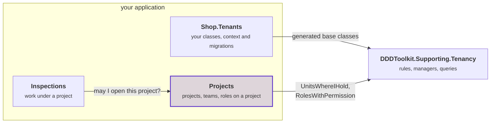
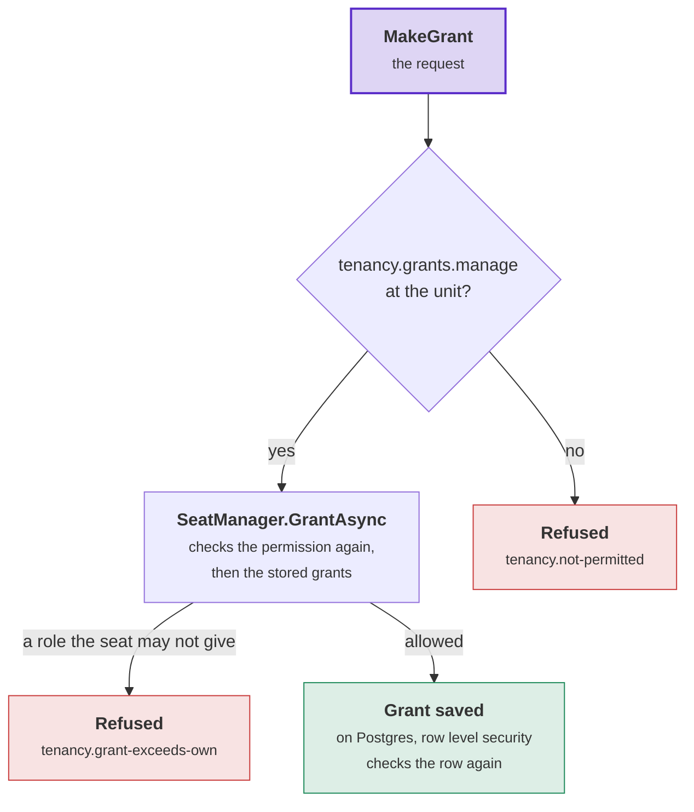

# Tenancy: who may do what

How a module of yours decides access with Tenancy:

- the queries a module runs to find out what its caller may do;
- what a request requires of its caller, checked before the handler runs;
- which of Tenancy's rows a module may read.

The [overview](overview.md) defines the words: tenant, unit, seat, grant, role, permission, system work.

## Tenancy's queries

A module calls `db.Tenancy()` on its own context. The call returns Tenancy's queries for the current caller at the
current moment. The generator writes `db.Tenancy()` for your ids, so the call names no type. Most of the queries
return an `IQueryable`. When you use such a query inside the module's LINQ query, Entity Framework runs it as a
subquery of that one SQL statement, so no list is fetched first. `HoldsAtTenantAsync` and `HoldsAtAsync` each run a
separate statement and return a `bool`. [Queries](reference/queries.md#queries) lists every member.

```csharp
internal sealed class ProjectReads(ProjectsContext db) : IProjectReads
{
    public async Task<IReadOnlyList<ProjectListing>> EditableAsync(CancellationToken cancellationToken)
    {
        var held = db.Tenancy().UnitsWhereIHold(ProjectPermissions.Edit);   // a subquery of the statement below

        return await db.Projects
            .Where(project => held.Contains(project.UnitId))
            .Select(project => new ProjectListing(project.Id, project.Name))
            .ToListAsync(cancellationToken);
    }
}
```

| Query | What it returns for the caller |
|---|---|
| `UnitsWhereIHold(permission)` | The units where a grant gives the caller the permission, and every unit below them. |
| `UnitsWhereIHold(permissions)`, with several permissions | Every pair of a unit and a permission the caller holds there (`UnitPermission`), in one query. |
| `ReadableUnits()` | The units the caller is placed in, and every unit below them. A placement alone gives no permission. |
| `UnitsUnder(unit)` | The unit and every unit below it. |
| `HoldsAtTenantAsync(permission)` | `true` when the caller holds the permission at the root. A permission at the root covers the whole tenant. |
| `HoldsAtAsync(permission, unit)` | `true` when the caller holds the permission at the unit, from a grant at the unit or above it. |
| `PermissionsIHoldAt(unit)` | Every live permission the caller holds that reaches the unit. |
| `RolesWithPermission(permission)` | The tenant's active roles that grant the permission. |
| `RolesWithPermission(permissions)`, with several permissions | Every pair of an active role and a permission it grants (`RoleWithPermission`), in one query. |
| `SeatsHoldingPermissionAt(permission, unit)` | The active seats that hold the permission at the unit now. The result contains only seats whose grants the caller [may read](postgres.md#who-reads-which-grants). |
| `Units()`, `Roles()`, `Seats()` | The tenant's units and roles, archived ones included, and the seats the caller may read. Each row holds access facts and no name. |

Who the caller is, and in which tenant, comes from `TenancyAccessManager`: `access.CurrentUser` and
`access.CurrentTenant` ([System work](keeping-tenants-apart.md#system-work)). These rules apply to every query:

- A grant counts from its start until its end. The query compares both with the current time, so a grant that ended
  yesterday gives nothing today. Nothing is written to the database when a grant ends.
- A suspended seat, an archived role and a retired permission give nothing.
- A permission that is not in the catalogue throws an `ArgumentException`. A typo fails at the first call.
- System work in a tenant holds every permission in that tenant. A query from system work outside any tenant throws
  an `InvalidOperationException`.

Tenancy has no rule about projects. The module that owns projects decides who may open a project, from Tenancy's
query results and the teams it stores. A module with work under a project queries the projects module. In the
diagram, purple marks the module that decides about projects:



### Mapping the read model

The module's context maps Tenancy's rows next to the module's tables. A module that sees Tenancy's ids and not its
classes says once which ids are Tenancy's, with `[assembly: TenancyIds<TenantId, SeatId, OrganizationUnitId, RoleId>]`
in its application project ([Calls closed over your ids](your-module.md#calls-closed-over-your-ids)). Its calls then
name no ids:

```csharp
// On Postgres the rows come from Tenancy's read functions. On other databases they come from views over its tables.
if (Database.IsNpgsql())
{
    modelBuilder.AddTenancyReadFunctions("tenancy");
}
else
{
    modelBuilder.AddTenancyReadModel<TenantId, SeatId, OrganizationUnitId, RoleId>("tenancy");
}
```

The module's own class says which tenant a row belongs to with `[OfTenant]`, on the domain class. The context needs no
line for it ([Keeping tenants apart](keeping-tenants-apart.md#the-tenant-filter-and-the-save-check)).

- The module's database must contain Tenancy's tables. Use one database with a schema per module, or one SQLite
  file. When the databases are separate, query Tenancy's context first and pass the result into the module's query
  as a list.
- On Postgres with `DDDToolkit.Supporting.Tenancy.Postgres`, map the functions
  ([modules read through functions](postgres.md#read-functions-for-modules)). On that database, `db.Tenancy()`
  throws for a module context that maps the views.
- The generator writes `AddTenancyReadFunctions(schema)` without ids, for the `TenancyIds` line.
  `AddTenancyReadModel` takes the ids in a module that sees only the ids. In a project that sees your classes, a
  generated overload of each call takes no ids.
- A module whose resources have their own members queries [Membership](../membership/overview.md) instead. The
  sample's Projects module works this way.

## Showing what a caller may do in a list

A list that shows, per row, what the caller may do needs several permissions for many rows. Calling `HoldsAtAsync`
for each row runs one query per row and permission. `UnitsWhereIHold` with several permissions returns every pair
of a unit and a permission in one query, inside the module's statement:

```csharp
var held = db.Tenancy().UnitsWhereIHold(["projects.edit", "projects.close"]);

// Each project with the permissions the caller holds at the project's unit, in one SQL statement
var abilities = await (
    from project in db.Projects
    join pair in held on project.UnitId equals pair.Unit
    select new { project.Id, pair.Permission }).ToListAsync(cancellationToken);
```

- `RolesWithPermission` with several permissions does the same for rows that a caller reaches through a role, such
  as a project's crew.
- Use the result to show buttons and menus. A grant can end between the list and the click, so the command checks
  the permission again when it runs.

## What a request requires of its caller

Every request states what it requires of its caller, and a check tests it before the handler runs. The mechanism
belongs to the toolkit core ([Access requirements](../access-requirements.md),
[How a request is checked](../how-a-request-is-checked.md)). This section lists Tenancy's cases. The generator turns
each attribute into the call in the comment beside it:

```csharp
[AccessRequests]
public partial interface IBillingRequest : IRequireAccess;      // one interface per module

[RequiresPermission(BillingPermissions.CloseTheBooks)]          // TenancyAccess.AtTenant(BillingPermissions.CloseTheBooks)
public sealed record CloseTheBooks(int Year) : IBillingRequest;

[RequiresPermission(BillingPermissions.OpenLedger)]             // TenancyAccess.AtUnit(BillingPermissions.OpenLedger, request.Unit)
public sealed record OpenLedger(string Name, [AtUnit] OrganizationUnitId Unit) : IBillingRequest;
```

| A request requires | Its attribute | The same, computed | Lets through | Refuses with |
|---|---|---|---|---|
| a caller in the tenant | `[InTenant]` | `TenancyAccess.InTenant()` | a seat in the request's tenant, and system work in that tenant | the caller's refusal code, such as `tenancy.not-seated` |
| a permission for the whole tenant | `[RequiresPermission(p)]` | `TenancyAccess.AtTenant(p)` | a caller who holds `p` at the root now, and system work in the tenant | `tenancy.not-permitted` |
| a permission at a unit | `[RequiresPermission(p)]`, with `[AtUnit]` on the unit | `TenancyAccess.AtUnit(p, unit)` | a caller who holds `p` at the unit now, from a grant there or above, and system work in the tenant | `tenancy.not-permitted`, with the unit |
| an operator | `[Operator]`, with `[ForTenant]` on the tenant of a command that acts in one | `TenancyAccess.Operator()`, `TenancyAccess.Operator(tenant)` | an [operator](operators-and-history.md#operators). On a command, the handler then runs as operator work. | `tenancy.operators-only`, also for seats and system work. `tenancy.tenant-mismatch` when the request names another tenant than `[ForTenant]`. |
| the caller's seat, or a permission | `[RequiresPermission(p)]`, with `[OrOwn]` on the seat | `AccessRequirement.Any(TenancyAccess.Own(seat), ...)` | the named seat when it is the caller's seat, and a caller who holds `p` | one `access.refused`, with both reasons |
| the caller's seat only | `[OwnOnly]`, with `[Own]` on the seat | `TenancyAccess.Own(seat)` | the named seat when it is the caller's seat. System work has no seat, so it is refused. | `access.not-own` |

- **Cost.** `AtTenant` and `AtUnit` each run one SQL statement. The other cases read nothing from the database,
  except `[Operator(Tenant = OperatorTenant.FromRequest)]`, whose tenant selection looks up the slug.
  [Requirements](reference/access.md#requirements) lists every case in full.
- **Level.** A permission's level is declared once, on its constant, with `[AtTenant]` or `[AtUnit]`
  ([Declaring a module's permissions](roles-and-permissions.md#declaring-a-modules-permissions)).
- **`[AtUnit]`** marks the unit of a command that acts at a unit it names. Two kinds of command need it. The first
  kind calls a manager method that checks the unit, such as placing a seat or giving a role there. The second kind
  creates something at a unit before anything exists there to hold a permission on, such as opening a project.
- `[AtUnit]` goes on a member of your unit id type, the id of your `[OrganizationUnit<TUnitId>]` class. On a member
  of another type it is [DDD00081](../diagnostics.md#ddd00081). A module that sees only your ids cannot get that
  error. There, the check throws an `InvalidOperationException` when the request is sent. The sample's
  `AccessDeclarationTests` catches this mistake by comparing every request with the requirement it should declare.
- **An optional unit.** When the unit is an `OrganizationUnitId?`, compute the requirement:
  `Unit is { } unit ? TenancyAccess.AtUnit(p, unit) : TenancyAccess.AtTenant(p)`. The sample's `SeatGrants` does
  this.
- **The module's default.** `[AccessRequests, InTenant]` on the module's interface makes every request that states
  nothing require a caller in the tenant ([A module's default](../access-requirements.md#a-modules-default)).
- **The caller's seat.** The check compares the named seat with the caller's seat in the request's tenant.
  `AddTenancy` registers `IOwnedByCurrentUser<TSeatId>`, which finds that seat from the caller's verified identity. The check
  never reads the caller's seat from the request. Example: the sample's `RenameSeat` lets a seat rename itself, and
  lets a caller with `tenancy.seats.manage` for the whole tenant rename any seat.
- `[OrOwn]` together with `[AtUnit]` is [DDD00085](../diagnostics.md#ddd00085). With both, a caller could send a
  unit where it holds the permission together with another person's seat.
  [What goes together](../access-requirements.md#valid-combinations-of-attributes) lists the other pairs that clash or add nothing.
- `[AllowAnonymous]` and `[SignedIn]` (a user who has no seat yet) belong to the toolkit core
  ([the vocabulary](../access-requirements.md#requirements-and-their-attributes)).
- Combine cases with `AccessRequirement.All` and `Any`
  ([Requirements that combine](../access-requirements.md#requirements-that-combine)). Example: moving a seat requires
  the permission at both units, `All(TenancyAccess.AtUnit(p, From), TenancyAccess.AtUnit(p, To))`. The handler then
  moves the seat from `From` and from no other unit.
- A module can keep things at a unit and give permissions on each thing. A permission on one of those things is a
  requirement case of that module ([What answers it](../access-requirements.md#what-answers-it)).
  [Membership](../membership/overview.md) ships these cases.

### Requests that call a manager

A request whose handler calls one of Tenancy's managers declares the permission that the manager checks first.
Examples:

- `MakeGrant`, whose handler calls `SeatManager.GrantAsync`, declares
  `[RequiresPermission(TenancyPermissions.GrantsManage)]` with `[AtUnit]` on the unit.
- A request that makes a role declares `[RequiresPermission(TenancyPermissions.RolesManage)]`.
- A query that calls a manager's read, such as `SeatManager.WhoAmIAsync` or `OrganizationManager.ListUnitsAsync`,
  declares `[InTenant]`.

When the manager's first check needs data from the database, the request declares `[InTenant]`. Example: archiving
a unit requires `tenancy.units.manage` at the unit's parent, and only the manager loads the parent.

```csharp
[RequiresPermission(TenancyPermissions.GrantsManage)]
public sealed record MakeGrant(SeatId Seat, RoleId Role, [AtUnit] OrganizationUnitId Unit) : ICommand<Seat>, ITenantsRequest;

public sealed class MakeGrantHandler(SeatManager seats) : ICommandHandler<MakeGrant, Seat>
{
    // The access check let through a caller with tenancy.grants.manage at the unit. GrantAsync checks it again,
    // then the rules that need stored data.
    public async ValueTask<Seat> Handle(MakeGrant command, CancellationToken cancellationToken)
        => await seats.GrantAsync(command.Seat, command.Role, command.Unit, until: null, reason: null, cancellationToken);
}
```

The manager checks the permission again, whoever calls it. Then it runs the checks that need stored data:

- whether the caller may give a role that manages access;
- whether a move gives away what the caller could not give;
- whether the tenant keeps an administrator.

A caller that the manager's first check would refuse is refused before the handler runs, with the same code.

The diagram shows the checks a grant passes, in order. The access check tests what the request names. The manager
tests what it reads from the database. On Postgres, [row level security](postgres.md) then checks every saved row
against the seat the manager runs as. Purple: the request. Red: refused. Green: saved.



### Requests that provision a tenant

System work outside any tenant provisions a tenant, and nobody holds a seat for that work. So a provisioning request
involves two separate decisions: who may send the request, and what the work runs as.

- The handler always begins the system work itself, with `access.BeginSystem()`. `ProvisionAsync` refuses a seat
  with `access.system-only`.
- The caller gains no rights from that system work. On Postgres, the policies let the work write only the tenant it
  creates.
- The requirement decides only where the handler gets the identity of the first administrator:

| Who may send the request | Its requirement | Where the first administrator comes from |
|---|---|---|
| a signed-in person who registers an organization | `[SignedIn]` | The caller's token, read before the system work begins. The handler refuses an anonymous sign-in. |
| anyone, through a public form or a development route | `[AllowAnonymous]` | An e-mail address in the form. The handler creates the account with `IIdentityAccounts.InviteByEmailAsync` and provisions the tenant for the new account's id. |
| a job or tool of the application, such as an import or the seeding | None. Trusted code begins the work and calls the manager. | The job's input. |
| your staff, for a customer | `[Operator]` on the command, without `[ForTenant]` | The command names the customer. The handler begins nothing: the access check runs it as operator work in no tenant, recorded as the operator ([Operators](operators-and-history.md#operators)). |

```csharp
[SignedIn]
public sealed record RegisterOrganization(string Slug, string Name, string AdministratorName) : ICommand<Tenant>, ITenantsRequest;

public sealed class RegisterOrganizationHandler(TenantManager tenants, TenancyAccessManager access)
    : ICommandHandler<RegisterOrganization, Tenant>
{
    public async ValueTask<Tenant> Handle(RegisterOrganization command, CancellationToken cancellationToken)
    {
        // Read the user before the system work begins. Inside the system work, the current user is system work.
        if (access.CurrentUser.Id is not { } administrator
            || string.Equals(access.CurrentUser.FindClaim("is_anonymous"), "true", StringComparison.OrdinalIgnoreCase))
        {
            throw TenancyRefusals.Refuse(TenancyRefusals.IdentityRequired);
        }

        using (access.BeginSystem())
        {
            return await tenants.ProvisionAsync(
                new TenantToProvision(
                    command.Slug, command.Name, TenantShape.Flat, command.Name, administrator,
                    ConfigureFirstSeat: seat => seat.Rename(command.AdministratorName)),
                cancellationToken);
        }
    }
}
```

A public form's handler creates the account first. When the address already has an account, the handler stops and
returns the same response as for a new address. So the form does not reveal which addresses have an account:

```csharp
var made = await accounts.InviteByEmailAsync(command.Address, signInRedirect: null, cancellationToken);
if (made is not IdentityAccountOutcome.Created(var administrator))
{
    return;
}
// then access.BeginSystem() and ProvisionAsync for administrator, as above
```

### Adding the check to a module

```csharp
// In the module that declares Tenancy's classes: generated, closed over the four ids
services.AddTenancyAccess<ITenantsRequest, ShopTenancyContext>();

// In any other module, with [assembly: TenancyIds<TenantId, SeatId, OrganizationUnitId, RoleId>] in its application
// project: generated too, closed over the ids the line names
services.AddTenancyAccess<IBillingRequest, BillingContext>();
```

- The check runs its queries over the module's context. That context maps the
  [read model](#what-a-module-reads-of-tenancy), or is Tenancy's context. When you registered
  `IDbContextFactory<TContext>`, the check uses a separate context from that factory.
- A request of a module without the check is stopped. The error message names `AddTenancyAccess`.
- The packages reference no dispatcher. Call `AccessChecks<IBillingRequest>.RequireAsync` before the handlers, or use
  the [behavior generated for Mediator](../access-requirements.md#the-generated-behavior-with-mediator).

## What a module reads of Tenancy

The read model has six row types, all access facts. A module's model can map nothing else of Tenancy's:

| Row | Contains | Leaves out |
|---|---|---|
| `SeatRight` | tenant, seat, unit, role, permission, the grant's start and end | |
| `OrganizationUnitPath` | tenant, the unit above, a unit at or below it, and the number of levels between them | |
| `OrganizationUnitRow` | id, tenant, parent, status | the name, and the fields of your unit class |
| `RoleRow` | id, tenant, the starter role it was copied from, status, permissions | the name |
| `PlacementRow` | seat, unit, whether it is the primary placement | |
| `SeatRow` | id, tenant, status | the identity, and the fields of your seat class, such as a name |

No row holds text that people see, and no access rule needs text. A module returns ids and gets the
[names](names-and-languages.md#names) from Tenancy.

### Testing that a module reads only these rows

`TenancyModel.ReadsBeyondAccessFacts(model)` returns one sentence per finding. It finds two kinds of mapping:

- a type of the module mapped onto a Tenancy table, view or function;
- a property added to one of the six rows, shadow properties included.

Assert that the result is empty for every module's context, built for each database you run on. The sample's
`ModuleModelTests` does this:

```csharp
using var projects = new ProjectsContext(optionsForPostgres);
TenancyModel.ReadsBeyondAccessFacts(projects.Model, schema: "tenancy").Should().BeEmpty();
```

- The method checks mappings. It does not see SQL written by hand. Without row level security on Postgres, only your
  project references keep a module away from Tenancy's tables.
- SQLite has no schemas and finds a table by its name only. For a SQLite model, call the method once more for each
  schema the model names. `schema: null` means the model's default schema.
