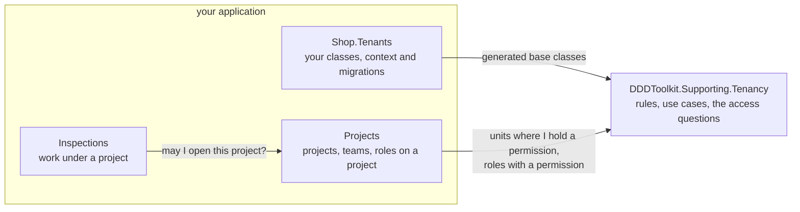
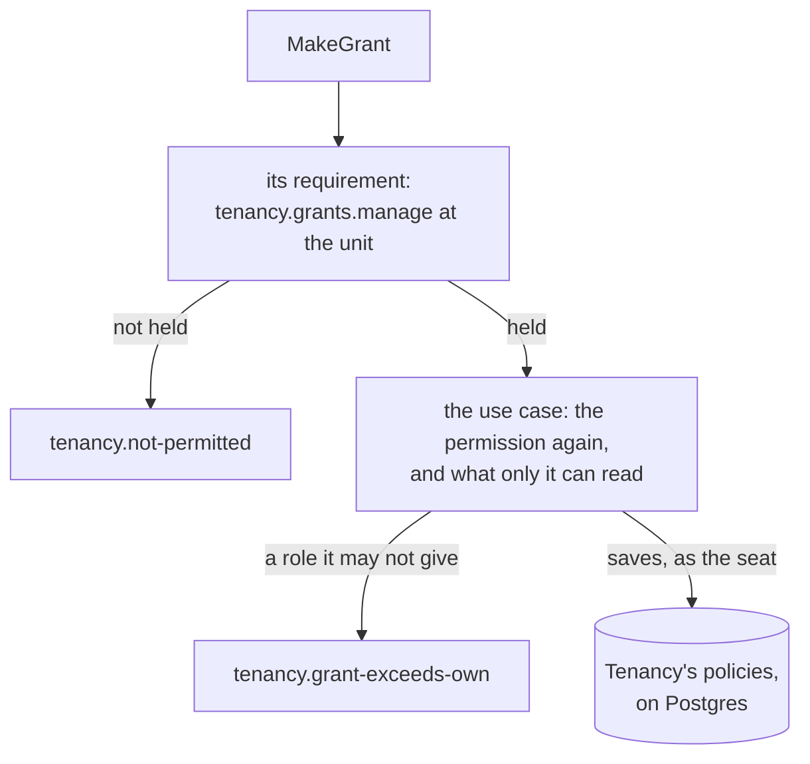

# Tenancy: who may do what

What a module asks Tenancy about its caller, what a request requires of its caller, and which of Tenancy's rows a
module may read. Read it when a module of yours decides access. The words are in the [overview](overview.md).

## The questions Tenancy answers

A module asks about the organization over its own context: `answers.Over(db)` gives the questions for the current
caller, now. Each answer is a query that becomes a subquery of the module's own statement, not a list fetched first.
Every member: [`ITenancyQuestions`](reference/questions.md#itenancyquestionsttenantid-tseatid-tunitid-troleid).

| Question | Answers, for the caller |
|---|---|
| `UnitsWhereIHold(permission)` | the units where it holds the permission: where granted, and every unit below |
| `WhereIHold(permissions)` | every pair of a unit and a permission held there, in one query |
| `ReadableUnits()` | the units it is placed in, and every unit below: where it belongs, not what it may open |
| `UnitsUnder(unit)` | the unit and every unit below it |
| `HoldsAtTenantAsync(permission)` | whether it holds the permission at the root, so for the whole tenant |
| `HoldsAtAsync(permission, unit)` | whether it holds the permission at the unit, granted there or above |
| `PermissionsIHoldAt(unit)` | every permission it holds that reaches the unit |
| `RolesWithPermission(permission)` | the tenant's active roles that grant the permission |
| `RolePermissions(permissions)` | every pair of an active role and a permission it grants, in one query |
| `SeatsHoldingPermissionAt(permission, unit)` | the active seats holding the permission there now, as far as the caller [may read their grants](postgres.md#who-reads-which-grants) |
| `Units()`, `Roles()`, `Seats()` | the tenant's units, roles and seats as access facts, without a name |
| `answers.Caller`, `answers.RequireTenant()` | who is asking, and the tenant it acts in |

- A grant counts from its start until its end, compared when asked: one that ended yesterday gives nothing today,
  with nothing written.
- A suspended seat, an archived role and a retired permission give nothing.
- A permission the catalogue does not know throws: a typo fails loudly.
- System work in a tenant holds every permission there; asking from system work outside any tenant throws.

Tenancy does not decide who may open a project: the module that owns projects does, from Tenancy's answer and its
own teams. Modules ask Tenancy's package about the organization; work under a project asks the projects module:



**Mapping the read model.** The module's context maps Tenancy's rows next to its own tables:

```csharp
// On Postgres the rows come from Tenancy's read functions, anywhere else from views over its tables.
// The module sees Tenancy's ids, not its classes, so it names them.
if (Database.IsNpgsql())
{
    modelBuilder.AddTenancyReadFunctions<TenantId, SeatId, OrganizationUnitId, RoleId>("tenancy");
}
else
{
    modelBuilder.AddTenancyReadModel<TenantId, SeatId, OrganizationUnitId, RoleId>("tenancy");
}

modelBuilder.Entity<Project>().ScopeToTenant(project => project.TenantId);
```

- It needs Tenancy's tables in the module's database: one database with a schema per module, or one SQLite file.
  Where they are apart, ask Tenancy's own context first and pass the answer in as a list.
- On Postgres with `DDDToolkit.Supporting.Tenancy.Postgres`, map the functions
  ([modules read through functions](postgres.md#modules-read-through-functions)): the questions refuse a module's
  context that maps the views there.
- Where your classes are visible, the call without the four ids is generated.
- A module whose resources have members leaves these questions to [Membership](../membership.md), as the sample's
  Projects module does.

## Permission sets for navigation, abilities for actions

A list that shows per row what the caller may do needs several permissions for many rows. `HoldsAtAsync` per row is
a query per answer; `WhereIHold(permissions)` answers every pair in one query, inside the module's own statement:

```csharp
var tenancy = answers.Over(db);
var held = tenancy.WhereIHold(["projects.edit", "projects.close"]);

// Each project with the permissions held where it hangs: one statement
var abilities = await (
    from project in db.Projects
    join pair in held on project.UnitId equals pair.Unit
    select new { project.Id, pair.Permission }).ToListAsync(cancellationToken);
```

- `RolePermissions(permissions)` does the same where rows are reached through a role, as a project's crew is.
- A permission set draws the screen and decides nothing: by the time a button is pressed, a grant may have ended.
  The use case asks again when the command runs.

## What a request requires of its caller

Every request states what it requires, checked before the handler runs. The mechanism is the toolkit's
([Access requirements](../access-requirements.md), [How a request is checked](../how-a-request-is-checked.md));
here are Tenancy's cases. The generator turns each attribute into the call beside it:

```csharp
[AccessRequests]
public partial interface IBillingRequest : IRequireAccess;      // one interface per module

[RequiresPermission(BillingPermissions.CloseTheBooks)]          // TenancyAccess.AtTenant(BillingPermissions.CloseTheBooks)
public sealed record CloseTheBooks(int Year) : IBillingRequest;

[RequiresPermission(BillingPermissions.OpenLedger)]             // TenancyAccess.AtUnit(BillingPermissions.OpenLedger, request.Unit)
public sealed record OpenLedger(string Name, [AtUnit] OrganizationUnitId Unit) : IBillingRequest;
```

| A request requires | Its attribute | Or, computed | Lets through | Refuses with |
|---|---|---|---|---|
| a caller in the tenant | `[InTenant]` | `TenancyAccess.InTenant()` | a seat in the request's tenant; system work there | the caller's own reason, such as `tenancy.not-seated` |
| a permission for the whole tenant | `[RequiresPermission(p)]` | `TenancyAccess.AtTenant(p)` | whoever holds it at the root now; system work in the tenant | `tenancy.not-permitted` |
| a permission at a unit | `[RequiresPermission(p)]`, `[AtUnit]` on the unit | `TenancyAccess.AtUnit(p, unit)` | whoever holds it at the unit now, there or above; system work in the tenant | `tenancy.not-permitted`, with the unit |
| an operator, on a query | `[RequiresOperator]` | `TenancyAccess.RequiresOperator()` | an [operator](operators-and-history.md#operators) | `tenancy.operators-only`, also for seats and system work |
| the caller's own seat, or a permission | `[RequiresPermission(p)]`, `[OrOwn]` on the seat | `AccessRequirement.Any(TenancyAccess.Own(seat), ...)` | the named seat if it is the caller's own; whoever holds `p` | one `access.refused`, with both reasons |
| the caller's own seat alone | `[OwnOnly]`, `[Own]` on the seat | `TenancyAccess.Own(seat)` | that seat; not system work, which has no seat | `access.not-own` |

- **Cost**: `AtTenant` and `AtUnit` read one statement each; the others read nothing. The cases in full:
  [Requirements](reference/callers.md#requirements).
- **The level** of a permission is declared once, on its constant, `[AtTenant]` or `[AtUnit]`
  ([A module states its permissions once](roles-and-permissions.md#a-module-states-its-permissions-once)).
- **`[AtUnit]`** is for a command that acts at a unit it names: one a package use case decides (placing a seat,
  giving a role there), or one that makes something where nothing exists yet to hold a permission on (opening a
  project there).
- It marks a member of your unit id (your `[OrganizationUnit<TUnitId>]` class's). On another id it is
  [DDD00081](../diagnostics.md#ddd00081), or, where a module sees only your ids, an `InvalidOperationException` when
  sent; the sample's `AccessDeclarationTests` catches it by holding every request to its requirement.
- **A unit the request may leave out**, `OrganizationUnitId?`, is computed:
  `Unit is { } unit ? TenancyAccess.AtUnit(p, unit) : TenancyAccess.AtTenant(p)`, as the sample's `SeatGrants` does.
- **The module's default**: `[AccessRequests, InTenant]` on the interface makes a request that states nothing
  require a caller in the tenant ([A module's default](../access-requirements.md#a-modules-default)).
- **The caller's own seat** is compared with the caller's seat in the request's tenant, which `AddTenancy` answers
  (`ICallersOwn<TSeatId>`) from the verified identity, never from the request. The sample's `RenameSeat`: a seat
  renames itself; `tenancy.seats.manage` for the whole tenant renames any.
- `[OrOwn]` beside `[AtUnit]` is [DDD00085](../diagnostics.md#ddd00085): the caller would send a unit where it holds
  the permission, for somebody else's seat. Other pairs that clash or add nothing:
  [What goes together](../access-requirements.md#what-goes-together).
- `[AllowAnonymous]` and `[SignedIn]` (a user with no seat yet) are the toolkit's
  ([the vocabulary](../access-requirements.md#the-vocabulary)).
- Cases combine in `AccessRequirement.All` and `Any`
  ([Requirements that combine](../access-requirements.md#requirements-that-combine)): moving a seat takes the
  permission at both units, `All(TenancyAccess.AtUnit(p, From), TenancyAccess.AtUnit(p, To))`, and the handler
  moves it from `From` alone.
- What is held on one thing a module keeps at a unit is that module's own case
  ([What answers it](../access-requirements.md#what-answers-it)); [Membership](../membership.md) ships such cases.

**A request handed to a package use case declares what that use case asks first.**

- Giving a role, `MakeGrant` whose handler calls `SeatCommands.GrantAsync`:
  `[RequiresPermission(TenancyPermissions.GrantsManage)]`, `[AtUnit]` on the unit. Making a role:
  `[RequiresPermission(TenancyPermissions.RolesManage)]`. A query of the package's directory: `[InTenant]`.
- Where that first question needs something read, the request declares `[InTenant]`: archiving a unit takes
  `tenancy.units.manage` at its parent, which only the use case reads.
- The use case asks again, whoever calls it, then what only it can read: who may give a role that manages access,
  whether a move gives away what the caller could not, whether the tenant keeps an administrator. A caller it would
  refuse first is refused at the door already, with the same code.

The checks a grant passes, in order: the door checks what the request names, the use case what only it can read, and
on Postgres [the second lock](postgres.md) holds every saved row to the seat the use case runs as.



### Who may ask, and what the work runs as

A tenant is provisioned by system work outside any tenant, which nobody holds a seat for. So who may send the request
and what the work runs as are two decisions.

- The handler always begins the work itself, `TenancyUseCases.BeginSystem()`: the use case refuses a seat with
  `access.system-only`. The caller gains nothing: the policies hold the work to the tenant it makes.
- The requirement only changes where the handler finds the first administrator:

| Who may send it | Its requirement | The first administrator |
|---|---|---|
| a signed-in person registering an organization | `[SignedIn]` | the caller's own token, read before the system work begins; an anonymous sign-in is refused |
| anyone, through a public form or a development route | `[AllowAnonymous]` | an address the form carries: the handler makes the account (`IIdentityAccounts.InviteByEmailAsync`) and provisions for its id |
| a job or tool of the application (an import, the seeding) | none: trusted code begins the work and calls the use case | the job's own input |

An operator's request is none of these: system work that names the operator carries it out,
`TenancyUseCases.BeginOperator(identity)` ([Operators](operators-and-history.md#operators)).

```csharp
[SignedIn]
public sealed record RegisterOrganization(string Slug, string Name, string AdministratorName) : ICommand<TenantId>, ITenantsRequest;

public sealed class RegisterOrganizationHandler(TenancyUseCases.TenantCommands tenants, ICallerAccessor callers)
    : ICommandHandler<RegisterOrganization, TenantId>
{
    public async ValueTask<TenantId> Handle(RegisterOrganization command, CancellationToken cancellationToken)
    {
        // Read before the system work begins: inside it, the caller is the system.
        var caller = callers.Current;
        if (caller.UserId is not { } administrator
            || string.Equals(caller.Claim("is_anonymous"), "true", StringComparison.OrdinalIgnoreCase))
        {
            throw TenancyRefusals.Refuse(TenancyRefusals.IdentityRequired);
        }

        using (TenancyUseCases.BeginSystem())
        {
            var made = await tenants.ProvisionAsync(
                new TenancyUseCases.TenantToProvision(
                    command.Slug, command.Name, TenantShape.Flat, command.Name, administrator,
                    ConfigureFirstSeat: seat => seat.Rename(command.AdministratorName)),
                cancellationToken);
            return made.Tenant;
        }
    }
}
```

A public form's handler makes the account first. An address that has one is answered as if it had none, so the form
tells nobody who has an account:

```csharp
var made = await accounts.InviteByEmailAsync(command.Address, signInRedirect: null, cancellationToken);
if (made is not IdentityAccountOutcome.Created(var administrator))
{
    return;
}
// then BeginSystem() and ProvisionAsync for administrator, as above
```

### Adding the check to a module

```csharp
// In the module that declares Tenancy's classes: generated, closed over the four ids
services.AddTenancyAccess<ITenantsRequest, ShopTenancyContext>();

// In any other module: the four ids written out
services.AddTenancyAccess<TenantId, SeatId, OrganizationUnitId, RoleId, IBillingRequest, BillingContext>();
```

- It reads over that module's context, which maps the [read model](#what-a-module-reads-of-tenancy) or is Tenancy's;
  on a context of its own where you registered `IDbContextFactory<TContext>`.
- A request of a module without the check is stopped; the message names `AddTenancyAccess`.
- The packages reference no dispatcher: call `AccessChecks<IBillingRequest>.RequireAsync` before the handlers, or use
  the [behavior generated for Mediator](../access-requirements.md#the-generated-behavior-with-mediator).

## What a module reads of Tenancy

The read model is six rows of access facts. A module's model can map nothing else of Tenancy's:

| Row | Carries | Does not carry |
|---|---|---|
| `SeatRight` | tenant, seat, unit, role, permission, the grant's start and end | |
| `OrganizationUnitPath` | tenant, the unit above, a unit at or below it, levels apart | |
| `OrganizationUnitRow` | id, tenant, parent, status | its name and your unit class's fields |
| `RoleRow` | id, tenant, the pack (starter role) it was copied from, status, permissions | its name |
| `PlacementRow` | seat, unit, whether it is the primary placement | |
| `SeatRow` | id, tenant, status | its identity and your seat class's fields, such as a name |

No row holds text shown to people, and no rule needs one: a module answers ids, and
[names](names-and-languages.md#names) are asked of Tenancy.

**Holding a module to these rows.** `TenancyModel.ReadsBeyondAccessFacts(model)` reports, a sentence per finding, a
type of the module's own on a Tenancy table, view or function, or a property added to a row, shadow ones included.
Assert it is empty for every module's context, built per database you run on, as the sample's `ModuleModelTests` does:

```csharp
using var projects = new ProjectsContext(optionsForPostgres);
TenancyModel.ReadsBeyondAccessFacts(projects.Model, schema: "tenancy").Should().BeEmpty();
```

- It judges mappings, not SQL written by hand. Without the second lock, only your project references keep a module
  from Tenancy's tables.
- SQLite has no schemas and finds a table by its name alone: for a SQLite model, ask once more per schema the model
  names (`schema: null` is its default schema).
