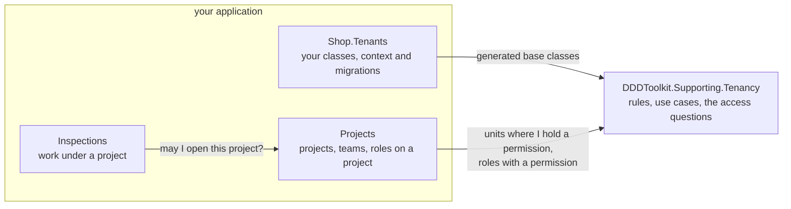
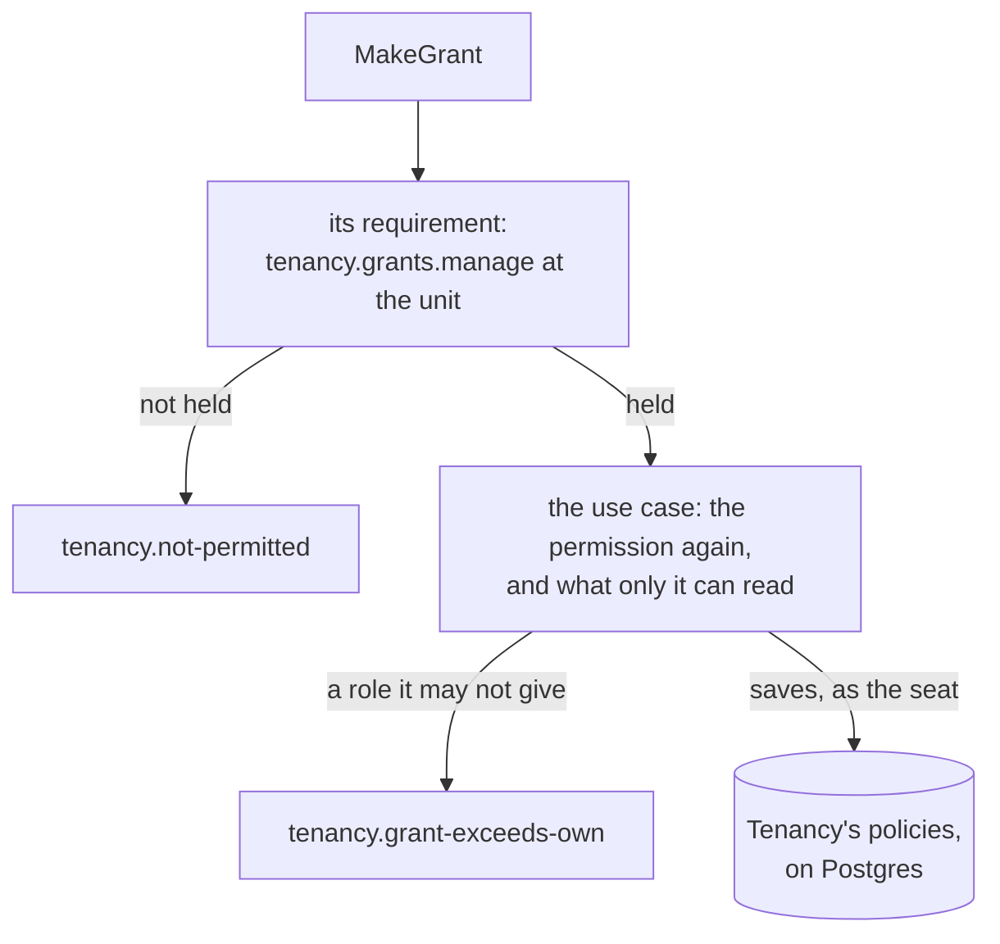

# Tenancy: who may do what

What a module asks Tenancy about its caller, how a request states what it requires, and what a module may read
of Tenancy's rows. Read it when a module of yours decides access. The words are in the [overview](overview.md).

## The questions Tenancy answers

Questions about the organization, and nothing else. "The seat" is the caller's: one person's place in the tenant.

| Question | Answer |
|---|---|
| `UnitsWhereIHold(permission)` | The units where the seat holds the permission: where it was granted, and every unit below |
| `ReadableUnits()` | The units the seat is placed in, and every unit below: where it belongs, not what it may open |
| `HoldsAtTenantAsync(permission)` | Whether it holds the permission at the root, so for the whole tenant |
| `HoldsAtAsync(permission, unit)` | Whether it holds the permission at that unit, granted there or above |
| `PermissionsIHoldAt(unit)` | Every permission it holds that reaches that unit |
| `RolesWithPermission(permission)` | The active roles that grant the permission |
| `SeatsHoldingPermissionAt(permission, unit)` | The active seats that hold the permission at that unit now, granted there or above. A seat learns of another seat only where it may read that seat's grant ([who reads which grants](postgres.md#who-reads-which-grants)): one that manages grants, seats or units at North learns who holds it from North or below, not from the root. System work in the tenant learns every holder; a seat that manages nothing learns only whether it holds it there itself |
| `WhereIHold(permissions)` | Every pair of a unit and a permission the seat holds there: `UnitsWhereIHold` for several permissions in one query |
| `RolePermissions(permissions)` | Every pair of an active role and a permission it grants: `RolesWithPermission` for several permissions in one query |
| `UnitsUnder(unit)` | The unit and every unit below it, in the caller's tenant |
| The current tenant and seat | Who is asking |

- A grant counts from its start until its end, compared when asked: one that ended yesterday gives nothing today,
  with nothing written.
- A suspended seat, an archived role and a retired permission give nothing.
- A permission held at a unit holds for everything below it.
- Tenancy does not decide who may open a project; the module that owns projects does. It knows what a project is
  and who is on its team in which role, and combines that with Tenancy's answer.

Who asks whom: modules ask Tenancy's package about the organization; a module whose work hangs under a project asks
the module that owns projects.



<details>
<summary>Show the code: asking Tenancy by hand, without Membership</summary>

- The questions run over the module's own context, which maps Tenancy's rows as a read model: they become
  subqueries of the module's statement, not lists fetched first.
- By hand, the two halves sit in two projects:
  - The application project references no Entity Framework. It asks through a read port, `IProjectReads`, which
    opens a reading on a context of its own per query.
  - Its access rules ask Tenancy's questions over the reading's rows and pack the answers, queries not yet run,
    into a reach: a record of the module's own.
  - The reading, in the infrastructure project, puts them into the statement that reads the projects.
- A module whose resources have members can leave both halves to [Membership](../membership.md), which writes them
  from its rules, as the sample's Projects module does.

Both, shortened, for the projects the caller may edit:

```csharp
// Projects.Application: Tenancy's answers stay sets, and go to the port as a reach
await using var reading = reads.Open();                          // a context for this one query
var tenancy = answers.Over(reading.Tenancy, reading.Queries);
var reach = new ProjectReach(
    atTenant: false,
    units: tenancy.UnitsWhereIHold("projects.edit"),             // a query, not a list
    seat,
    membershipIsEnough: false,                                   // true for "projects.view" alone
    crewRoles: tenancy.RolesWithPermission("projects.edit"),            // a query too
    now);
var mine = await reading.PageAsync(reach, filter, paging, cancellationToken);       // data: no entity leaves the port

// Projects.Infrastructure: the reading writes the statement, with both answers as subqueries
var units = reach.Units;
var roles = reach.CrewRoles;
return await db.Projects.AsNoTracking()
    .Where(project => units.Contains(project.UnitId)
        || project.Crew.Any(row => row.SeatId == seat
            && row.StartsAt <= now && (row.EndsAt == null || row.EndsAt > now)
            && row.Roles.Any(held => roles.Contains(held.RoleId)
                && held.StartsAt <= now && (held.EndsAt == null || held.EndsAt > now))))
    .Select(project => new Row { /* its own columns, and how it was reached */ })
    .OrderBy(row => row.Number)
    .ToPageAsync(paging, cancellationToken);   // one statement: GreenDonut's paging, by the number
```

- A crew member holds a permission on a project through a role that gives it, held now, in a membership that
  applies now.
- The one exception is seeing the project: for `projects.view` the membership alone is enough, so that reach says
  `membershipIsEnough` and the reading leaves the roles out.
- Code that holds the context itself (a module's infrastructure project, or a module of one project) writes
  `answers.Over(db)`: the same questions over the same rows.

```csharp
// The context: the read model next to the module's own tables, and the tenant on its own entities.
// On Postgres the rows come from Tenancy's read functions, anywhere else from views over its tables.
// The module sees Tenancy's ids, not its classes, so it names them (Your ids, named once).
if (Database.IsNpgsql())
{
    modelBuilder.AddTenancyReadFunctions<TenantId, SeatId, OrganizationUnitId, RoleId>("tenancy");
}
else
{
    modelBuilder.AddTenancyReadModel<TenantId, SeatId, OrganizationUnitId, RoleId>("tenancy");
}

modelBuilder.Entity<Project>().ScopeToTenant(project => project.TenantId);
```

```sql
-- Postgres: the same shape as a policy, two set-shaped questions that each run once per statement
"Id" = ANY (ARRAY(SELECT "projects".projects_as_member_with('projects.edit')))
OR "UnitId" = ANY (ARRAY(SELECT "tenancy".units_where_i_hold_permission('projects.edit')))
```

</details>

**Where the read model works.**

- It needs Tenancy's tables in the module's database: one database with a schema per module, or one SQLite file.
- Where they are apart, ask Tenancy's own context first and pass the answer in as a list.
- `AddTenancyReadModel` maps the rows as views over Tenancy's tables.
- On Postgres with `DDDToolkit.Supporting.Tenancy.Postgres`, map `AddTenancyReadFunctions` instead, to
  [read Tenancy through its functions](postgres.md#modules-read-through-functions). The questions are asked the
  same way over either.

## Permission sets for navigation, abilities for actions

- A list that shows what the caller may do per row (a button here, none there) needs several permissions for many
  rows. `UnitsWhereIHold` per permission, or `HoldsAtAsync` per row, is a query per answer.
- `WhereIHold(permissions)` answers every pair of unit and permission in one query, inside the module's own
  statement:

```csharp
var tenancy = answers.Over(db);
var held = tenancy.WhereIHold(["projects.edit", "projects.close"]);

// Each project with the permissions held where it hangs: one statement
var abilities = await (
    from project in db.Projects
    join pair in held on project.UnitId equals pair.Unit
    select new { project.Id, pair.Permission }).ToListAsync(cancellationToken);

// The projects under one unit, whatever the caller holds there
var under = tenancy.UnitsUnder(unit);
var below = await db.Projects.Where(project => under.Contains(project.UnitId)).ToListAsync(cancellationToken);
```

- `RolePermissions(permissions)` does the same for roles, where rows are also reached through a role, as a project's
  crew is.
- Every permission is checked against the catalogue (every permission the application knows) first: a typo throws,
  a retired permission is held nowhere.
- A permission set is for showing, and decides nothing: by the time a button is pressed, a grant may have ended.
- Whether a command may run is asked when it runs, by its use case, with `HoldsAtAsync` or the module's own rule.
  Read permissions to draw the screen; ask again to act.

## What a request requires of its caller

- Every command and query says what it requires; a check holds the caller to it before the handler runs.
- The types are the toolkit's, in `DDDToolkit.Access`. [Access requirements](../access-requirements.md) has how a
  request declares it, how checks are asked and fail closed, and the behavior written for you with Mediator.
- Tenancy ships the cases only it can decide, each with an attribute, for a requirement that reads nothing of the
  request but the permission and a unit it names.
- The generator turns the attribute into the call beside it, in the module's interface, declared `partial`:

```csharp
[AccessRequests]
public partial interface IBillingRequest : IRequireAccess;      // one interface per module

[RequiresPermission(BillingPermissions.CloseTheBooks)]                        // TenancyAccess.AtTenant(BillingPermissions.CloseTheBooks)
public sealed record CloseTheBooks(int Year) : IBillingRequest;
```

| A request requires | Its attribute | Or, computed, `RequiredAccess =>` | Lets through | Refuses with |
|---|---|---|---|---|
| a caller who works in the tenant | `[InTenant]` | `TenancyAccess.InTenant()` | a seat in the request's tenant, and system work there | what the caller is nobody for, such as `tenancy.not-seated` |
| a permission for the whole tenant | `[RequiresPermission(permission)]`, no marker | `TenancyAccess.AtTenant(permission)` | whoever holds it at the root now, and system work in the tenant | `tenancy.not-permitted`, naming the permission |
| a permission at a unit | `[RequiresPermission(permission)]`, `[AtUnit]` on the unit | `TenancyAccess.AtUnit(permission, unit)` | whoever holds it at that unit now, there or above, and system work in the tenant at one of its units | `tenancy.not-permitted`, with the permission and the unit |
| an operator of the application, on a query | `[RequiresOperator]` | `TenancyAccess.RequiresOperator()` | an [operator](operators-and-history.md#operators) | `tenancy.operators-only`, also for a seat and system work |
| the caller's own seat, or a permission | `[RequiresPermission(permission)]`, `[OrOwn]` on the seat | `AccessRequirement.Any(TenancyAccess.Own(seat), ...)` | the named seat, if it is the caller's own in the tenant; else whoever holds the permission | one `access.refused`, with `access.not-own` and the permission's reason |
| the caller's own seat alone | `[OwnOnly]`, `[Own]` on the seat | `TenancyAccess.Own(seat)` | that seat alone; not system work, which has no seat | `access.not-own` |

**The toolkit's own cases.**

- `[AllowAnonymous]` for anyone, `[SignedIn]` for a signed-in user with no seat yet (accepting an invitation,
  picking a tenant): about who is calling, nothing else.
- They are [the vocabulary](../access-requirements.md#the-vocabulary) a request picks from. Stacked attributes all
  hold.
- None is system work (work no person does). That is a scope trusted code begins around the work
  ([System work](keeping-tenants-apart.md#system-work)); a request it sends says who may send it like any other,
  `[InTenant]` in a tenant.
- `[InTenant]` beside a Tenancy permission adds nothing (only a seat in the tenant, or system work there, holds
  one): warning [DDD00084](../diagnostics.md#ddd00084).

**Said once for a module.**

- `[AccessRequests, InTenant]` on the module's interface: a request that states nothing requires a caller in the
  tenant; one that states its own, a permission say, keeps only its own.
- `[RequiresPermission(permission)]` may be the default too, held for the whole tenant.
- `[RequiresOperator]` may not: a command that says nothing would take it
  ([A module's default](../access-requirements.md#a-modules-default)).
- The sample's Projects module does this.

**A seat of the caller's own.**

- `TenancyAccess.Own(seat)`, and `[OrOwn]` or `[Own]` on a member of your seat id, compare the seat the request names
  with the caller's seat in the request's tenant: at the door, nothing read.
- `AddTenancy` registers what answers it, an `ICallersOwn<TSeatId>` over Tenancy's caller. That caller comes from the
  verified identity and the tenant the request names, never from the request.
- The sample's `RenameSeat`: a seat renames itself; `tenancy.seats.manage` for the whole tenant renames any seat.
- `[OrOwn]` beside `[AtUnit]` is [DDD00085](../diagnostics.md#ddd00085): the unit is where the permission is checked,
  so a caller would send a unit where it holds the permission, for somebody else's seat
  ([Yours, or the permission](../access-requirements.md#yours-or-the-permission)).
- Only a seat in the tenant has a seat of its own there, so Tenancy's `[assembly: CallersOwn]` says with `Implies`
  that it requires `[InTenant]` and `[SignedIn]` already. Either beside `[OwnOnly]` with `[Own]` on the seat id is
  warning [DDD00084](../diagnostics.md#ddd00084); so is `[InTenant]` beside a Tenancy permission with `[OrOwn]`.

**Combined with other cases.**

- Tenancy's cases combine with the core's, a module's and Membership's in `AccessRequirement.All` and `Any`
  ([Requirements that combine](../access-requirements.md#requirements-that-combine)).
- Moving a seat between units takes the permission at both,
  `All(TenancyAccess.AtUnit(permission, From), TenancyAccess.AtUnit(permission, To))`, and the handler moves it from
  `From` and no other unit.
- A tenant's audit log, for operators or a seat that manages seats:
  `Any(TenancyAccess.RequiresOperator(), TenancyAccess.AtTenant(TenancyPermissions.SeatsManage))`, with a row rule
  per way in ([The door and the rows](../access-requirements.md#the-door-and-the-rows)).

**`[AtUnit]`.**

- For a command that acts at a unit the request names: one the package's use case decides (placing a seat, giving
  a role there), or one that makes something where nothing exists yet to hold a permission on (opening a project
  there).
- It marks the member that is the unit, a positional parameter as it is or a property:

```csharp
[RequiresPermission(BillingPermissions.OpenLedger)]                           // TenancyAccess.AtUnit(BillingPermissions.OpenLedger, request.Unit)
public sealed record OpenLedger(string Name, [AtUnit] OrganizationUnitId Unit) : IBillingRequest;
```

- The member is your unit id, the one your `[OrganizationUnit<TUnitId>]` class is declared over.
- On a request that also carries a seat, `[AtUnit]` on the seat is [DDD00081](../diagnostics.md#ddd00081) at build,
  in a project that sees your unit class (as the application project of the module that declares Tenancy's
  classes does).
- Where a module sees only your ids, the check stops such a request when sent, with an `InvalidOperationException`
  naming your unit id. A test holding every request to the requirement it should declare catches it, as the
  sample's `AccessDeclarationTests` does.
- A unit the request may leave out, `OrganizationUnitId?`, is a computed requirement the request answers itself,
  as the sample's `SeatGrants` does:

```csharp
public sealed record ListLedgers(OrganizationUnitId? Unit) : IBillingRequest
{
    AccessRequirement IRequireAccess.RequiredAccess => Unit is { } unit
        ? TenancyAccess.AtUnit(BillingPermissions.Read, unit)
        : TenancyAccess.AtTenant(BillingPermissions.Read);
}
```

- What is held on one thing a module keeps at a unit is that module's own case, with a
  [check of its own](../access-requirements.md#what-answers-it) over the questions above;
  [Membership](../membership.md) ships such cases for a resource with members.

**A request handed to a package use case declares what that use case asks first.**

- No requirement leaves a request to the package. Giving a role:
  `[RequiresPermission(TenancyPermissions.GrantsManage)]` with `[AtUnit]` on the unit. Making a role:
  `[RequiresPermission(TenancyPermissions.RolesManage)]`. A query the package's directory answers: `[InTenant]`.
- Where that first question needs something read, the request declares what it can name and the use case asks the
  rest. Archiving a unit takes `tenancy.units.manage` at the unit's parent, which only the use case reads, so its
  request declares `[InTenant]`.
- The use case asks again past the check, whoever calls it, then what only it can read: who may give a role that
  manages access, whether a move gives away what the caller could not, whether the tenant keeps an administrator.
  Those rules are the package's; no request spells them.
- A caller the use case would refuse first is refused at the door already, with the same code and permission.
- Under it all, on Postgres, [the second lock](postgres.md) holds every saved row to the seat the use case runs as.

The checks a grant passes, in order, with what each refuses: the door checks what the request names, the use case
what only it can read, Postgres the rows.



<details>
<summary>Show the code: a command handed to the package's use case</summary>

```csharp
// What the use case asks first, and the request names: the check refuses a caller without it.
[RequiresPermission(TenancyPermissions.GrantsManage)]
public sealed record MakeGrant(SeatId Seat, [AtUnit] OrganizationUnitId Unit, RoleId Role, DateTimeOffset? Until, string? Reason) : ICommand, ITenantsRequest;

public sealed class MakeGrantHandler(TenancyUseCases.SeatCommands seats) : ICommandHandler<MakeGrant>
{
    public async ValueTask<Unit> Handle(MakeGrant command, CancellationToken cancellationToken)
    {
        // The use case asks for the permission again, whoever calls it, and then for the rules only it can read.
        await seats.GrantAsync(command.Seat, command.Unit, command.Role, command.Until, command.Reason, cancellationToken);
        return Unit.Value;
    }
}
```

</details>

### Who may ask, and what the work runs as

- A tenant is provisioned by system work outside any tenant; nobody holds a seat to ask for that with.
- So who may send the provisioning request and what the work runs with are two decisions.
- The handler always begins the system work itself, in trusted code: each below begins
  `TenancyUseCases.BeginSystem()` and provisions as that, whoever sent the request.
- The caller gains nothing by it: what the system work does is the handler's to say, and the database's policies
  hold it to the tenant it makes.
- The requirement only changes where the handler finds what system work cannot tell it, the first administrator:

| Who may send it | Its requirement | Where the first administrator comes from |
|---|---|---|
| a signed-in person registering an organization | `[SignedIn]` | the caller's own token, read before the system work begins, never the request; an anonymous sign-in is refused |
| anyone, through a public registration form or a development route | `[AllowAnonymous]` | no caller to take it from: the form carries an address; the handler makes that account with `IIdentityAccounts.InviteByEmailAsync` and provisions for the id it answers |
| a job or console tool of the application, such as an import or the seeding | none: trusted code begins `TenancyUseCases.BeginSystem()` and calls the use case, as the sample's seeding does | the job's own input |

- The provisioning use case refuses all but system work outside any tenant, `access.system-only`, so whichever door
  a request opens, the handler begins the work behind it.
- An operator's screen is none of these: an operator is a signed-in user, and what one asks for is carried out by
  system work that names the operator, `TenancyUseCases.BeginOperator(identity)`
  ([Operators](operators-and-history.md#operators)).

<details>
<summary>Show the code: a registration that provisions a tenant</summary>

```csharp
// Who may send it: a signed-in person, who becomes the first administrator.
[SignedIn]
public sealed record RegisterOrganization(string Slug, string Name, string AdministratorName) : ICommand<TenantId>, ITenantsRequest;

public sealed class RegisterOrganizationHandler(TenancyUseCases.TenantCommands tenants, ICallerAccessor callers)
    : ICommandHandler<RegisterOrganization, TenantId>
{
    public async ValueTask<TenantId> Handle(RegisterOrganization command, CancellationToken cancellationToken)
    {
        // The administrator is the verified identity of the request's own token, never one the request carries,
        // and it is read before the system work begins: inside it, the caller is the system. [SignedIn] lets an
        // anonymous sign-in through as well, and no seat should belong to one.
        var caller = callers.Current;
        if (caller.UserId is not { } administrator
            || string.Equals(caller.Claim("is_anonymous"), "true", StringComparison.OrdinalIgnoreCase))
        {
            throw TenancyRefusals.Refuse(TenancyRefusals.IdentityRequired);
        }

        // What it runs with: system work outside any tenant, begun here, which is what provisions a tenant.
        using (TenancyUseCases.BeginSystem())
        {
            var made = await tenants.ProvisionAsync(
                new TenancyUseCases.TenantToProvision(
                    command.Slug, command.Name, TenantShape.Flat, command.Name, administrator,
                    ConfigureFirstSeat: seat => seat.Rename(command.AdministratorName)),
                cancellationToken);
            return made.Tenant;
        }
    }
}
```

A public form declares `[AllowAnonymous]` and carries an address; its handler makes the account first. An address
that has an account is answered as if it had none, so the form tells nobody who has one; that person signs in and
registers as above.

```csharp
var made = await accounts.InviteByEmailAsync(command.Address, signInRedirect: null, cancellationToken);
if (made is not IdentityAccountOutcome.Created(var administrator))
{
    return;                                          // the address has an account: answer as if it had none
}

using (TenancyUseCases.BeginSystem())
{
    await tenants.ProvisionAsync(
        new TenancyUseCases.TenantToProvision(
            command.Slug, command.Name, TenantShape.Flat, command.Name, administrator,
            ConfigureFirstSeat: seat => seat.Rename(command.AdministratorName)),
        cancellationToken);
}
```

</details>

### Adding the check to a module

The check is added per module, for its request interface, over its context:

```csharp
// In the module that declares Tenancy's classes: generated like AddTenancy, closed over the four ids
services.AddTenancyAccess<ITenantsRequest, ShopTenancyContext>();

// In any other module, which sees the ids and none of the classes: the four ids written out, as where the read
// model is mapped (Your ids, named once)
services.AddTenancyAccess<TenantId, SeatId, OrganizationUnitId, RoleId, IBillingRequest, BillingContext>();
```

- Only `AtTenant` and `AtUnit` read: one statement each, over that context, which is Tenancy's own or maps the
  [read model](#what-a-module-reads-of-tenancy). No module is checked over another's context.
- A request of a module without the check is stopped; the message names `AddTenancyAccess`.
- It runs on a context of its own where you registered a factory for the context (a pooled one, say), else on the
  request's.
- The Tenancy packages reference no dispatcher. In front of the handlers, you call
  `AccessChecks<IBillingRequest>.RequireAsync`, or, with Mediator, use the
  [behavior the generator writes](../access-requirements.md#the-generated-behavior-with-mediator) for an interface
  marked `[AccessRequests]`.

## What a module reads of Tenancy

The read model is six rows, carrying what an access rule reads: ids, permissions, periods, statuses, a unit's
parent, and a role's pack (the starter role it was copied from) and permissions. A module's model can map nothing
else of Tenancy's, as a view or a function:

| Row | Carries | Does not carry |
|---|---|---|
| `SeatRight` | the tenant, the seat, the unit, the role, the permission, and the grant's start and end | |
| `OrganizationUnitPath` | the tenant, the unit above, the unit at or below it, and how many levels apart they are | |
| `OrganizationUnitRow` | the unit's id, its tenant, its parent and its status | its name, and every field your unit class adds |
| `RoleRow` | the role's id, its tenant, the pack it was copied from, its status and its permissions | its name |
| `PlacementRow` | the seat, the unit, and whether the placement is the primary one | |
| `SeatRow` | the seat's id, its tenant and its status | its identity, and every field your seat class adds, such as a name |

- No row holds text shown to people, so a module's query has no seat name to select, whatever it joins. A module
  answers ids; [names](names-and-languages.md#names) are asked of Tenancy.
- A rule never needs a name: "the unit is active", "the role is a copy of the lead's pack", "the seat holds the
  permission here" are all in the rows.

**Holding a module to these rows.** `TenancyModel.ReadsBeyondAccessFacts(model)` reports, one sentence per finding,
what a model maps beyond them: a type of the module's own on a Tenancy table, view or function, or a property added
to a row, shadow properties included. Assert it is empty for every module's context, built per database you run on:

```csharp
using var projects = new ProjectsContext(optionsForPostgres);
TenancyModel.ReadsBeyondAccessFacts(projects.Model, schema: "tenancy").Should().BeEmpty();
```

- It judges mappings only: SQL written by hand is not seen.
- Without the second lock, only your project references keep a module from Tenancy's tables.
- SQLite has no schemas, so a table is found by name whatever schema a mapping names. For a SQLite model, ask once
  more per schema the model names (`schema: null` is its default), so a type mapped under a Tenancy table name is
  found there too.
- The sample's `ModuleModelTests` asks it of every context its host registers, under Tenancy's schema.
