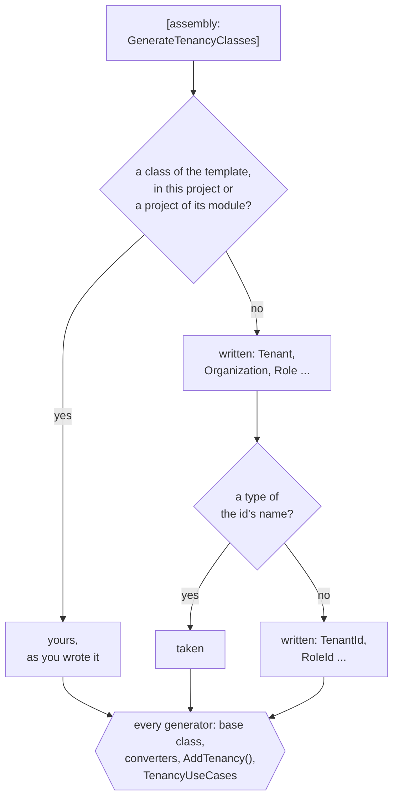
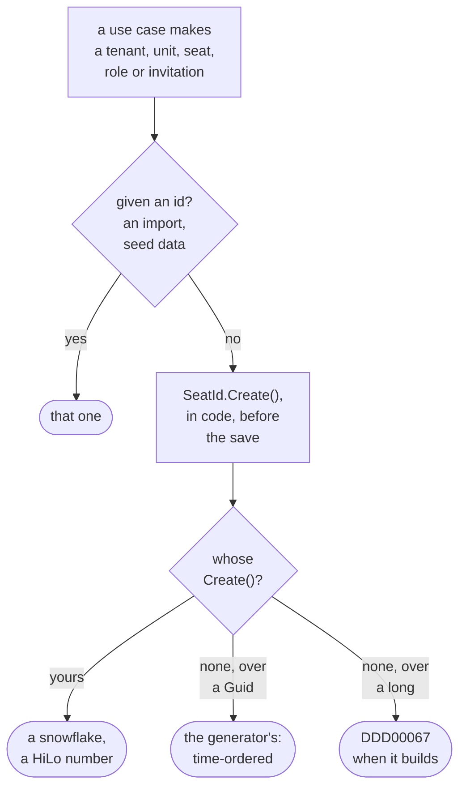
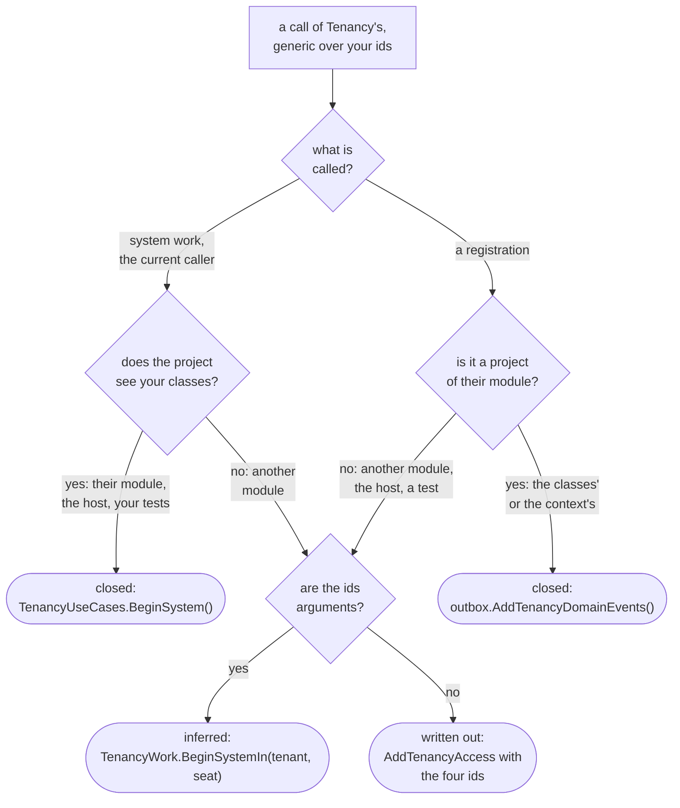

# Tenancy: your module

The module that holds Tenancy in your application: its packages, classes, ids, context and registration, and how
your code calls its use cases. Read it when you set up the module or add fields and rules to its classes. The
[tutorial](tutorial.md) builds it step by step; the [overview](overview.md) explains the words.

- Tenancy's aggregates are classes of your own (the tenant, its organization with its units, the seats, the roles),
  each declared with one of the package's templates over an id of your own.
- Most applications add something to one or two of them. The rest need not be written at all.

## The packages

> [!NOTE]
> The Tenancy packages are published as `Temp.DDDToolkit.Supporting.Tenancy`, `.EntityFramework` and `.Postgres`,
> under a `Temp.` id like [every 3.x package](../migrating-to-3.md#the-package-ids), and first as prereleases: the
> names on these pages can change until a release that is not one. [The sample](the-sample.md#who-may-do-what-in-the-sample)
> runs on them from source, on Supabase's own Postgres image.

Tenancy is the toolkit's first [supporting domain](../writing-a-supporting-domain.md): every multi-tenant
application needs it and none is set apart by it, so it is one package, which each application extends with what
only it knows.

| Package | What it holds |
|---|---|
| `DDDToolkit.Supporting.Tenancy` | The model, its rules and its use cases. No database in it. |
| `DDDToolkit.Supporting.Tenancy.EntityFramework` | `AddTenancy()` for your context, the organization tree as a closure table, and the access questions as Entity Framework queries. Works on every provider. |
| `DDDToolkit.Supporting.Tenancy.Postgres` | The same questions as SQL functions and row level security (RLS) policies, through the [export](../supabase.md). |

## The model

| | Holds | Rules the package states |
|---|---|---|
| **Tenant** | Its slug, its status and its shape | Status moves in one direction, and closed is final. The shape only goes from flat to hierarchical. |
| **Organization** | The tree of **OrganizationUnits** | One root, no cycles, a depth of at most 32. A unit is archived, never deleted. |
| **Seat** | A person in a tenant: their **Placements** in units, and the **RoleGrants** at each | One placement per unit and one primary. Only active roles are granted. The person a seat belongs to never changes. |
| **Role** | A name and the **Permissions** it grants | Only permissions from the catalogue, with the permissions they imply expanded. |
| **Catalogue** | The permissions and the **RolePacks** (packs: starter roles every new tenant gets a copy of) | One administrators' pack seeded for each shape, Tenancy's own when you declare none. A permission is retired, never deleted. Permissions that manage access are marked, Tenancy's own among them. |

- Tenant, Organization, Seat and Role are aggregates, referring to each other by id.
- The catalogue is data, not a class you declare: Tenancy's permissions, your modules', and what your application
  adds, which may be nothing ([What the catalogue is for](roles-and-permissions.md#what-the-catalogue-is-for)).
- A unit has no kind. Region or site is yours to keep, on your unit class ([The kind of a unit](#the-kind-of-a-unit)).
- Tenancy raises domain events. Integration events are yours to write from them, as any module writes its own.

Two rules span aggregates, so they live in the use cases, guarded against concurrent changes:

- The last administrator of a tenant cannot be removed.
- A role that manages access is given or taken away only by someone who holds its permissions that manage access,
  there and for at least as long, and never by a seat to itself. The same holds for suspending, deactivating or
  reactivating a seat that holds one, and for moving a unit away from it or under it.
- Other roles are given by whoever holds `tenancy.grants.manage` where the seat is placed.

Details: [Who may give a role](roles-and-permissions.md#who-may-give-a-role).

## Adopting it, step by step

Tenancy becomes a module of your application, like any other. In order:

1. **Add the packages**, at the version of every other `Temp.DDDToolkit.*` package (prereleases for now:
   `--prerelease`), as the sample's projects do:
   - the model in the domain project, which declares your classes, and in the projects that ask its questions;
   - the Entity Framework package in the infrastructure project, which has the context;
   - on Postgres, the Postgres package beside it. The host and the project that exports the migrations see it
     through their references.

   ```bash
   dotnet add Shop.Tenants.Domain package Temp.DDDToolkit.Supporting.Tenancy --prerelease
   dotnet add Shop.Tenants.Infrastructure package Temp.DDDToolkit.Supporting.Tenancy.EntityFramework --prerelease
   dotnet add Shop.Tenants.Infrastructure package Temp.DDDToolkit.Supporting.Tenancy.Postgres --prerelease   # on Postgres
   ```

   A contracts project that says `[assembly: GenerateTenancyIds]` takes the first package too
   ([In a module split by layer](#the-shortest-start-the-switch)).
2. **Get your classes and ids.** `[assembly: GenerateTenancyClasses]` writes each class you leave out, and its id
   ([The shortest start: the switch](#the-shortest-start-the-switch)). Declare a class where you need fields and
   rules; yours always wins ([How your classes add behaviour](#how-your-classes-add-behaviour)).
3. **Map and register it.** `modelBuilder.AddTenancy(database: Database)` in a plain context of your module, a
   migration of your own, and `services.AddTenancy<TContext>()`, with your catalogue when you have one
   ([The context and the registration](#the-context-and-the-registration)). Each id makes its own new ones
   ([How a new id is made](#how-a-new-id-is-made)).
4. **Write your catalogue, when you need one.**
   - Each module declares its permissions once, in a class marked `[Permissions]`; the host adds every module's with
     one generated call ([A module states its permissions once](roles-and-permissions.md#a-module-states-its-permissions-once)).
   - Your part adds the packs a tenant starts with, permissions no module owns, and a mark on every permission that
     manages access ([What the catalogue is for](roles-and-permissions.md#what-the-catalogue-is-for)).
   - No administrators' pack declared: every tenant starts with Tenancy's own
     ([The administrators' pack](roles-and-permissions.md#the-administrators-pack)). None of the rest needed: leave
     the catalogue out.
   - `SyncRolePacks()` in the host brings a pack you change later to the roles tenants made from it
     ([Packs after provisioning](roles-and-permissions.md#packs-after-provisioning)).
5. **Say who is calling, per request.** After authentication, `TenantSelection` finds the seat the token's identity
   has in the tenant the request names; that seat is the caller for the rest of the request (the middleware:
   [How the tenant reaches a policy](postgres.md#how-the-tenant-reaches-a-policy)).
6. **Provision a tenant.** `TenantCommands.ProvisionAsync` makes the tenant, its root unit, its roles from the packs
   and its first seat, as [system work](keeping-tenants-apart.md#system-work).
   [Calling a use case](#calling-a-use-case) shows the call, and `TenancyUseCases`, the generated class every use
   case is named through. A request that asks for a tenant says who may send it, and its handler begins the system
   work itself ([Who may ask, and what the work runs as](who-may-do-what.md#who-may-ask-and-what-the-work-runs-as)).
7. **Keep your own tables to a tenant.** `ScopeToTenant` on an entity; `UseDDDToolkit` on its context gives it
   Tenancy's save check, which `AddTenancy` brought ([Keeping tenants apart](keeping-tenants-apart.md)).
8. **Ask in your modules.**
   - A module maps the read model and asks, inside its own query, where the caller holds a permission
     ([Who may do what](who-may-do-what.md)).
   - A request says what it requires of its caller; a check holds the caller to it before the handler runs
     ([What a request requires of its caller](who-may-do-what.md#what-a-request-requires-of-its-caller)).
   - A module answers ids; a screen asks the directory what they are called ([Names](names-and-languages.md#names)).
9. **Let people manage access.** The package's use cases place seats, give roles and change roles, each held to
   [who may give a role](roles-and-permissions.md#who-may-give-a-role). Put requests of your own in front of them,
   each declaring what its use case asks first, and routes in front of those.
10. **Add what you need of the rest**: [invitations](invitations.md), role names in a tenant's
    [language](names-and-languages.md#languages), [operators](operators-and-history.md#operators),
    [who changed a row](operators-and-history.md#who-changed-a-row), the
    [access history](operators-and-history.md#access-history).
11. **On Postgres, add the second lock**: RLS under all of it ([Setting it up](postgres.md#setting-it-up)).

The [sample](the-sample.md#who-may-do-what-in-the-sample) is a small application built this way.

## The shortest start: the switch

One line in the project your classes belong to:

```csharp
[assembly: GenerateTenancyClasses]
```

**What it writes**: each of Tenancy's classes the project leaves out, as the package ships it.

- `Tenant`, `Organization`, `OrganizationUnit`, `Role` and `Seat`, each declared with its template.
- `TenantId`, `OrganizationUnitId`, `RoleId` and `SeatId`, each an `[EntityId<Guid>]` without a prefix, published
  with `[ModuleContract]`. An organization shares its tenant's id: there is no `OrganizationId`.
- Public, in the project's root namespace, so every folder sees them without a using. Each one's documentation says
  the switch wrote it, and how to declare it yourself.
- Not the invitation, the one class you may leave out: declaring it turns [invitations](invitations.md) on.
- Each is the package's whole class. The role remembers what its pack gave it, `PermissionsFromPack` (your migration
  maps it like every column), and follows the pack when the host syncs
  ([Packs after provisioning](roles-and-permissions.md#packs-after-provisioning)).

How the switch decides, per class and per id, whether to write it:



**What stays yours.**

- Nothing is generated without the switch; nothing you declare is replaced.
- A template's class declared in the project, or in a referenced project of its module, is yours. The switch writes
  the others around it.
- An id is taken where a type of its name is found, in the project or a project of its module, and written where
  none is.
- A written class that shares its id with one you declared takes that id: an organization written beside your
  `ShopTenant` over `ShopTenantId` is declared over `ShopTenantId`.

**A name the switch cannot use** is reported once, at the switch, [DDD00066](../diagnostics.md#ddd00066), and that
class is not written. The cases:

- a type of the class's name already in the root namespace, yours or a referenced project's;
- a namespace of that name, such as a folder `Organization/` directly under the project;
- an id of the class's name that the generator writes for an `[AggregateRoot<Guid>]` class of yours;
- two ids of one name to choose from.

A class that needs the one kept out (a seat needs its role) is kept out with it, with no id for either.
`AddTenancy()` and the class the use cases are named through then stand back rather than report it again. A class
of yours in the way that should be the package's class becomes it with the template:
`[RoleAggregate<RoleId>] public sealed partial class Role`.

**What the generators write for them.**

- Everything they write for a class or id you declare. No generator sees another's output, but each provider they
  read hands the written classes and ids on beside the declared ones.
- So the base class, the ids' converters, `modelBuilder.AddTenancy()` and the class the use cases are named through
  ([Calling a use case](#calling-a-use-case)) are written for them, in a project of one and in a module split by
  layer alike.
- So is what another package writes for a template that names a written id: a [Membership](../membership.md) member
  class whose members are seats, `[Member<CrewMemberId, SeatId, RoleId, Project>]`, gets its member list and
  registrations over the written `SeatId`.
- The compiled project carries the attributes a hand-written one would, so projects above see the written classes as
  they see yours.

**Two things see them only from the next project up.**

- **Other generators of the switch's own project.** HotChocolate's: an `[ObjectType<Role>]` over a written `Role`
  does not compile there. Nor does a toolkit generator that reads a written class by its symbol, such as a row
  access rule that names it.
  - A module split by layer has those in the projects above, where all is well.
  - A module of one project that needs one declares that class or id itself, one line, and it wins.
  - A written id as the key of a [resource access contract](../row-level-security.md#a-resources-access-asked-by-its-id)
    needs neither: the contract beside `[assembly: GenerateTenancyIds]`, and a rule of that project that asks it,
    are written over the switch's id.
- **Code outside the root namespace.** It names the written types through `global using Shop.Tenants;` (the root
  namespace), not a using at the top of a file: the parts the generators write for your classes, such as a
  collection of `SeatId`s, are files of their own, which a file's using does not reach. Code inside the root
  namespace, in any folder, needs neither.

**In a module split by layer**, the ids belong in the contracts project, which other modules reference, and the
classes in the domain project.

- `[assembly: GenerateTenancyIds]` in the contracts project; `[assembly: GenerateTenancyClasses]` in the domain
  project, which takes the contracts' ids.
- `GenerateTenancyIds` needs the contracts project to reference the Tenancy package. A contracts project that should
  not, as the sample's, declares the four ids itself, one line each; the domain project's switch takes those.

<details>
<summary>Show the code: what the switch writes for a class and for an id</summary>

```csharp title="Role.TemplateDefault.g.cs, the comment shortened"
namespace Shop.Tenants;

/// <summary>
/// The application's <c>Role</c>, declared <c>[RoleAggregate&lt;RoleId&gt;]</c> and nothing more: the package's class as it
/// ships. Written by the generator, because this project says <c>[assembly: GenerateTenancyClasses]</c> and
/// neither it nor a project it references declares a class with <c>[RoleAggregate]</c>.
/// </summary>
[global::DDDToolkit.Supporting.Tenancy.RoleAggregateAttribute<global::Shop.Tenants.RoleId>]
public sealed partial class Role
{
}
```

```csharp title="RoleId.TemplateDefault.g.cs, the comment shortened"
namespace Shop.Tenants;

/// <summary>
/// The id of the class declared with <c>[RoleAggregate]</c>: written by the generator, because this
/// project says <c>[assembly: GenerateTenancyClasses]</c> and neither it nor a project it references declares <c>RoleId</c>.
/// </summary>
[global::DDDToolkit.Abstractions.Attributes.ModuleContract]
[global::DDDToolkit.Abstractions.Attributes.EntityId<global::System.Guid>]
public readonly partial record struct RoleId;
```

The base class, the constructor, the rules and the id's members come from the generators that write them for a
declared class and id, in files of their own.

</details>

## Your own classes

A class that needs fields, rules or behaviour of its own, you declare; the switch writes the rest:

```csharp
// Shop.Tenants: the switch for the classes that add nothing, your own seat for its job title
[assembly: GenerateTenancyClasses]

[SeatAggregate<SeatId>]
public sealed partial class Seat
{
    public string? JobTitle { get; private set; }
}
```

The seat is declared over the switch's `SeatId`. Without the switch you declare all classes and ids, the ids in your
contracts project with the key type and prefix you choose. An id over anything but a `Guid` says how a new one is
made ([How a new id is made](#how-a-new-id-is-made)):

```csharp
// Shop.Tenants.Contracts
[EntityId<long>]
public readonly partial record struct TenantId
{
    public static TenantId Create() => new(Snowflakes.Next());   // yours: a snowflake, or a number of a HiLo block
}

[EntityId<Guid>] public readonly partial record struct SeatId;
[EntityId<Guid>] public readonly partial record struct OrganizationUnitId;
[EntityId<Guid>] public readonly partial record struct RoleId;

// Shop.Tenants
[TenantAggregate<TenantId>]
public sealed partial class ShopTenant
{
    public bool IsDemo { get; private set; }
}

[SeatAggregate<SeatId>]
public sealed partial class ShopSeat
{
    public string? JobTitle { get; private set; }
}

[OrganizationUnit<OrganizationUnitId>]
public sealed partial class ShopUnit
{
    public CostCentre? CostCentre { get; private set; }
}

[OrganizationAggregate<TenantId>] public sealed partial class ShopOrganization;
[RoleAggregate<RoleId>] public sealed partial class ShopRole;
```

The package's rules run for your classes before your own. Your classes, written or declared, are what Entity
Framework maps; [Writing your own supporting domain](../writing-a-supporting-domain.md) explains how.

## How a new id is made

Tenancy makes the id of every tenant, unit, seat, role and invitation it creates in code, before the save, so the
change and its events know it from the start; the database never makes one. It asks the id, `SeatId.Create()`. A use
case given an id (an import, seed data) uses that one.

Where a new id comes from, and when the build refuses:



| The id | Its `Create()` |
|---|---|
| `[EntityId<Guid>]`, the switch's included | Written by the generator: a time-ordered id, what `CreateSequential()` makes, which a database index keeps in order. One of your own wins. |
| `[EntityId<long>]`, `<int>`, `<string>` | None, since there is no telling how a new one is made; you declare it. For a `long`, a snowflake or a number of a block a HiLo sequence hands out; for an `int`, which a 64-bit snowflake does not fit, the HiLo number. |
| Written by hand, without `[EntityId<T>]` | Nothing from the generator: declare `Create()` and implement `ICreatableEntityId<TenantId>` yourself. |

- A class declared over an id without one is [DDD00067](../diagnostics.md#ddd00067) at build, on the class. Its code
  fix adds a `Create()` that throws until you write its body.
- So nothing is set in the registration, and nothing is generated by the database: Entity Framework stores an id as
  a value the application gives ([Ids the database never makes](../entity-framework.md#ids-the-database-never-makes)).

<details>
<summary>Show the code: an id that says how a new one is made, and what Tenancy calls</summary>

```csharp
// Shop.Tenants.Contracts: a tenant id over a long, from a sequence that hands out blocks of a thousand
[EntityId<long>]
public readonly partial record struct TenantId
{
    public static TenantId Create() => new(TenantNumbers.Next());
}

// Every id the generator writes over a Guid, the four the switch writes among them
public static SeatId Create() => CreateSequential();

// In Tenancy's use cases, generic over your ids, where TSeatId : ICreatableEntityId<TSeatId>
var seatId = command.AdminSeatId ?? TSeatId.Create();
```

</details>

## The context and the registration

The context is a plain `DbContext` in your module, with your conventions. `AddTenancy()` is generated for your
classes, as `AddDomainEventOutbox` adds the outbox:

```csharp
public sealed class ShopTenancyContext(DbContextOptions<ShopTenancyContext> options) : DbContext(options)
{
    protected override void OnModelCreating(ModelBuilder modelBuilder)
    {
        modelBuilder.HasDefaultSchema("tenancy");
        modelBuilder.AddTenancy(database: Database);
        modelBuilder.AddDomainEventOutbox(Database, schema: "tenancy");
    }

    protected override void ConfigureConventions(ModelConfigurationBuilder configurationBuilder)
    {
        configurationBuilder.AddDDDToolkitConventions();
        configurationBuilder.AddTenantsConverters();   // generated: both projects are of the module Tenants
    }
}
```

**Migrations** are yours, made from your model in the context's project; the package cannot know your database.

- Their history is in the context's schema (`tenancy` here), where `UseDDDToolkit` keeps it. The design-time factory
  `dotnet ef` uses keeps it there with `UseDDDToolkitDesignTime()` after its provider
  ([The migration history](../entity-framework.md#the-migration-history)).
- On Supabase, write no factory: mark the context `[SupabaseMigrations]`, as any module's, and the build writes one
  beside it ([Exporting as part of the build](../supabase.md#exporting-as-part-of-the-build)).

**Two rules held by the database too**, when `AddTenancy` is given the context's `Database`: one root per
organization, and one primary placement per seat.

- Each is a filtered unique index in your provider's SQL, for Postgres, SQLite and SQL Server. Another provider, or a
  context that leaves `database` out, gets neither.
- They refuse a write that goes past the aggregates, such as your own SQL.
- On an existing model they are a migration like any other change.
- On Postgres with [the second lock](postgres.md) the root index is required: the start-up checks refuse a database
  without it ([The index on a tenant's root](postgres.md#the-index-on-a-tenants-root)).

**Names.** Tables are `Tenants`, `Seats`, `SeatRoleGrants` and so on, and the two indexes are named after their
tables, unless you pass `AddTenancy` a `TenancyTableNames`. Columns, keys and other indexes follow your context's
naming; [Your own naming](postgres.md#your-own-naming) keeps a database in snake_case.

**The registration** is generated too: `services.AddTenancy<ShopTenancyContext>(...)`, closed over your classes and
ids, leaves you the context to name. Both generated calls are internal to the project that declares your classes, or
to a project of the same module that declares none of them (the module set with `DDD_Module`, which a folder can set
for all of them, [A module named by its folder](../modules.md#a-module-named-by-its-folder), or with
`[assembly: Module]`, as the infrastructure project next to its domain project,
[In a module split by layer](../writing-a-supporting-domain.md#in-a-module-split-by-layer)). Register Tenancy there:

```csharp
public static IServiceCollection AddShopTenancy(this IServiceCollection services, string connectionString)
    => services
        .AddTenancy<ShopTenancyContext>(options =>
            options.Catalogue = ShopCatalogue.Application)   // when you have one: packs, permissions of your own, marks
        .AddDbContext<ShopTenancyContext>((serviceProvider, options) => options
            .UseNpgsql(connectionString)
            .UseDDDToolkit(serviceProvider));
```

- `AddTenancy` brings Tenancy's save check to every context `UseDDDToolkit` wires, after the toolkit's interceptors:
  this one, and every context that keeps its own entities to a tenant, with nothing more to write. Why there, and
  what it checks: [Keeping tenants apart](keeping-tenants-apart.md).
- How calls without your classes come about:
  [A registration closed over your classes](../writing-a-supporting-domain.md#a-registration-closed-over-your-classes).

## Calling a use case

Tenancy's use cases, and the records they take and answer, are nested in one generic class,
`TenancyUseCases<TTenant, TTenantId, TOrganization, TUnit, TUnitId, TSeat, TSeatId, TRole, TRoleId>`, so your classes
and ids are named once for all. You do not close it yourself: the generator does, in the project that declares your
classes, as a class of the same name without type parameters, `TenancyUseCases`, whatever your module is called.
Every project that references that project (application, infrastructure, API, host, tests) names everything through
it, and none writes the nine types.

<details>
<summary>Show the code: what the generator writes into the project that declares the classes</summary>

```csharp title="TenancyUseCases.TemplateFacade.g.cs, shortened"
/// <summary>
/// TenancyUseCases, closed over the classes of the module Tenants: ShopTenant, TenantId, ShopOrganization,
/// ShopUnit, OrganizationUnitId, ShopSeat, SeatId, ShopRole and RoleId.
/// Named as the package's class is; [assembly: TemplateFacadeName("TenancyUseCases", "...")] in this project names it otherwise.
/// </summary>
public abstract class TenancyUseCases : global::DDDToolkit.Supporting.Tenancy.UseCases.TenancyUseCases<
    global::Shop.Tenants.ShopTenant, global::Shop.Tenants.Contracts.TenantId, global::Shop.Tenants.ShopOrganization,
    global::Shop.Tenants.ShopUnit, global::Shop.Tenants.Contracts.OrganizationUnitId, global::Shop.Tenants.ShopSeat,
    global::Shop.Tenants.Contracts.SeatId, global::Shop.Tenants.ShopRole, global::Shop.Tenants.Contracts.RoleId>
{
    private TenancyUseCases()
    {
    }
}
```

</details>

- **Services**, registered by `AddTenancy`, taken in a constructor: `TenancyUseCases.TenantCommands`,
  `TenancyUseCases.OrganizationCommands`, `TenancyUseCases.SeatCommands`, `TenancyUseCases.RoleCommands`,
  `TenancyUseCases.TenancyDirectory`.
- **Records** to name: `TenancyUseCases.TenantToProvision`, `TenancyUseCases.SeatOverview`.
- **Invitations** take your invitation class and its id too:
  `TenancyUseCases.InvitationCommands<ShopInvitation, InvitationId>` ([Invitations](invitations.md)).

The first call most applications write provisions a tenant:

```csharp
public sealed class FirstTenant(TenancyUseCases.TenantCommands tenants)
{
    public async Task SetUpAsync(Guid identity, CancellationToken cancellationToken)
    {
        // Nobody holds a seat yet, so this is system work, begun on purpose: closed over your ids as well.
        using (TenancyUseCases.BeginSystem())
        {
            await tenants.ProvisionAsync(
                new TenancyUseCases.TenantToProvision(
                    "harbor", "Harbor Works", TenantShape.Hierarchical, "Harbor Works", identity),
                cancellationToken);
        }
    }
}
```

`TenancyUseCases` is a global-namespace class that derives from the package's, closed over your classes, and does
nothing else; nothing makes one. C# finds a nested type through every derived class, so `TenancyUseCases.SeatCommands`
is the package's own `SeatCommands` over your classes: the type `AddTenancy` registered, which the container hands
out and whose documentation your editor shows.

- **A class, not an alias.** A global `using` alias holds only in its own project, so every project would declare
  one. A class is written once, reaches every project that references it, and their generators read it as any type:
  HotChocolate's sees the package's record in `[ObjectType<TenancyUseCases.PermissionReach>]` in an API project. A
  generator's alias would be the compiler's to see, not theirs.
- **Named as the package's class is**, whatever your module is called, so these pages and the package's
  documentation read the same for a module called Tenancy or Tenants. It does not clash with the generic class, even
  in a file importing `DDDToolkit.Supporting.Tenancy.UseCases`: C# tells them apart by their type parameters.
- **Or name it yourself, in one line**, in the project that declares the classes, beside `[assembly: Module]` or the
  switch: `[assembly: TemplateFacadeName("TenancyUseCases", "ShopTenancy")]`, from
  `DDDToolkit.Abstractions.Attributes` as `[assembly: Module]` is. Every project above uses that name.
  - A **template facade** is the toolkit's word for this class: the one a package asks, with
    `[assembly: TemplateFacade]`, to have written over your classes.
  - Needed when two modules declare Tenancy's classes ([below](#two-modules-with-the-classes)); otherwise only if you
    prefer another name.
  - Any class name will do that no namespace or type of yours in the global namespace has: `Shop`, for a module whose
    namespaces start with `Shop.`, is the namespace's.
  - A line that changes nothing (in a project that declares none of the classes, naming a class no package asks for,
    or a name a namespace has) is a warning at the line, [DDD00076](../diagnostics.md#ddd00076).
- **Only the project that declares the classes gets it.** Classes split over two projects of one module get it where
  they are complete, and projects above see that one. A name of your own goes beside the module in either: the
  project that writes the class reads it in the projects of its module it takes classes from.
- **What leaves it out is said where the classes are.** A template with no class or several, or a class that does
  not meet what the use cases ask: projects above would only see CS0246, so the declaring project says why,
  [DDD00065](../diagnostics.md#ddd00065), as information on the first class. Where a class or `AddTenancy` there
  already reports an error, you see that error.
- **What you wrote stays.**
  - A project with a type or namespace of that name in the global namespace, or an alias of that name atop one of
    its files, gets no class.
  - A name you give yourself that a type or namespace has is DDD00076, since the line would only take the class
    away. Your own alias of it still stands.
  - A project above that keeps an alias of that very name gets CS0576 from the compiler: take the alias out. An alias
    of another name still works beside the class, naming the same types.
  - A type of that name the project declares in a namespace of its own keeps the class out too, with DDD00065 on the
    type: in the global namespace the class would win over it in every file that imports its namespace, since C#
    looks there before a file's usings.
  - A project above is not looked at: there the class hides a type of that name imported with a using, so qualify
    the type, or name the class otherwise.
- **Other generators of the declaring project do not see it**: it is one generator's output, and they read the code
  as written. Mediator's writes the name as spelled, which compiles. HotChocolate's does not know the type, in its
  attributes or a resolver's parameters and return type, and writes `typeof(TenancyUseCases.RoleSummary?)` for a
  lookup that may answer nothing, which does not compile.
  - A module split by layer has its GraphQL types in its API project, above, where all is well.
  - A module of one project with GraphQL types over Tenancy's records keeps one alias of exactly that name there,
    `global using TenancyUseCases = DDDToolkit.Supporting.Tenancy.UseCases.TenancyUseCases<...>;`, which every
    generator of the project reads. The generator stands back for it; nothing else changes.

### Two modules with the classes

Most applications have one module with Tenancy's classes. One with two (customers' tenants and partners') gets a
`TenancyUseCases` in each module's domain project.

- While neither module references the other, each module's projects see only their own: nothing is wrong.
- They meet in every project that references both, the host and your tests, where the first line naming
  `TenancyUseCases` would be CS0433. Such a project is told first, [DDD00075](../diagnostics.md#ddd00075), with the
  line that gives one of them its own name written out, and the project it goes in.
- The line goes where that module declares its classes. Its projects above, the host and the tests use the new name;
  the other module keeps `TenancyUseCases`.
- A module whose domain project references the other's still gets its own class, and is told on its own first
  Tenancy class too. There the compiler binds the name to its own class and says so, CS0436; every project above sees
  both, is told at its project file, and cannot name either, CS0433.
- So nothing names the other module's classes without a word.

<details>
<summary>Show the code: the one line, and the host naming each</summary>

```csharp
// Shop.Customers.Domain/Module.cs
using DDDToolkit.Abstractions.Attributes;
using DDDToolkit.Supporting.Tenancy;

[assembly: Module("Customers")]
[assembly: GenerateTenancyClasses]
[assembly: TemplateFacadeName("TenancyUseCases", "CustomersTenancy")]
```

```csharp
// Shop.Host/Provisioning.cs
public sealed class Provisioning(CustomersTenancy.TenantCommands customers, TenancyUseCases.TenantCommands partners)
{
    // Customers' tenants through the name given, partners' through the package's.
}
```

</details>

The rest of these pages write `TenancyUseCases.`, as the sample does.

## Your ids, named once

You name your classes and ids once, where you declare them. What you call of Tenancy's that is generic over your ids
comes closed over them too, each kind as far as it can reach, so no project there writes the ids again:

| What | Generic over your ids | Closed over them | Where |
|---|---|---|---|
| System work | `TenancyWork.BeginSystem<TenantId, SeatId>()` and the rest | `TenancyUseCases.BeginSystem()`, `BeginSystemIn(tenant)`, `BeginOperator`, `BeginOperatorIn`, `BeginTokenIn` | Every project that sees your classes: their module, the host, your tests |
| The current caller | `TenancyCallers.Current<TenantId, SeatId>()` | `TenancyUseCases.CurrentCaller()` | The same |
| Registrations | `outbox.AddTenancyDomainEvents<TenantId, SeatId, OrganizationUnitId, RoleId>()` and the rest | `outbox.AddTenancyDomainEvents()`, `log.AddTenancyEventLog()`, `outbox.AddTenancyInvitationEvents<InvitationId>()`, `modelBuilder.AddTenancyReadModel()` and `AddTenancyReadFunctions()`, beside `AddTenancy`, `AddTenancyAccess` and `AddTenancyInvitations` | The project that declares your classes, and a project of their module that registers Tenancy, where the context is; not the host or a test project above them |
| Tenant selection, for a host's middleware | `TenantSelection<TenantId, SeatId>` | `ITenantSelection`, which answers the caller without its ids | Every project: it names no id |

Which form a project writes, by what it calls and what it sees:



What "seen" means per kind:

- **System work and the current caller** are static members of `TenancyUseCases`. C# finds a static member through a
  derived class as it finds a nested type, so they reach exactly as far as the class: the declaring project and every
  project above, host and tests included. In the declaring project too, though the class is generator output: the
  compiler binds a call and sees every generator's output. Only another generator does not, reading a signature or
  an attribute, and a call is neither.
- **Registrations** are generated as `AddTenancy` is, into the declaring project or the lowest project of the module
  that references the registrations, where the context is. They are internal there, so the host or a test project
  above does not get them: a host registers a module through the module's own registration, and a test project that
  registers Tenancy itself writes the ids, unless it declares classes of its own.
- **`ITenantSelection`** names no id. `AddTenancy` registers it per scope as the very selection it registers closed
  over your ids, unless your host registered one before, which stays. It answers an `ITenancyCaller`, which
  `TenancyCallers.Begin` takes, so a host's middleware reads the same in every application
  ([How the tenant reaches a policy](postgres.md#how-the-tenant-reaches-a-policy)).

**Another module sees only your ids.** A module referring to the organization by your contracts' ids (Billing,
Projects) sees none of your classes, and nothing it sees says which ids are Tenancy's: the toolkit never takes an id
for the tenant's by its name. So it writes them where they are no arguments,
`AddTenancyAccess<TenantId, SeatId, OrganizationUnitId, RoleId, IBillingRequest, BillingContext>()` and
`AddTenancyReadFunctions<TenantId, SeatId, OrganizationUnitId, RoleId>()`, and C# infers them where they are: system
work for a seat, `TenancyWork.BeginSystemIn(tenant, seat, "billing")`; a permission at a unit,
`TenancyAccess.AtUnit(permission, unit)`.

**Types keep their ids.** `ITenancyAnswers<...>` and `ITenancyQuestions<...>`, which a handler takes in its
constructor, and records such as `SeatOfCaller<TenantId, SeatId>` name your ids everywhere. A class names what is
nested in it and gives no other generic type a second name; these stay apart from the use cases so a module that
sees only the ids can take them. A project names such a type once, with a `global using` alias, as each of the
sample's application projects names the answers.

**Three more name them, in the declaring project too.** The sample's Tenants module writes two; the third is in
[System work](keeping-tenants-apart.md#system-work).

- `TenantSelection<TenantId, SeatId>`, for a person's own seats in a tenant picker, `SeatsOfAsync`: its records carry
  your ids, so it stays on the generic selection. `ITenantSelection` carries only what needs no id.
- `EfTenancyReadSource<TenantId, SeatId, OrganizationUnitId, RoleId>`, the source of Tenancy's rows a reading of your
  own makes over its context: a type, as the answers are.
- `TenancySystemReads.TenantsToSweepAsync<ShopTenant, TenantId>(tenancy, scope, cancellationToken)`, the tenants a
  round of system work visits: a method of the Entity Framework package, which `TenancyUseCases` does not know, taking
  Tenancy's context as any context, so no argument says which tenant it is.

<details>
<summary>Show the code: the same calls where your classes are seen, and in another module</summary>

```csharp
// The module that declares the classes, in its infrastructure project: generated, closed over the four ids
options.UseOutbox<ShopTenancyContext>(outbox => outbox
    .AddTenancyDomainEvents()
    .AddTenancyInvitationEvents<InvitationId>()       // the invitation's id: an application may have none
    .KeepEventLog(log => log.AddTenancyEventLog()));

// The host, a test, or any project that sees TenancyUseCases: system work and the current caller
using (TenancyUseCases.BeginSystemIn(tenant, administrator))
{
    await seeder.SeedAsync(cancellationToken);
}

var caller = TenancyUseCases.CurrentCaller();          // a TenancyCaller<TenantId, SeatId>, nobody outside any scope

// The host's middleware: the selection without its ids
var seat = await context.RequestServices.GetRequiredService<ITenantSelection>()
    .ResolveAsync(context.GetSupabaseCaller(), context.Request.Headers["Tenant"], context.RequestAborted);

// Another module, which sees only the ids: written out where they are no arguments, inferred where they are
services.AddTenancyAccess<TenantId, SeatId, OrganizationUnitId, RoleId, IBillingRequest, BillingContext>();
modelBuilder.AddTenancyReadFunctions<TenantId, SeatId, OrganizationUnitId, RoleId>("tenancy");

using (TenancyWork.BeginSystemIn(tenant, seat, "billing"))
{
    await invoices.SaveOnlyAsync(invoice, cancellationToken);
}

// The answers it takes in a constructor: one alias per project
global using ShopAnswers = DDDToolkit.Supporting.Tenancy.Access.ITenancyAnswers<
    Shop.Contracts.TenantId, Shop.Contracts.SeatId, Shop.Contracts.OrganizationUnitId, Shop.Contracts.RoleId>;
```

</details>

## How your classes add behaviour

Your class is the package's class with your part added; nothing of the package's is replaced. Four ways to add:

- **Members**: fields and methods, stored with the class: a tenant's `IsDemo`, a seat's `JobTitle` and a method that
  changes it. Placements and grants stay the package's, changed through its use cases only.
- **Entities** of your own, mapped with the class, as in any aggregate.
- **Rules**: a nested `IInvariant<T>` runs after the package's rules on every save, and refuses the save as theirs do.
- **The package's domain events**: every change raises one (`tenancy.seat-suspended`,
  `tenancy.organization-unit-archived` and the rest), each saying [who made the change](operators-and-history.md#access-history).
  Handle one in process with `AlsoDispatchInProcess`, or map it to an integration event of your own before
  `AddTenancyDomainEvents` to send it through the outbox like any module's. An unmapped event is stored and reaches
  no other module.

There are no virtual members or hook methods, so nothing to override: a package rule always runs, and yours only add
to it. The sample's unit adds a cost centre and a rule about its format:

```csharp
[OrganizationUnit<OrganizationUnitId>]
public sealed partial class OrganizationUnit
{
    public string? CostCentre { get; private set; }

    public void SetCostCentre(string? costCentre) => CostCentre = costCentre;

    // Runs after the package's rules about names, parents and archiving, never instead of them.
    public sealed partial class CostCentreFormat : IInvariant<OrganizationUnit>
    {
        public string Code => "tenants.unit.cost-centre";

        public InvariantFailure? Check(OrganizationUnit entity)
            => entity.CostCentre is null || Format().IsMatch(entity.CostCentre)
                ? null
                : "A cost centre is two capitals, a dash and three digits.";

        [GeneratedRegex(@"^[A-Z]{2}-\d{3}$")]
        private static partial Regex Format();
    }
}
```

A field of yours starts at its default. For a new tenant, its root and its first seat, set it while provisioning,
through three callbacks on the command:

```csharp
await tenants.ProvisionAsync(
    new TenancyUseCases.TenantToProvision(
        "harbor", "Harbor Works", TenantShape.Hierarchical, "Harbor Works", identity,
        ConfigureTenant: tenant => tenant.MarkAsDemo(),
        ConfigureRoot: root => root.SetCostCentre("HW-001"),
        ConfigureFirstSeat: seat =>
        {
            seat.Rename("Ada");
            seat.ChangeJobTitle("Harbor master");
        }),
    cancellationToken);
```

- They run in that order, each once its instance is made and before the tenant is activated: the tenant is still
  provisioning, the root is in its organization, the seat is placed at the root and holds the administrators' role.
- What they set is written in the provisioning save; an event your class raises there leaves with the provisioning's
  own. A callback that throws stops the provisioning with nothing saved.
- Later units: `AddUnitAsync` takes the same kind of callback, `configure` ([The kind of a unit](#the-kind-of-a-unit)).
  Later seats: so do `AddSeatAsync` and an invitation's `AcceptAsync`
  ([How a seat is shown](names-and-languages.md#how-a-seat-is-shown)).

An event another module should hear is mapped in your Tenancy context's outbox, before the call that keeps the rest
to itself:

```csharp
services.AddDDDToolkitEntityFramework(options => options.UseOutbox<ShopTenancyContext>(outbox => outbox
    .PublishAs<SeatSuspended<TenantId, SeatId>, SeatSuspendedV1>(suspended => new SeatSuspendedV1(suspended.SeatId.Value))
    .AddTenancyDomainEvents()));   // generated like AddTenancy, closed over your four ids
```

### The kind of a unit

Tenancy keeps no kind of unit. Region, area or site decides nothing about access (a permission held at a unit reaches
every unit below it, whatever they are called), so the package neither asks for a kind nor checks one. An application
that tells its units apart adds a field to its unit class, an enum say, shown and stored like any field of its own,
and sets it in the callback of the use case that makes the unit.

What `AddUnitAsync` checks, in order, and where your callback runs:


<details>
<summary>Show the code: a unit's kind as the application's own enum</summary>

```csharp
public enum UnitKind { Company, Region, Area, Site }

[OrganizationUnit<OrganizationUnitId>]
public sealed partial class OrganizationUnit
{
    public UnitKind? Kind { get; private set; }

    public void SetKind(UnitKind? kind) => Kind = kind;
}

// The command's handler: the package's use case adds the unit, the callback sets the kind, one save writes both
public async ValueTask<OrganizationUnitId> Handle(AddOrganizationUnit command, CancellationToken cancellationToken)
    => await organization.AddUnitAsync(command.Parent, command.Name, cancellationToken, configure: unit => unit.SetKind(command.Kind));

// The root's, when the tenant is provisioned
new TenancyUseCases.TenantToProvision(slug, name, shape, name, identity, ConfigureRoot: root => root.SetKind(UnitKind.Company));

// The query's handler: the directory decides which units the caller reads and answers your own units, whole, each
// with its path and depth beside it; a plain select shows the kind
public sealed record UnitListing(OrganizationUnitId Id, OrganizationUnitId? ParentId, string Name, UnitKind? Kind, UnitStatus Status, string Path, int Depth);

public async ValueTask<IReadOnlyList<UnitListing>> Handle(OrganizationUnits query, CancellationToken cancellationToken)
{
    var units = await reads.AskDirectoryAsync(directory => directory.ListUnitsAsync(cancellationToken));
    return [.. units.Select(found => new UnitListing(found.Unit.Id, found.Unit.ParentId, found.Unit.Name, found.Unit.Kind, found.Unit.Status, found.Path, found.Depth))];
}

// Stored by its name: one line in the context's ConfigureConventions
configurationBuilder.Properties<UnitKind>().HaveConversion<string>().HaveMaxLength(16);
```

The sample stores the kind by its key in lower case instead, with a converter of its own (`UnitKindKeyConverter`),
because its rows from before the enum hold the keys of the catalogue the package once asked for.

</details>

- **Setting it.** The use case checks the caller; the organization checks the tree and makes the unit through your
  class, handing it to `configure` before taking it in. So your field is written in the unit's own save, and a rule
  of your class judges it there. A callback that throws leaves the organization as it was: the unit is not added, not
  even by a later save in the same scope. The root works the same way, through `ConfigureRoot` at provisioning.
- **Showing it.** Select it. `ListUnitsAsync` answers your own units, whole, each as a `UnitInTree`: the unit, with
  its path from the root and its depth, the two things a unit does not carry. So a plain `Select` over what the
  directory read shows your field, with no read more; nothing you do to one is saved.
- **By id.** `UnitsByIdAsync` names a unit alone, as a `NamedUnit` of its name, path and depth: what another module's
  answer needs, for a seat that may not read the rest of the unit.
- The sample does all of it: a `UnitKind` enum on its unit, set by its command and its seeding, and a `UnitListing`
  its queries select, the unit's own fields with the path beside them.
