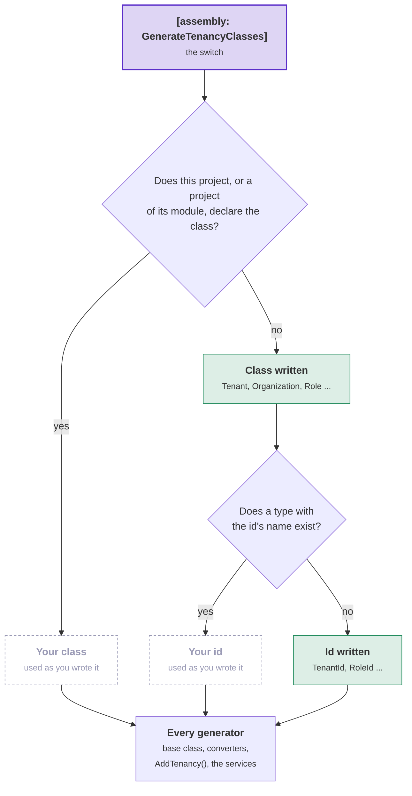
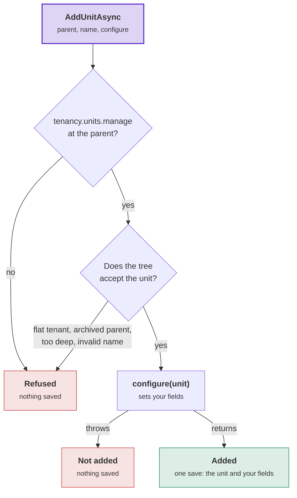

# Tenancy: your module

The module that holds Tenancy is the toolkit's first [supporting domain](../writing-a-supporting-domain.md). This
page covers the module's options, variants and edge cases: its packages, classes, ids, context and registration, and
how your code names the services and the access manager. The [tutorial](tutorial.md) shows the basic path. The [overview](overview.md)
defines the words.

## The packages

| Package | What it contains | Where it goes |
|---|---|---|
| `DylansTechStack.Tenancy` | The model, its rules, its services and their generators. No database code. | The domain project, which declares your classes. Also a contracts project with `[assembly: GenerateTenancyIds]`. |
| `DylansTechStack.Tenancy.Abstractions` | Tenancy's markers for domain classes: `[OfTenant]`, on the property that says which tenant a row belongs to ([Keeping tenants apart](keeping-tenants-apart.md)). The markers of the kinds of seat: `[SeatKinds]`, `[InOrganization]` and `[OutsideOrganization]` ([Kinds of seat](#kinds-of-seat)). Tenancy's generators, which every project that references the package gets. No Entity Framework. `DTS.Tenancy` references it. | The domain project of another module, which sees only Tenancy's ids. The contracts project that declares the kinds of seat. |
| `DylansTechStack.Tenancy.EntityFramework` | `AddTenancy()` for your context, the organization tree as a closure table, and Tenancy's queries as Entity Framework queries. It works with every provider. | The infrastructure project, which has the context |
| `DylansTechStack.Tenancy.Postgres` | Tenancy's queries as SQL functions, and row level security (RLS) policies, written by the [export](../supabase.md). It references the Entity Framework package. | The infrastructure project, on Postgres |

The packages are `DylansTechStack.Tenancy*`, and their namespaces are `DTS.Tenancy*`. They are part of DTS Pro and are
not published on nuget.org. Their version is the version of every `DylansTechStack.DDD.*` package. They are 0.x, so
their names can still change.

## The model

| | Contains | Rules the package enforces |
|---|---|---|
| **Tenant** | Its slug, status and shape | A tenant goes from provisioned to active. It can be suspended and reactivated. A closed tenant stays closed. The shape changes only from flat to hierarchical. |
| **Organization** | The tree of **OrganizationUnits** | One root, no cycles, a depth of at most 32. A unit is archived and never deleted. |
| **Seat** | A person in a tenant, of one **kind**, with **Placements** at units and **RoleGrants** at each placement | One placement per unit, and one primary placement. Only active roles are granted. The seat's identity and kind never change. A seat of a kind outside the organization has no placements. |
| **Role** | A name and its **Permissions** | Only permissions from the catalogue. The permissions they imply are added. |
| **Catalogue** | The permissions, the **starter roles** (`StarterRole`) and the **kinds of seat** (`SeatKind`) | One administrators' starter role per shape. Tenancy adds its own when you declare none. A permission is retired and never deleted. Permissions that manage access are marked. One kind of seat inside the organization is the default. |

- Tenant, Organization, Seat and Role are aggregates. They refer to each other by id.
- The catalogue is not an aggregate. It is data in code: Tenancy's permissions, your modules' permissions, and an
  optional part that your application adds
  ([What the catalogue is for](roles-and-permissions.md#what-the-catalogue-is-for)).

The services enforce the rules that involve more than one aggregate. These services first take the tenant's access
revision, so two concurrent changes cannot both commit
([Who may give a role](roles-and-permissions.md#who-may-give-a-role)):

- The last administrator of a tenant cannot be removed.
- While containment is on, only a seat that holds a role's access-managing permissions at the unit, for at least as
  long as the grant runs, can give or take away a role that manages access. A seat never gives itself a role that manages access.
- The containment rule also covers suspending, deactivating or reactivating a seat with a role that manages access.
  It also covers moving a unit, because a move changes which grants reach the unit.
- Any other role needs `tenancy.grants.manage` at the unit where it is given.

## Adopting Tenancy step by step

What a module needs, in order:

| What | Basic path | Options and variants |
|---|---|---|
| The packages | [Step 1](tutorial.md#step-1-the-modules-projects-and-their-packages) | [The packages](#the-packages) |
| Your classes and ids | [Step 2](tutorial.md#step-2-your-classes) | [Quick start](#quick-start), [your own classes](#your-own-classes), [new ids](#how-a-new-id-is-made) |
| The module's context, and your migration | [Step 3](tutorial.md#step-3-where-it-is-stored) | [The context and the registration](#the-context-and-the-registration) |
| The registration, and a catalogue when you need one | [Step 4](tutorial.md#step-4-the-modules-registration) | [The registration](#the-context-and-the-registration), [the catalogue](roles-and-permissions.md#declaring-a-modules-permissions) |
| The caller of each request, through `ITenantSelection` | [Step 5](tutorial.md#step-5-the-host) | [How the tenant reaches a policy](postgres.md#passing-the-tenant-to-postgres) |
| Provisioning a tenant as system work | [Step 6](tutorial.md#step-6-provisioning-a-tenant) | [System work](keeping-tenants-apart.md#system-work) |
| Your tables kept to a tenant, with `[OfTenant]` | | [Keeping tenants apart](keeping-tenants-apart.md) |
| Queries in your modules | [Steps 7-8](tutorial.md#step-7-who-am-i) | [Who may do what](who-may-do-what.md), [names](names-and-languages.md#names) |
| Requests through which people manage access | [Step 9](tutorial.md#step-9-a-role-at-a-unit) | [Who may give a role](roles-and-permissions.md#who-may-give-a-role) |
| People from outside the organization, such as a client's site manager | | [Kinds of seat](#kinds-of-seat), [invitations from outside the organization](invitations.md#invitations-from-outside-the-organization) |
| Other features | | [Invitations](invitations.md), [languages](names-and-languages.md#languages), [operators](operators-and-history.md#operators), [who changed a row](operators-and-history.md#who-changed-a-row), [access history](operators-and-history.md#access-history), [starter roles you change later](roles-and-permissions.md#starter-roles-after-provisioning) |
| Row level security on Postgres | Steps 1-5 | [Setup steps](postgres.md#setup-steps) |

The [sample](the-sample.md#who-may-do-what-in-the-sample) is an application built this way.

## Quick start

Add one line to the project your classes belong to. The docs call this attribute the **switch**:

```csharp
[assembly: GenerateTenancyClasses]
```

The generator then writes every Tenancy class that the project does not declare, as the package ships it:

- `Tenant`, `Organization`, `OrganizationUnit`, `Role` and `Seat`, each declared with its template.
- `TenantId`, `OrganizationUnitId`, `RoleId` and `SeatId`, each an `[EntityId<Guid>]` without a prefix and
  published with `[ModuleContract]`. An organization uses its tenant's id, so there is no `OrganizationId`.
- Each type is public and in the project's root namespace. Its documentation comment says how to declare the type
  yourself.
- The invitation is not written. Declaring the invitation class turns [invitations](invitations.md) on.
- Each written class has every member of the package's class. For example, the role's `PermissionsFromStarterRole` is a
  column, and your migration maps it like any other column
  ([Starter roles after provisioning](roles-and-permissions.md#starter-roles-after-provisioning)).

The diagram shows how the generator decides, for each class and each id, what to write. It never replaces a type you
declare. Purple: the switch. Green: written by the generator. Grey: your type, used as you wrote it.



- "A project of its module" means a project of the same module that this project references.
- A written class takes the id of a declared class that shares the id. Example: you declare `ShopTenant` over
  `ShopTenantId`, so the written organization is declared over `ShopTenantId` too.
- Every generator writes the same code for a written class as for a declared class. This includes a
  [Membership](../membership/overview.md) member list over a written `SeatId`. Projects above see written classes in
  the same way as declared ones.

<details>
<summary>Show the code: what the switch writes for a class and for an id</summary>

```csharp title="Role.TemplateDefault.g.cs, the comment shortened"
namespace Shop.Tenants;

/// <summary>
/// The application's <c>Role</c>, declared <c>[RoleAggregate&lt;RoleId&gt;]</c> and nothing more: the package's class as it
/// ships. Written by the generator, because this project says <c>[assembly: GenerateTenancyClasses]</c> and
/// neither it nor a project it references declares a class with <c>[RoleAggregate]</c>.
/// </summary>
[global::DTS.Tenancy.RoleAggregateAttribute<global::Shop.Tenants.RoleId>]
public sealed partial class Role
{
}
```

```csharp title="RoleId.TemplateDefault.g.cs, the comment shortened"
namespace Shop.Tenants;

/// <summary>
/// The id of the class declared with <c>[RoleAggregate]</c>: written by the generator, because this
/// project says <c>[assembly: GenerateTenancyClasses]</c> and neither it nor a project it references declares <c>RoleId</c>.
/// </summary>
[global::DTS.DDD.Abstractions.Attributes.ModuleContract]
[global::DTS.DDD.Abstractions.Attributes.EntityId<global::System.Guid>]
public readonly partial record struct RoleId;
```

Other generators write the base class, the constructor, the rules and the id's members in separate files, as they do
for a declared class and id.

</details>

### Names the switch cannot use

When the switch cannot use a name, it reports [DDD00066](../diagnostics.md#ddd00066) once, on the switch line, and
does not write that class. This happens in these cases:

- A type with the class's name exists in the root namespace, in your project or in a referenced project.
- A namespace with the class's name exists, for example a folder `Organization/` directly under the project.
- A type with the id's name exists and is not an entity id. Mark it `[EntityId<T>]`.
- The generator already writes an id with that name for one of your `[AggregateRoot<Guid>]` or `[Entity<Guid>]`
  classes.
- Two types with the id's name exist.

A class that needs a class the switch left out is left out too, and neither class gets an id. Example: a seat needs
its role. `AddTenancy()` and the services are then not written either, and they report no second error.

When one of your classes is in the way and should become the package's class, add the template to it:
`[RoleAggregate<RoleId>] public sealed partial class Role`.

### Classes seen only from the next project up

- Other generators in the switch's project do not see the written classes. So an `[ObjectType<Role>]` over a written
  `Role` does not compile in that project, and neither does a row access rule that names a written class. Put that
  code in a project above, or declare the class or id yourself in one line.
- A rule in the same project may
  [ask about a resource](../row-level-security.md#asking-about-a-resource-by-its-id) by a written id.
- Code outside the root namespace imports the written types with `global using Shop.Tenants;`. A `using` in one file
  does not reach the files that the generators write for your classes.

### Modules split by layer

In a module split by layer, the ids go in the contracts project, which other modules reference. Put
`[assembly: GenerateTenancyIds]` in the contracts project and `[assembly: GenerateTenancyClasses]` in the domain
project. The domain project then uses the ids from the contracts project. `GenerateTenancyIds` requires the contracts
project to reference the Tenancy package. When the contracts project should not reference the package, declare the
four ids there yourself, one line each. The sample and the tutorial do this.

## Your own classes

Declare a class yourself when it needs fields, rules or behaviour. The switch writes the other classes.
[Tutorial step 2](tutorial.md#step-2-your-classes) declares one seat class beside the switch.

Without the switch, you declare all five classes and all four ids, with the names, key types and prefixes you choose.
An id over any type other than `Guid` must say how a new id is made ([How a new id is made](#how-a-new-id-is-made)):

```csharp
// Shop.Tenants.Contracts
[EntityId<long>]
public readonly partial record struct TenantId
{
    public static TenantId Create() => new(Snowflakes.Next());   // yours: a snowflake, or a number from a HiLo block
}

[EntityId<Guid>] public readonly partial record struct SeatId;
[EntityId<Guid>] public readonly partial record struct OrganizationUnitId;
[EntityId<Guid>] public readonly partial record struct RoleId;

// Shop.Tenants
[TenantAggregate<TenantId>]
public sealed partial class ShopTenant
{
    public bool IsDemo { get; private set; }
}

[OrganizationAggregate<TenantId>] public sealed partial class ShopOrganization;
[OrganizationUnit<OrganizationUnitId>] public sealed partial class ShopUnit;
[SeatAggregate<SeatId>] public sealed partial class ShopSeat;
[RoleAggregate<RoleId>] public sealed partial class ShopRole;
```

The package's rules run for your classes before your rules. Entity Framework maps your classes, written or declared
([Writing your own supporting domain](../writing-a-supporting-domain.md)).

## Kinds of seat

A kind of seat says what a person is to the tenant. Each kind is inside the organization or outside it:

- A seat of a kind **inside the organization** is placed at units and holds roles there. It reads the tenant's units,
  roles and seats.
- A seat of a kind **outside the organization** is placed at no unit and holds no role of the organization. While
  `NarrowOutsideSeats` is on, the seat reads its own seats and its tenant, and no unit, role or other seat
  ([What a seat outside the organization reads](postgres.md#what-a-seat-outside-the-organization-reads)).
- A seat gets its kind when it is added, and keeps it. A person who changes kind gets a new seat.

An application that declares no kinds has one kind, `member` (`SeatKinds.Member`), inside the organization.

Harbor Works has employees: Ada, Rhea and Leo. It also works with the site managers of its clients. Mira manages a
site for one of Harbor's clients. She gets a seat of the kind `guest`, outside the organization. She reads her own seat
and her tenant, and nothing of Harbor's units, roles or other people.

Declare the kinds in a static partial class marked `[SeatKinds]`, in the contracts project of the module that holds
Tenancy:

**`Harbor.Tenancy.Contracts/HarborSeatKinds.cs`**

```csharp
using DTS.Tenancy;

namespace Harbor.Tenancy.Contracts;

[SeatKinds]
public static partial class HarborSeatKinds
{
    [InOrganization] public const string Employee = "employee";

    [OutsideOrganization] public const string Guest = "guest";
}
```

- Each `public const string` is one kind. Its value is what the seat stores: lowercase letters, digits and dashes,
  starting with a letter, at most 64 characters.
- Each constant has one marker, `[InOrganization]` or `[OutsideOrganization]`.
- The **default kind** is the kind a seat gets when `AddAsync` or `IssueAsync` names none. The first seat of a new
  tenant gets it too. With one kind inside the organization, that kind is the default. With several, mark one of them
  `[InOrganization(Default = true)]`.
- The generator writes `All` into the class. `All` lists every kind as a `SeatKind`, in the order of the constants.
- The build reports a class the generator cannot read: [DDD10001](../diagnostics.md#ddd10001) for the class,
  [DDD10002](../diagnostics.md#ddd10002) for a constant, and [DDD10003](../diagnostics.md#ddd10003) for the default.
- The markers and the generator are in `DylansTechStack.Tenancy.Abstractions`. A contracts project that references
  only that package gets `All`.

Give `All` to the catalogue:

```csharp
public static class HarborCatalogue
{
    [TenancyCatalogue]
    public static ApplicationCatalogue Application { get; } = new(SeatKinds: HarborSeatKinds.All);
}
```

- `TenancyCatalogue.Build` checks the list again, so a list written by hand follows the same rules.
- On Postgres, the export writes the kinds into the access file. The start-up check refuses a database written with
  other kinds ([What a seat outside the organization reads](postgres.md#what-a-seat-outside-the-organization-reads)).

Add a seat of a kind with `kind`:

```csharp
var mira = await seats.AddAsync(identity, cancellationToken, kind: HarborSeatKinds.Guest);
```

- A kind the catalogue does not declare is refused with `tenancy.seat-kind-unknown`.
- `PlaceAsync` refuses a seat outside the organization with `tenancy.seat-outside-organization`. A grant needs a
  placement, so a seat outside the organization holds no role of the organization.
- A person from outside the organization usually arrives through an invitation
  ([Invitations from outside the organization](invitations.md#invitations-from-outside-the-organization)).
- A handler reads the caller's kind from `access.CurrentTenant.RequireSeat()`, which has `Kind` and `InOrganization`.
  A row access rule asks `user.IsInOrganization()` or `user.SeatKind()`
  ([The caller's kind of seat](who-may-do-what.md#the-callers-kind-of-seat)).
- The seats and the invitations tables have the columns `Kind`, at most 64 characters, and `InOrganization`. A
  database with seats from before needs a migration that gives those rows your default kind and `InOrganization` true.
  The sample's migration `SeatKinds` does this.

## How a new id is made

Tenancy creates the id of every tenant, unit, seat, role and invitation in code, before the save. It calls the static
`Create()` of the id type, for example `TSeatId.Create()`. So the change and its events have the id from the start.
The database never creates an id. A service method that receives an id, for an import or seed data, uses that id.

| The id | Its `Create()` |
|---|---|
| `[EntityId<Guid>]`, including the switch's ids | Written by the generator. It makes a time-ordered id, the same as `CreateSequential()`, which keeps a database index in order. A `Create()` you write takes precedence. |
| `[EntityId<long>]`, `<int>`, `<string>` | None. You declare it. For a `long`, use a snowflake or a number from a HiLo block. A 64-bit snowflake does not fit an `int`, so use the HiLo number there. |
| An id written by hand, without `[EntityId<T>]` | Nothing from the generator. Declare `Create()` and implement `ICreatableEntityId<TenantId>` yourself. |

- A class declared over an id without `Create()` is [DDD00067](../diagnostics.md#ddd00067) at build. Its code fix
  adds a `Create()` that throws until you write the body.
- The registration sets nothing for this. Entity Framework stores the id as a value that the application provides
  ([Ids the database never makes](../entity-framework.md#ids-made-in-code)).

## The context and the registration

The context is a plain `DbContext` of your module that calls `modelBuilder.AddTenancy(database: Database)`
([tutorial step 3](tutorial.md#step-3-where-it-is-stored)). The registration is `services.AddTenancy<TContext>()`
([step 4](tutorial.md#step-4-the-modules-registration)). The details the tutorial leaves out follow.

**The context**

- `Add{Module}Converters()` is named after your module, for example `AddTenantsConverters()` for a module named
  Tenants ([`Add{Module}Converters`](../entity-framework.md#adddddtoolkitconventions-and-addmoduleconverters)).
- **Migrations.** You create the migrations from your model, in the context's project. Their history table is in the
  context's schema. A design-time factory keeps the history there by calling `UseDDDToolkitDesignTime()` after its
  provider ([The migration history](../entity-framework.md#the-migration-history)). On Supabase,
  `[SupabaseMigrations]` writes the factory
  ([Exporting as part of the build](../supabase.md#exporting-as-part-of-the-build)).
- **Two rules in the database.** When `AddTenancy` receives `database`, it adds two filtered unique indexes. One
  allows one root per organization. The other allows one primary placement per seat. Postgres, SQLite and SQL Server
  get both indexes. Another provider, or a call without `database`, gets neither. The indexes refuse a write that
  bypasses the aggregates, such as SQL you write. [Row level security on Postgres](postgres.md) requires the root
  index ([The index on a tenant's root](postgres.md#the-index-on-a-tenants-root)).
- **Names.** The tables are `Tenants`, `Seats`, `SeatRoleGrants` and so on. The two indexes are named after their
  tables. Pass a `TenancyTableNames` to change these names. Every other name follows your context's naming
  ([Your own naming](postgres.md#naming-tables-and-columns) keeps a database in snake_case).

**The registration**

| Option, in `AddTenancy<TContext>(options => ...)` | Default | Set it when |
|---|---|---|
| `Catalogue` | None. The catalogue then holds Tenancy's permissions, your modules' permissions and the default administrators' role. | You declare starter roles, permissions that no module owns, or marks ([What the catalogue is for](roles-and-permissions.md#what-the-catalogue-is-for)) |
| `TenantSelection.SeatedTokenRoles` | `authenticated` | Your tokens give people with seats another role |
| `OperatorTokenRoles` | Empty | You have [operators](operators-and-history.md#operators) |

[`TenancyOptions`](reference/services.md#tenancyoptionsttenantid-tseatid-tunitid-troleid) lists every option.

- `services.AddTenancy<TContext>()` and `modelBuilder.AddTenancy()` are generated, closed over your classes and ids
  ([A registration closed over your classes](../writing-a-supporting-domain.md#a-registration-closed-over-your-classes)).
- Both are internal to the project that declares your classes, or to a project of the same module that declares none,
  such as the infrastructure project
  ([In a module split by layer](../writing-a-supporting-domain.md#in-a-module-split-by-layer)). The module name comes
  from `DDD_Module` ([A module named by its folder](../modules.md#a-module-named-by-its-folder)).
- `AddTenancy` adds Tenancy's save check to every context that `UseDDDToolkit` wires
  ([Keeping tenants apart](keeping-tenants-apart.md)).

## The services and the access manager

Your code changes and reads Tenancy's aggregates through **managers**, one per aggregate, as ASP.NET Core Identity
does with `UserManager` and `RoleService`. Each service holds the commands and the reads of its aggregate. The
package declares each one as a generic class, such as `SeatService<TTenant, TTenantId, …>`. In the project that
declares your classes, the generator writes a class without type parameters, closed over your classes. Each class is
in the global namespace, whatever your module is called. Every project that references the declaring project takes
the class by that name:

| Class | What it holds | Registered by |
|---|---|---|
| `TenantService` | Provisioning a tenant, changing its shape, suspending, reactivating and closing it. The operators' list of tenants. | `AddTenancy` |
| `OrganizationService` | Renaming the organization. Adding, renaming, moving and archiving units. The units a caller reads. | `AddTenancy` |
| `SeatService` | Adding a seat, placing and withdrawing it, granting and revoking roles, suspending, reactivating and deactivating it. The caller's overview and the seats a caller reads. | `AddTenancy` |
| `RoleService` | Creating, renaming and archiving roles, changing their permissions, following the starter roles. The tenant's roles. | `AddTenancy` |
| `InvitationService` | Issuing, cancelling and accepting invitations, and the open ones. It is written only where you declare an invitation class. | `AddTenancyInvitations` |
| `TenancyAccessManager` | Who acts (`CurrentUser`), in which tenant (`CurrentTenant`), and the `Begin…` methods that start system work ([System work](keeping-tenants-apart.md#system-work)). | `AddTenancy`, and `AddTenancyAccess` in another module |
| `TenantToProvision` | The record `ProvisionAsync` takes. Your code makes it with `new`. | (a record) |

```csharp
public sealed record GrantRole(SeatId Seat, RoleId Role, [AtUnit(TenancyPermissions.GrantsManage)] OrganizationUnitId Unit) : ICommand<Seat>, ITenancyRequest;

public sealed class GrantRoleHandler(SeatService seats) : ICommandHandler<GrantRole, Seat>
{
    // The request carries ids, so the handler passes ids. GrantAsync returns the seat with its new grant.
    public async ValueTask<Seat> Handle(GrantRole command, CancellationToken cancellationToken)
        => await seats.GrantAsync(command.Seat, command.Role, command.Unit, until: null, reason: null, cancellationToken);
}
```

- **Objects or ids.** A method takes your objects or their ids: `seats.GrantAsync(leo, safetyOfficer, north, ...)`
  or `seats.GrantAsync(seatId, roleId, unitId, ...)`. The object overload reads only the object's id. The service
  loads the aggregate and checks it the same way for both.
- **What a command returns.** A command returns the aggregate it made or changed. `AddAsync` returns the new `Seat`,
  `AddUnitAsync` the new unit, `CreateAsync` the new `Role`, `GrantAsync` the seat, and `ProvisionAsync` the new
  `Tenant`.
- **What a read returns.** A read returns your classes. A read that adds data your class does not have returns a
  record that holds your objects: `SeatService.SeatOverview`, `OrganizationService.UnitInTree` and
  `TenantService.TenantListing`. `roles.ManagesAccess(role)` says whether a role holds a permission that manages
  access.
- **The checks.** Each service checks the caller's permissions where it acts, after the access check before the
  handler ([Requests that call a service](who-may-do-what.md#requests-that-call-a-service)).
- [Tenants](reference/services.md#tenants), [Organization](reference/services.md#organization),
  [Seats](reference/services.md#seats), [Roles](reference/services.md#roles) and
  [Invitations](reference/services.md#invitations) in the reference list every method.

The first service method most applications call provisions a tenant
([tutorial step 6](tutorial.md#step-6-provisioning-a-tenant)).

C# finds a nested type through a derived class. So `SeatService.SeatOverview` is the package's `SeatOverview`,
closed over your classes. Each name is a class because a `global using` alias works only in its own project. A class
reaches every project above, and the generators of those projects read it.

### The repositories

The services load and save through two **stores**, interfaces that the storage package implements and registers:
`ITenancyRepositories<...>` and, where you declare an invitation class, `IInvitationRepository<...>`. A command of yours that changes
a field of your own on one of Tenancy's aggregates loads and saves it through the repositories. The save then happens in the unit
of work that the services save through.

The generator names the repositories `TenancyRepositories` and `InvitationRepository`. Each name is a `global using` alias, closed over
your classes. No class can stand for an interface that the container hands out. An alias works only in its own
project, so the generator writes the alias into the project that declares your classes and into every project above it
that sees them.

```csharp
public sealed class RenameSeatHandler(TenancyRepositories repositories) : ICommandHandler<RenameSeat, Seat>
{
    // The repositories keeps to the caller's tenant. A seat of another tenant is not found.
    public async ValueTask<Seat> Handle(RenameSeat command, CancellationToken cancellationToken)
    {
        var seat = await repositories.Seats.FindAsync(command.Seat, cancellationToken) ?? throw TenancyRefusals.Refuse(TenancyRefusals.SeatNotFound);
        seat.Rename(command.DisplayName);
        await repositories.SaveAsync(cancellationToken);
        return seat;
    }
}
```

- A project above gets the aliases only when the toolkit's generator runs in it. A package reference brings the
  generator. A project reference to the toolkit's source needs `OutputItemType="Analyzer"`.
- Your own alias of the same name stays, and the generator writes none.
- [Repositories](reference/services.md#repositories) in the reference lists every member.

### Another name for a service

Add one line per class or store to the project that declares the classes, beside `[assembly: Module]` or the switch.
Every project above uses the new name.

```csharp
using DTS.DDD.Abstractions.Attributes;

[assembly: TemplateFacadeName("SeatService", "ShopSeatManager")]
```

- You need these lines when two modules declare Tenancy's classes ([below](#two-modules-with-tenancys-classes)).
  Otherwise a line is optional. **Template facade** is the toolkit's term for a class like `SeatService`, which a
  package requests with `[assembly: TemplateFacade]`.
- The name must not be the name of a namespace or type of yours in the global namespace. For example, `Shop` is taken
  when your namespaces start with `Shop.`. A line that changes nothing is [DDD00076](../diagnostics.md#ddd00076).

### When a service is not written

| Situation | Result |
|---|---|
| A template has no class or several classes, or a class does not meet the constraints of the services | No service is written. [DDD00065](../diagnostics.md#ddd00065) reports this as information on the first class, because projects above would see only CS0246. When a module's classes are split over two projects, the first project gets the message, and the second project, where the classes are complete, gets the services. |
| A type, namespace or alias of yours with a service's name exists in the global namespace | That service is not written. Your type stays. |
| A type of yours with a service's name exists in a namespace of the declaring project | That service is not written. [DDD00065](../diagnostics.md#ddd00065) says so on your type: a class in the global namespace would win over yours in every file that imports your namespace. |
| A project above has an alias with that name | CS0576. Remove the alias. |
| A project declares a type of yours with the repositories' name in a namespace | That project gets no alias of the repositories. [DDD00065](../diagnostics.md#ddd00065) says so on your type. |
| HotChocolate's generator runs in the declaring project | HotChocolate's generator does not see the services, because they are another generator's output. Its code over a service's record, such as `SeatService.SeatOverview`, does not compile. A module split by layer names those records in its API project, where the generators see them. A module of one project keeps an alias of the service's name, such as `global using SeatService = DTS.Tenancy.Services.SeatService<...>;`. Every generator reads the alias, and the class is then not written. |

### Two modules with Tenancy's classes

An application can have two modules that declare Tenancy's classes, for example one for customers' tenants and one
for partners' tenants. Each module's domain project then gets its own services and its own access manager.

- The two sets of classes meet in every project that references both modules, such as the host and your tests. In
  those projects, naming `TenantService` is CS0433. [DDD00075](../diagnostics.md#ddd00075) warns in each of those
  projects, on the project file. The warning contains the line that gives one class another name, and names the
  project where that module declares its classes.
- Those projects get no `TenancyRepositories` alias, because they would get one for each module.
  [DDD00075](../diagnostics.md#ddd00075) warns about the alias in the same way.
- When one module's domain project references the other module's domain project, the warning appears on the first
  Tenancy class of the referencing project. In that project, C# binds the name to the project's own class (CS0436).
  No project above can name either class (CS0433).
- Give each class of one module another name, one line per class.

**`Shop.Customers.Domain/Module.cs`**

```csharp
using DTS.DDD.Abstractions.Attributes;
using DTS.Tenancy;

[assembly: Module("Customers")]
[assembly: GenerateTenancyClasses]
[assembly: TemplateFacadeName("TenantService", "CustomersTenantManager")]
[assembly: TemplateFacadeName("OrganizationService", "CustomersOrganizationManager")]
[assembly: TemplateFacadeName("SeatService", "CustomersSeatService")]
[assembly: TemplateFacadeName("RoleService", "CustomersRoleManager")]
[assembly: TemplateFacadeName("TenantToProvision", "CustomersTenantToProvision")]
[assembly: TemplateFacadeName("TenancyAccessManager", "CustomersAccessManager")]
[assembly: TemplateFacadeName("TenancyRepositories", "CustomersTenancyRepositories")]
```

**`Shop.Host/Provisioning.cs`**

```csharp
public sealed class Provisioning(CustomersTenantManager customers, TenantService partners)
{
    // Customers' tenants through the new names, partners' tenants through the package's names.
}
```

The rest of these pages use the package's names, as the sample does.

## Calls closed over your ids

Tenancy's calls that are generic over your ids also come in a form closed over your ids. So you write your ids only
where you declare them. The last column says where each closed form is available:

| What | Generic over your ids | Closed over your ids | Where the closed form is available |
|---|---|---|---|
| Who acts, and system work | `TenancyUsers.Current<TenantId, SeatId>()`, `TenancyWork.BeginSystem<TenantId, SeatId>()` and the others | `TenancyAccessManager`: `CurrentUser`, `CurrentTenant`, `BeginSystem()`, `BeginSystemIn(tenant)`, `BeginTokenIn(...)`, `TenantsToSweepAsync(...)` | Every project that sees your classes: their module, the host, your tests. Also a project of another module with the `TenancyIds` line below. |
| Tenancy's queries over a context | `access.In(source, executor)`, over a read source that is not Entity Framework | `db.Tenancy()` | The project that holds the context, in your classes' module or in a module with the `TenancyIds` line |
| Registrations | `outbox.AddTenancyDomainEvents<TenantId, SeatId, OrganizationUnitId, RoleId>()` and the others | `outbox.AddTenancyDomainEvents()`, `log.AddTenancyEventLog()`, `modelBuilder.AddTenancyReadModel()` and the others, beside `AddTenancy` | Internal to the project that declares your classes, or to a project of their module that registers Tenancy. A test project that registers Tenancy itself writes the ids. |
| Tenant selection, for a host's middleware | `TenantSelection<TenantId, SeatId>` | `ITenantSelection`, which returns the caller without its ids | Every project |

- **`ITenantSelection`** is the closed selection, registered per scope, unless your host registered one before. It
  returns an `ITenancyUser`, which `TenancyUsers.Begin` takes. So a host's middleware
  ([tutorial step 5](tutorial.md#step-5-the-host)) looks the same in every application.
- **Another module sees only your ids** (Billing, Projects). The toolkit never picks an id type as the tenant's id
  because of its name. The module says which of its ids are Tenancy's, with one line in its application project:

  ```csharp
  [assembly: TenancyIds<TenantId, SeatId, OrganizationUnitId, RoleId>]
  ```

  The generator then writes `TenancyAccessManager` into that project's root namespace. The module's project that
  holds its context gets `db.Tenancy()`, `services.AddTenancyAccess<TRequests, TContext>()` and
  `modelBuilder.AddTenancyReadFunctions(schema)`. None of them names an id. The services are not written there: only
  the module that declares Tenancy's classes changes them. A class that the module declares with one of Tenancy's
  templates wins over the line.
- **Some types always carry the ids**: `ITenancyQueries<...>`, and records such as `SeatOfUser<TenantId, SeatId>`.
  A module that sees only the ids can use these types. Name each one once per project with a `global using` alias.
- **Two calls take the ids in every project**, the declaring project included:
  - `TenantSelection<TenantId, SeatId>.SeatsOfAsync`, which returns a person's seats for a tenant picker;
  - `EfTenancyReadSource<TenantId, SeatId, OrganizationUnitId, RoleId>`, the rows of one context, for
    `access.In(source, executor)`. `db.Tenancy()` makes one for you.

<details>
<summary>Show the code: the same calls where your classes are seen, and in another module</summary>

```csharp
// In the infrastructure project of the module that declares the classes. Closed over the four ids.
options.UseOutbox<ShopTenancyContext>(outbox => outbox
    .AddTenancyDomainEvents()
    .AddTenancyInvitationEvents<InvitationId>()       // the invitation's id: an application may have none
    .KeepEventLog(log => log.AddTenancyEventLog()));

// In any project that sees your classes: the host, a test. access: TenancyAccessManager
using (access.BeginSystemIn(tenant, administrator))
{
    await seeder.SeedAsync(cancellationToken);
}

var tenant = access.CurrentTenant.Id;                 // null outside any tenant
var scope = access.CurrentTenant.RequireSeat();       // the tenant and a seat that is never null, for work a seat does

// In another module: the line, once, in its application project
[assembly: TenancyIds<TenantId, SeatId, OrganizationUnitId, RoleId>]

// ... and in its infrastructure project, with no ids
services.AddTenancyAccess<IBillingRequest, BillingContext>();
modelBuilder.AddTenancyReadFunctions("tenancy");

// ... and in its handlers, through the module's own TenancyAccessManager
using (access.BeginSystemIn(tenant, scope: "billing"))
{
    await invoices.SaveAsync(cancellationToken);
}
```

</details>

## How your classes add behaviour

Your class is the package's class plus your additions. The package has no virtual members or hooks. A package rule
always runs, and your code adds to it. You can add four things:

- **Members.** Add fields and methods. Entity Framework stores them with the class. Placements and grants stay the
  package's, and only the package's services change them.
- **Entities.** Map entities of yours with the class, as in any aggregate.
- **Rules.** A nested `IInvariant<T>` runs after the package's rules on every save. It refuses the save in the same
  way as the package's rules.
- **Handlers for the package's domain events.** Every change raises an event (`tenancy.seat-suspended` and the
  others). Each event records [who made the change](operators-and-history.md#access-history).
  [Handle an event in process](#handling-an-event-in-process), or [publish](#publishing-an-event) it. An event
  without a handler or a mapping is stored and reaches no other module.

The sample's unit adds a cost centre and a rule for its format.

**`OrganizationUnit.cs`**, in the domain project

```csharp
[OrganizationUnit<OrganizationUnitId>]
public sealed partial class OrganizationUnit
{
    public string? CostCentre { get; private set; }

    public void SetCostCentre(string? costCentre) => CostCentre = costCentre;

    // Runs after the package's rules about names, parents and archiving. It cannot replace them.
    public sealed partial class CostCentreFormat : IInvariant<OrganizationUnit>
    {
        public string Code => "tenants.unit.cost-centre";

        public InvariantFailure? Check(OrganizationUnit entity)
            => entity.CostCentre is null || Format().IsMatch(entity.CostCentre)
                ? null
                : "A cost centre is two capitals, a dash and three digits.";

        [GeneratedRegex(@"^[A-Z]{2}-\d{3}$")]
        private static partial Regex Format();
    }
}
```

### Setting your fields on a new tenant, root and seat

Your fields start at their default values. `TenantToProvision` has three callbacks that set them on the new tenant,
its root unit and its first seat:

```csharp
await tenants.ProvisionAsync(
    new TenantToProvision(
        "harbor", "Harbor Works", TenantShape.Hierarchical, "Harbor Works", identity,
        ConfigureTenant: tenant => tenant.MarkAsDemo(),
        ConfigureRoot: root => root.SetCostCentre("HW-001"),
        ConfigureFirstSeat: seat =>
        {
            seat.Rename("Ada");
            seat.ChangeJobTitle("Harbor master");
        }),
    cancellationToken);
```

- The callbacks run in that order. Each callback runs once its instance exists, and before the tenant is activated.
  At that point the root is in its organization, and the seat is placed at the root and holds the administrators'
  role.
- The provisioning save writes what the callbacks set. An event that your class raises in a callback is saved with
  the provisioning's events. When a callback throws, provisioning stops and nothing is saved.
- For later units, use the `configure` callback of `OrganizationService.AddUnitAsync`
  ([The kind of a unit](#the-kind-of-a-unit)). For later seats, use the callbacks of `SeatService.AddAsync` and of
  `InvitationService.AcceptAsync`
  ([How a seat is shown](names-and-languages.md#how-a-seat-is-shown)).

### Handling an event in process

Every domain event of Tenancy is a notification of the toolkit's mediator, closed over your ids. A module handles one
like an event of its own, with `INotificationHandler<TEvent>`. The sample's Projects module takes a deactivated seat
off its crews:

**`Projects.Application/Crew/DeactivatedSeatLeavesItsCrews.cs`**

```csharp
internal sealed class DeactivatedSeatLeavesItsCrews(CrewMemberService crew, IProjectReads reads, TenancyAccessManager tenancy)
    : INotificationHandler<SeatDeactivated<TenantId, SeatId>>
{
    public async ValueTask Handle(SeatDeactivated<TenantId, SeatId> notification, CancellationToken cancellationToken)
    {
        using (tenancy.BeginSystemIn(notification.TenantId, scope: ProjectMembership.Scope))
        {
            IReadOnlyList<ProjectId> crews;
            await using (var reading = reads.Open())
            {
                crews = await reading.CrewsToLeaveAsync(notification.SeatId, cancellationToken);
            }

            foreach (var project in crews)
            {
                await crew.RemoveAsync(project, notification.SeatId, cancellationToken);
            }
        }
    }
}
```

The outbox of your Tenancy context delivers the event in process, beside its sinks:

```csharp
services.AddDDDToolkitEntityFramework(options => options.DispatchWithMediator().UseOutbox<ShopTenancyContext>(outbox =>
{
    outbox.AddTenancyDomainEvents();
    outbox.AlsoDispatchInProcess = true;
}));
```

- The generator registers the handler in `Add{Module}Handlers()` of the project that declares it. The module calls
  that method where it registers its services.
- The outbox's processor delivers the event after the change committed. A handler that throws fails the delivery, and
  the processor delivers the event again. Write the handler so that a second delivery finds nothing left to do.
- The processor hands the event over with nobody begun. On a host that requires an explicit current user, the
  handler begins the caller it works as, such as system work in the event's tenant with the module's own scope.
- Each handler begins that work itself. A notification behavior is no place for it: it runs around the handlers of
  every module that handles the event, so it cannot tell whose scope to begin
  ([Notification behaviors](../event-delivery.md#notification-behaviors)).
- The handler saves its own work. The processor saves only its own bookkeeping.

### Publishing an event

To let another module receive one of Tenancy's events, map the event in the outbox of your Tenancy context, before
`AddTenancyDomainEvents`. `AddTenancyDomainEvents` keeps every event without a mapping off the sinks, so a mapping
after that call throws:

```csharp
services.AddDDDToolkitEntityFramework(options => options.UseOutbox<ShopTenancyContext>(outbox => outbox
    .PublishAs<SeatSuspended<TenantId, SeatId>, SeatSuspendedV1>(suspended => new SeatSuspendedV1(suspended.SeatId.Value))
    .AddTenancyDomainEvents()));
```

### The kind of a unit

Tenancy stores no kind for a unit. Region, area or site plays no part in access, so the package neither requires nor
checks a kind. Keep the kind as a field of your unit class, such as an enum. Set the field in the callback of the use
case that creates the unit.

The diagram shows what `AddUnitAsync` checks, in order, and where your callback runs. So you can see what is saved
when your callback throws. Purple: the call. Green: the unit is added. Red: refused, or not added.



- Your class's rules check the field in that save. When the callback throws, a later save in the same scope does not
  add the unit either. Set the root's kind through `ConfigureRoot`.
- **Showing the kind.** [`ListUnitsAsync`](reference/services.md#listunitsasynccancellationtoken) returns the units
  the caller reads. Each unit is your unit class with all its fields, in a `UnitInTree` with its path and depth. Your
  field is on each unit.
- **By id.** [`UnitsByIdAsync`](reference/services.md#unitsbyidasyncireadonlycollectiontunitid-cancellationtoken)
  returns a `NamedUnit` with the name, path and depth. A seat that may not read the rest of a unit still gets the
  unit's name this way. Use it when another module shows units by id.

<details>
<summary>Show the code: a unit's kind as the application's own enum</summary>

```csharp
public enum UnitKind { Company, Region, Area, Site }

[OrganizationUnit<OrganizationUnitId>]
public sealed partial class OrganizationUnit
{
    public UnitKind? Kind { get; private set; }

    public void SetKind(UnitKind? kind) => Kind = kind;
}

// The command's handler. The service adds the unit, the callback sets the kind, and one save writes both.
// AddUnitAsync returns the new unit with its kind.
public async ValueTask<OrganizationUnit> Handle(AddOrganizationUnit command, CancellationToken cancellationToken)
    => await organization.AddUnitAsync(command.Parent, command.Name, cancellationToken, configure: unit => unit.SetKind(command.Kind));

// The query's handler. ListUnitsAsync returns the units the caller reads. Each UnitInTree holds your unit with its kind.
IReadOnlyList<OrganizationService.UnitInTree> units = await organization.ListUnitsAsync(cancellationToken);

// Store the kind by its name, with one line in the context's ConfigureConventions
configurationBuilder.Properties<UnitKind>().HaveConversion<string>().HaveMaxLength(16);
```

</details>

The sample does all of this. It stores the kind by a lower-case key, with a converter it declares (`UnitKindKeyConverter`).
