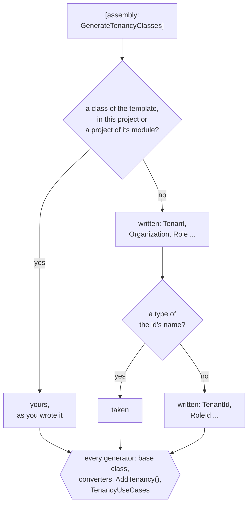
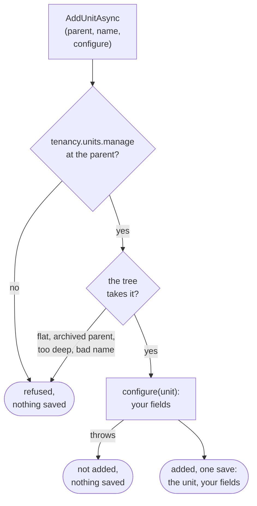

# Tenancy: your module

The options, variants and edge cases of the module that holds Tenancy, the toolkit's first
[supporting domain](../writing-a-supporting-domain.md): its packages, classes, ids, context and registration, and how
your code names the use cases. The basic path is the [tutorial](tutorial.md); the words are in the
[overview](overview.md).

## The packages

| Package | What it holds | Where it goes |
|---|---|---|
| `DDDToolkit.Supporting.Tenancy` | The model, its rules, its use cases and their generators. No database. | The domain project, which declares your classes; a contracts project with `[assembly: GenerateTenancyIds]` |
| `DDDToolkit.Supporting.Tenancy.EntityFramework` | `AddTenancy()` for your context, the organization tree as a closure table, the access questions as Entity Framework queries. Every provider. | The infrastructure project, which has the context |
| `DDDToolkit.Supporting.Tenancy.Postgres` | The same questions as SQL functions and row level security (RLS) policies, through the [export](../supabase.md). Brings the package above. | The infrastructure project, on Postgres |

They are published as `Temp.DDDToolkit.Supporting.Tenancy*`, like [every 3.x package](../migrating-to-3.md#the-package-ids),
at the version of every other `Temp.DDDToolkit.*` package, and as prereleases for now (`--prerelease`): names can
change until a release.

## The model

| | Holds | Rules the package keeps |
|---|---|---|
| **Tenant** | Its slug, status and shape | Status moves one way; closed is final. Shape goes only from flat to hierarchical. |
| **Organization** | The tree of **OrganizationUnits** | One root, no cycles, depth at most 32. A unit is archived, never deleted. |
| **Seat** | A person in a tenant: **Placements** at units, **RoleGrants** at each | One placement per unit, one primary. Only active roles are granted. The seat's person never changes. |
| **Role** | A name and its **Permissions** | Only catalogue permissions, with the permissions they imply expanded. |
| **Catalogue** | The permissions and the **RolePacks** (starter roles) | One administrators' pack per shape, Tenancy's own when you declare none. A permission is retired, never deleted. Permissions that manage access are marked. |

- Tenant, Organization, Seat and Role are aggregates, referring to each other by id.
- The catalogue is data, not a class: Tenancy's permissions, your modules', and what your application adds, which
  may be nothing ([What the catalogue is for](roles-and-permissions.md#what-the-catalogue-is-for)).

Rules that span aggregates live in the use cases, guarded against concurrent changes
([Who may give a role](roles-and-permissions.md#who-may-give-a-role)):

- The last administrator of a tenant cannot be removed.
- A role that manages access is given or taken away only by a seat that holds its access-managing permissions there,
  for at least as long, and never by a seat to itself. The same holds for suspending, deactivating or reactivating a
  seat that holds one, and for moving a unit away from it or under it.
- Any other role: whoever holds `tenancy.grants.manage` at the unit it is given at.

## Adopting it, step by step

What a module needs, in order:

| What | Basic path | Options and variants |
|---|---|---|
| The packages | [Step 1](tutorial.md#step-1-the-modules-projects-and-their-packages) | [The packages](#the-packages) |
| Your classes and ids | [Step 2](tutorial.md#step-2-your-classes) | [The switch](#the-shortest-start-the-switch), [your own classes](#your-own-classes), [new ids](#how-a-new-id-is-made) |
| A context of the module, a migration of your own | [Step 3](tutorial.md#step-3-where-it-is-stored) | [The context and the registration](#the-context-and-the-registration) |
| The registration; a catalogue only when you need one | [Step 4](tutorial.md#step-4-the-modules-registration) | [The registration](#the-context-and-the-registration), [the catalogue](roles-and-permissions.md#a-module-states-its-permissions-once) |
| Who is calling, per request: `ITenantSelection` | [Step 5](tutorial.md#step-5-the-host) | [How the tenant reaches a policy](postgres.md#how-the-tenant-reaches-a-policy) |
| A tenant, provisioned as system work | [Step 6](tutorial.md#step-6-provisioning-a-tenant) | [System work](keeping-tenants-apart.md#system-work) |
| Your own tables kept to a tenant: `ScopeToTenant` | | [Keeping tenants apart](keeping-tenants-apart.md) |
| Asking in your modules | [Steps 7-8](tutorial.md#step-7-who-am-i) | [Who may do what](who-may-do-what.md), [names](names-and-languages.md#names) |
| People managing access, through requests of your own | [Step 9](tutorial.md#step-9-a-role-at-a-unit) | [Who may give a role](roles-and-permissions.md#who-may-give-a-role) |
| What else you need | | [Invitations](invitations.md), [languages](names-and-languages.md#languages), [operators](operators-and-history.md#operators), [who changed a row](operators-and-history.md#who-changed-a-row), [access history](operators-and-history.md#access-history), [packs you change later](roles-and-permissions.md#packs-after-provisioning) |
| On Postgres, RLS under all of it | Steps 1-5 | [Setting it up](postgres.md#setting-it-up) |

The [sample](the-sample.md#who-may-do-what-in-the-sample) is an application built this way.

## The shortest start: the switch

One line in the project your classes belong to:

```csharp
[assembly: GenerateTenancyClasses]
```

It writes each of Tenancy's classes the project leaves out, as the package ships it:

- `Tenant`, `Organization`, `OrganizationUnit`, `Role` and `Seat`, each declared with its template.
- `TenantId`, `OrganizationUnitId`, `RoleId` and `SeatId`: `[EntityId<Guid>]` without a prefix, published with
  `[ModuleContract]`. An organization shares its tenant's id: there is no `OrganizationId`.
- Public, in the project's root namespace; each one's documentation says how to declare it yourself.
- Not the invitation: declaring that class is what turns [invitations](invitations.md) on.
- Each is the package's whole class: the role's `PermissionsFromPack` is a column your migration maps like any other
  ([Packs after provisioning](roles-and-permissions.md#packs-after-provisioning)).

How it decides, per class and per id, what to write; nothing you declare is replaced:



- "A project of its module" is one of the same module that this project references.
- A written class takes the id of a declared class it shares one with: an organization written beside your
  `ShopTenant` over `ShopTenantId` is declared over `ShopTenantId`.
- Every generator writes for written classes what it writes for declared ones, a [Membership](../membership.md)
  member list over a written `SeatId` included. Projects above see them as they see yours.

<details>
<summary>Show the code: what the switch writes for a class and for an id</summary>

```csharp title="Role.TemplateDefault.g.cs, the comment shortened"
namespace Shop.Tenants;

/// <summary>
/// The application's <c>Role</c>, declared <c>[RoleAggregate&lt;RoleId&gt;]</c> and nothing more: the package's class as it
/// ships. Written by the generator, because this project says <c>[assembly: GenerateTenancyClasses]</c> and
/// neither it nor a project it references declares a class with <c>[RoleAggregate]</c>.
/// </summary>
[global::DDDToolkit.Supporting.Tenancy.RoleAggregateAttribute<global::Shop.Tenants.RoleId>]
public sealed partial class Role
{
}
```

```csharp title="RoleId.TemplateDefault.g.cs, the comment shortened"
namespace Shop.Tenants;

/// <summary>
/// The id of the class declared with <c>[RoleAggregate]</c>: written by the generator, because this
/// project says <c>[assembly: GenerateTenancyClasses]</c> and neither it nor a project it references declares <c>RoleId</c>.
/// </summary>
[global::DDDToolkit.Abstractions.Attributes.ModuleContract]
[global::DDDToolkit.Abstractions.Attributes.EntityId<global::System.Guid>]
public readonly partial record struct RoleId;
```

The base class, the constructor, the rules and the id's members come from the generators that write them for a
declared class and id, in files of their own.

</details>

**A name the switch cannot use** is [DDD00066](../diagnostics.md#ddd00066), once, at the switch, and that class is
not written:

- a type of its name in the root namespace (yours or a referenced project's), or a namespace of that name (a folder
  `Organization/` directly under the project);
- for its id: a type of that name that is no entity id (mark it `[EntityId<T>]`), an id the generator writes for an
  `[AggregateRoot<Guid>]` or `[Entity<Guid>]` class of yours, or two ids of one name.
- A class that needs the one left out (a seat needs its role) is left out too, with no id for either; `AddTenancy()`
  and `TenancyUseCases` stand back rather than report it again.
- A class of yours in the way that should be the package's becomes it with the template:
  `[RoleAggregate<RoleId>] public sealed partial class Role`.

**Seen only from the next project up:**

- Other generators of the switch's own project do not see the written classes: an `[ObjectType<Role>]` over a written
  `Role` does not compile there, nor does a row access rule that names one. Put those in a project above, or declare
  that class or id yourself, one line. A written id as the key of a
  [resource access contract](../row-level-security.md#a-resources-access-asked-by-its-id) works in the same project.
- Code outside the root namespace imports the written types with `global using Shop.Tenants;`: a file's using does
  not reach the files the generators write for your classes.

**In a module split by layer**, the ids go in the contracts project, which other modules reference:
`[assembly: GenerateTenancyIds]` there, `[assembly: GenerateTenancyClasses]` in the domain project, which takes those
ids. `GenerateTenancyIds` needs the contracts project to reference the Tenancy package; one that should not, as the
sample's and the tutorial's, declares the four ids itself, one line each.

## Your own classes

Declare a class where it needs fields, rules or behaviour; the switch writes the rest. One seat of your own beside the
switch is [tutorial step 2](tutorial.md#step-2-your-classes).

Without the switch you declare all five classes and four ids, with the names, key types and prefixes you choose. An
id over anything but a `Guid` says how a new one is made ([How a new id is made](#how-a-new-id-is-made)):

```csharp
// Shop.Tenants.Contracts
[EntityId<long>]
public readonly partial record struct TenantId
{
    public static TenantId Create() => new(Snowflakes.Next());   // yours: a snowflake, or a number of a HiLo block
}

[EntityId<Guid>] public readonly partial record struct SeatId;
[EntityId<Guid>] public readonly partial record struct OrganizationUnitId;
[EntityId<Guid>] public readonly partial record struct RoleId;

// Shop.Tenants
[TenantAggregate<TenantId>]
public sealed partial class ShopTenant
{
    public bool IsDemo { get; private set; }
}

[OrganizationAggregate<TenantId>] public sealed partial class ShopOrganization;
[OrganizationUnit<OrganizationUnitId>] public sealed partial class ShopUnit;
[SeatAggregate<SeatId>] public sealed partial class ShopSeat;
[RoleAggregate<RoleId>] public sealed partial class ShopRole;
```

The package's rules run for your classes before your own. Your classes, written or declared, are what Entity
Framework maps ([Writing your own supporting domain](../writing-a-supporting-domain.md)).

## How a new id is made

Tenancy makes the id of every tenant, unit, seat, role and invitation it creates in code, before the save, by asking
the id: `TSeatId.Create()`. So the change and its events know the id from the start; the database never makes one. A
use case given an id (an import, seed data) uses that one.

| The id | Its `Create()` |
|---|---|
| `[EntityId<Guid>]`, the switch's included | Written by the generator: time-ordered, as `CreateSequential()` makes, which a database index keeps in order. One of your own wins. |
| `[EntityId<long>]`, `<int>`, `<string>` | None: you declare it. For a `long`, a snowflake or a number of a HiLo block; for an `int`, which a 64-bit snowflake does not fit, the HiLo number. |
| Written by hand, without `[EntityId<T>]` | Nothing from the generator: declare `Create()` and implement `ICreatableEntityId<TenantId>` yourself. |

- A class declared over an id without one is [DDD00067](../diagnostics.md#ddd00067) at build. Its code fix adds a
  `Create()` that throws until you write its body.
- Nothing is set in the registration: Entity Framework stores the id as a value the application gives
  ([Ids the database never makes](../entity-framework.md#ids-the-database-never-makes)).

## The context and the registration

The context is a plain `DbContext` of your module that calls `modelBuilder.AddTenancy(database: Database)`
([tutorial step 3](tutorial.md#step-3-where-it-is-stored)); the registration is `services.AddTenancy<TContext>()`
([step 4](tutorial.md#step-4-the-modules-registration)). What the tutorial leaves out:

**The context**

- `Add{Module}Converters()` is named after your module: `AddTenantsConverters()` for a module Tenants
  ([`Add{Module}Converters`](../entity-framework.md#adddddtoolkitconventions-and-addmoduleconverters)).
- **Migrations** are yours, made from your model in the context's project. Their history is in the context's schema;
  a design-time factory keeps it there with `UseDDDToolkitDesignTime()` after its provider
  ([The migration history](../entity-framework.md#the-migration-history)). On Supabase, `[SupabaseMigrations]` writes
  the factory ([Exporting as part of the build](../supabase.md#exporting-as-part-of-the-build)).
- **Two rules the database holds too**, when `AddTenancy` is given `database`: one root per organization, one primary
  placement per seat. Each is a filtered unique index on Postgres, SQLite and SQL Server; another provider, or no
  `database`, gets neither. They refuse a write past the aggregates, such as your own SQL. With
  [the second lock](postgres.md) the root index is required ([The index on a tenant's root](postgres.md#the-index-on-a-tenants-root)).
- **Names**: tables `Tenants`, `Seats`, `SeatRoleGrants` and so on, and the two indexes after their tables, unless
  you pass a `TenancyTableNames`. The rest follows your context's naming
  ([Your own naming](postgres.md#your-own-naming) keeps a database in snake_case).

**The registration**

| Option, in `AddTenancy<TContext>(options => ...)` | Default | Set it when |
|---|---|---|
| `Catalogue` | None: Tenancy's and your modules' permissions, and the default administrators' role | You declare starter roles, permissions no module owns, or marks ([What the catalogue is for](roles-and-permissions.md#what-the-catalogue-is-for)) |
| `TenantSelection.SeatedTokenRoles` | `authenticated` | Your tokens give people who hold seats another role |
| `OperatorTokenRoles` | Empty | You have [operators](operators-and-history.md#operators) |

All options: [`TenancyOptions`](reference/use-cases.md#tenancyoptionsttenantid-tseatid-tunitid-troleid).

- `services.AddTenancy<TContext>()` and `modelBuilder.AddTenancy()` are generated, closed over your classes and ids
  ([A registration closed over your classes](../writing-a-supporting-domain.md#a-registration-closed-over-your-classes)).
- Both are internal to the project that declares your classes, or to a project of the same module that declares none,
  such as the infrastructure project ([In a module split by layer](../writing-a-supporting-domain.md#in-a-module-split-by-layer)).
  The module comes from `DDD_Module` ([A module named by its folder](../modules.md#a-module-named-by-its-folder)).
- `AddTenancy` brings Tenancy's save check to every context `UseDDDToolkit` wires
  ([Keeping tenants apart](keeping-tenants-apart.md)).

## Calling a use case

Tenancy's use cases and their records are nested in one generic class,
[`TenancyUseCases<TTenant, TTenantId, TOrganization, TUnit, TUnitId, TSeat, TSeatId, TRole, TRoleId>`](reference/use-cases.md#tenancyusecasesttenant-ttenantid-torganization-tunit-tunitid-tseat-tseatid-trole-troleid).
The generator closes it over your classes in the project that declares them, as `TenancyUseCases` without type
parameters, in the global namespace, whatever your module is called. Every project that references that one names
everything through it:

- **Services**, registered by `AddTenancy`, taken in a constructor: `TenancyUseCases.TenantCommands`,
  `.OrganizationCommands`, `.SeatCommands`, `.RoleCommands`, `.TenancyDirectory`.
- **Records**: `TenancyUseCases.TenantToProvision`, `TenancyUseCases.SeatOverview` and the rest.
- **Invitations**, with your invitation class and id: `TenancyUseCases.InvitationCommands<ShopInvitation, InvitationId>`.
- **Static members**: `TenancyUseCases.BeginSystem()` and the rest ([Your ids, named once](#your-ids-named-once)).

The first call most applications write provisions a tenant: [tutorial step 6](tutorial.md#step-6-provisioning-a-tenant).

C# finds a nested type through a derived class, so `TenancyUseCases.SeatCommands` is the package's own `SeatCommands`,
the type `AddTenancy` registered. It is a class rather than a `global using` alias because an alias holds in its own
project only, while a class reaches every project above and their generators read it.

**Naming it yourself**: one line in the project that declares the classes, beside `[assembly: Module]` or the switch.
Every project above uses that name.

```csharp
using DDDToolkit.Abstractions.Attributes;

[assembly: TemplateFacadeName("TenancyUseCases", "ShopTenancy")]
```

- Needed when two modules declare Tenancy's classes ([below](#two-modules-with-the-classes)); otherwise a matter of
  taste. A **template facade** is the toolkit's word for this class: one a package asks for with
  `[assembly: TemplateFacade]`.
- The name must be one no namespace or type of yours in the global namespace has: `Shop`, the root of `Shop.*`
  namespaces, is taken. A line that changes nothing is [DDD00076](../diagnostics.md#ddd00076).

**When it is not written, or stands back**

| Situation | What happens |
|---|---|
| A template with no class or several, or a class that does not meet what the use cases ask | No class, and [DDD00065](../diagnostics.md#ddd00065), as information on the first class: projects above would only see CS0246. Classes split over two projects of one module get it where they are complete. |
| A type, namespace or alias named `TenancyUseCases` of yours in the global namespace | No class; yours stays. |
| A project above with an alias of that name | CS0576: take the alias out. |
| HotChocolate's generator in the declaring project | It does not see the class, one generator's output, and its code does not compile. A module of one project with GraphQL types over Tenancy's records keeps `global using TenancyUseCases = DDDToolkit.Supporting.Tenancy.UseCases.TenancyUseCases<...>;` there, which every generator reads; the class stands back for it. |

### Two modules with the classes

An application with two modules that declare Tenancy's classes (customers' tenants and partners') gets a
`TenancyUseCases` in each module's domain project.

- They meet in every project that references both, the host and your tests, where naming `TenancyUseCases` would be
  CS0433. Such a project is told first, [DDD00075](../diagnostics.md#ddd00075), with the line that gives one of them
  its own name, for the project where that module declares its classes.
- A module whose domain project references the other's is told on its first Tenancy class: C# binds the name there
  to its own class (CS0436), and no project above can name either (CS0433).

**`Shop.Customers.Domain/Module.cs`**

```csharp
using DDDToolkit.Abstractions.Attributes;
using DDDToolkit.Supporting.Tenancy;

[assembly: Module("Customers")]
[assembly: GenerateTenancyClasses]
[assembly: TemplateFacadeName("TenancyUseCases", "CustomersTenancy")]
```

**`Shop.Host/Provisioning.cs`**

```csharp
public sealed class Provisioning(CustomersTenancy.TenantCommands customers, TenancyUseCases.TenantCommands partners)
{
    // Customers' tenants through the name given, partners' through the package's.
}
```

The rest of these pages write `TenancyUseCases.`, as the sample does.

## Your ids, named once

Tenancy's calls that are generic over your ids come closed over them too, each kind as far as it can reach, so you
write your ids only where you declare them:

| What | Generic over your ids | Closed over them | Where the closed form is |
|---|---|---|---|
| System work | `TenancyWork.BeginSystem<TenantId, SeatId>()` and the rest | `TenancyUseCases.BeginSystem()`, `BeginSystemIn(tenant)`, `BeginOperator`, `BeginOperatorIn`, `BeginTokenIn` | Every project that sees your classes: their module, the host, your tests |
| The current caller | `TenancyCallers.Current<TenantId, SeatId>()` | `TenancyUseCases.CurrentCaller()` | The same |
| Registrations | `outbox.AddTenancyDomainEvents<TenantId, SeatId, OrganizationUnitId, RoleId>()` and the rest | `outbox.AddTenancyDomainEvents()`, `log.AddTenancyEventLog()`, `modelBuilder.AddTenancyReadModel()` and the rest, beside `AddTenancy` | Internal to the project that declares your classes, or a project of their module that registers Tenancy; a test project that registers Tenancy itself writes the ids |
| Tenant selection, for a host's middleware | `TenantSelection<TenantId, SeatId>` | `ITenantSelection`, which answers the caller without its ids | Every project |

- **`ITenantSelection`** is the closed selection itself, per scope, unless your host registered one before. It
  answers an `ITenancyCaller`, which `TenancyCallers.Begin` takes, so a host's middleware
  ([tutorial step 5](tutorial.md#step-5-the-host)) reads the same in every application.
- **Another module sees only your ids** (Billing, Projects), and the toolkit never takes an id for the tenant's by
  its name. It writes them out where they are no arguments (`AddTenancyAccess`, `AddTenancyReadFunctions`), and C#
  infers them where they are: `TenancyWork.BeginSystemIn(tenant, seat, "billing")`.
- **Types keep their ids**: `ITenancyAnswers<...>`, `ITenancyQuestions<...>` and records such as
  `SeatOfCaller<TenantId, SeatId>`, so a module that sees only the ids can take them. Name one once per project with
  a `global using` alias.
- **Three more name them, in the declaring project too**: `TenantSelection<TenantId, SeatId>.SeatsOfAsync` (a
  person's seats for a tenant picker), `EfTenancyReadSource<TenantId, SeatId, OrganizationUnitId, RoleId>` (Tenancy's
  rows for a reading of your own), and `TenancySystemReads.TenantsToSweepAsync<ShopTenant, TenantId>(...)`
  ([Reads before any tenant is known](keeping-tenants-apart.md#reads-before-any-tenant-is-known)).

<details>
<summary>Show the code: the same calls where your classes are seen, and in another module</summary>

```csharp
// The module that declares the classes, in its infrastructure project: closed over the four ids
options.UseOutbox<ShopTenancyContext>(outbox => outbox
    .AddTenancyDomainEvents()
    .AddTenancyInvitationEvents<InvitationId>()       // the invitation's id: an application may have none
    .KeepEventLog(log => log.AddTenancyEventLog()));

// Any project that sees TenancyUseCases: the host, a test
using (TenancyUseCases.BeginSystemIn(tenant, administrator))
{
    await seeder.SeedAsync(cancellationToken);
}

var caller = TenancyUseCases.CurrentCaller();          // nobody outside any scope

// Another module: written out where they are no arguments, inferred where they are
services.AddTenancyAccess<TenantId, SeatId, OrganizationUnitId, RoleId, IBillingRequest, BillingContext>();
modelBuilder.AddTenancyReadFunctions<TenantId, SeatId, OrganizationUnitId, RoleId>("tenancy");

using (TenancyWork.BeginSystemIn(tenant, seat, "billing"))
{
    await invoices.SaveOnlyAsync(invoice, cancellationToken);
}

global using ShopAnswers = DDDToolkit.Supporting.Tenancy.Access.ITenancyAnswers<
    Shop.Contracts.TenantId, Shop.Contracts.SeatId, Shop.Contracts.OrganizationUnitId, Shop.Contracts.RoleId>;
```

</details>

## How your classes add behaviour

Your class is the package's class with your part added. There are no virtual members or hooks: a package rule always
runs, and yours only add to it. Four ways to add:

- **Members**: fields and methods, stored with the class. Placements and grants stay the package's, changed through
  its use cases only.
- **Entities** of your own, mapped with the class, as in any aggregate.
- **Rules**: a nested `IInvariant<T>` runs after the package's rules on every save, and refuses the save as theirs do.
- **The package's domain events**: every change raises one (`tenancy.seat-suspended` and the rest), each saying
  [who made the change](operators-and-history.md#access-history). Handle one in process with `AlsoDispatchInProcess`,
  or [publish](#publishing-an-event) it; an unmapped event is stored and reaches no other module.

The sample's unit adds a cost centre and a rule about its format.

**`OrganizationUnit.cs`**, in the domain project

```csharp
[OrganizationUnit<OrganizationUnitId>]
public sealed partial class OrganizationUnit
{
    public string? CostCentre { get; private set; }

    public void SetCostCentre(string? costCentre) => CostCentre = costCentre;

    // Runs after the package's rules about names, parents and archiving, never instead of them.
    public sealed partial class CostCentreFormat : IInvariant<OrganizationUnit>
    {
        public string Code => "tenants.unit.cost-centre";

        public InvariantFailure? Check(OrganizationUnit entity)
            => entity.CostCentre is null || Format().IsMatch(entity.CostCentre)
                ? null
                : "A cost centre is two capitals, a dash and three digits.";

        [GeneratedRegex(@"^[A-Z]{2}-\d{3}$")]
        private static partial Regex Format();
    }
}
```

### Setting your fields on what a use case makes

A field of yours starts at its default. Set it on a new tenant, its root and its first seat through three callbacks
of `TenantToProvision`:

```csharp
await tenants.ProvisionAsync(
    new TenancyUseCases.TenantToProvision(
        "harbor", "Harbor Works", TenantShape.Hierarchical, "Harbor Works", identity,
        ConfigureTenant: tenant => tenant.MarkAsDemo(),
        ConfigureRoot: root => root.SetCostCentre("HW-001"),
        ConfigureFirstSeat: seat =>
        {
            seat.Rename("Ada");
            seat.ChangeJobTitle("Harbor master");
        }),
    cancellationToken);
```

- They run in that order, each once its instance is made and before the tenant is activated: the root is in its
  organization, the seat is placed at the root and holds the administrators' role.
- What they set is written in the provisioning save; an event your class raises there leaves with the provisioning's.
  A callback that throws stops the provisioning with nothing saved.
- Later units: `AddUnitAsync`'s `configure` ([The kind of a unit](#the-kind-of-a-unit)). Later seats: `AddSeatAsync`'s
  and an invitation's `AcceptAsync`'s ([How a seat is shown](names-and-languages.md#how-a-seat-is-shown)).

### Publishing an event

An event another module should hear is mapped in your Tenancy context's outbox before `AddTenancyDomainEvents`,
which keeps the rest to itself; a mapping after it throws:

```csharp
services.AddDDDToolkitEntityFramework(options => options.UseOutbox<ShopTenancyContext>(outbox => outbox
    .PublishAs<SeatSuspended<TenantId, SeatId>, SeatSuspendedV1>(suspended => new SeatSuspendedV1(suspended.SeatId.Value))
    .AddTenancyDomainEvents()));
```

### The kind of a unit

Tenancy keeps no kind of unit: region, area or site decides nothing about access, so the package neither asks for a
kind nor checks one. Keep it as a field of your unit class, an enum say, set in the callback of the use case that
makes the unit.

What `AddUnitAsync` checks, in order, and where your callback runs, so you know what is saved when it throws:



- Your class's rules judge the field in that save. A unit whose callback threw is not added by a later save in the
  same scope either. The root's kind goes through `ConfigureRoot`.
- **Showing it**: [`ListUnitsAsync`](reference/use-cases.md#listunitsasynccancellationtoken) answers your own units,
  whole, each as a `UnitInTree` with its path and depth beside it, so a plain `Select` shows your field.
- **By id**: [`UnitsByIdAsync`](reference/use-cases.md#unitsbyidasyncireadonlycollectiontunitid-cancellationtoken)
  answers a `NamedUnit` of name, path and depth: what another module's answer needs, for a seat that may not read the
  rest of the unit.

<details>
<summary>Show the code: a unit's kind as the application's own enum</summary>

```csharp
public enum UnitKind { Company, Region, Area, Site }

[OrganizationUnit<OrganizationUnitId>]
public sealed partial class OrganizationUnit
{
    public UnitKind? Kind { get; private set; }

    public void SetKind(UnitKind? kind) => Kind = kind;
}

// The command's handler: the use case adds the unit, the callback sets the kind, one save writes both
public async ValueTask<OrganizationUnitId> Handle(AddOrganizationUnit command, CancellationToken cancellationToken)
    => await organization.AddUnitAsync(command.Parent, command.Name, cancellationToken, configure: unit => unit.SetKind(command.Kind));

// The query's handler: the directory decides which units the caller reads; a plain select shows the kind
var units = await directory.ListUnitsAsync(cancellationToken);
return [.. units.Select(found => new UnitListing(found.Unit.Id, found.Unit.Name, found.Unit.Kind, found.Path, found.Depth))];

// Stored by its name: one line in the context's ConfigureConventions
configurationBuilder.Properties<UnitKind>().HaveConversion<string>().HaveMaxLength(16);
```

</details>

The sample does all of it, storing the kind by a lower-case key with a converter of its own (`UnitKindKeyConverter`).
