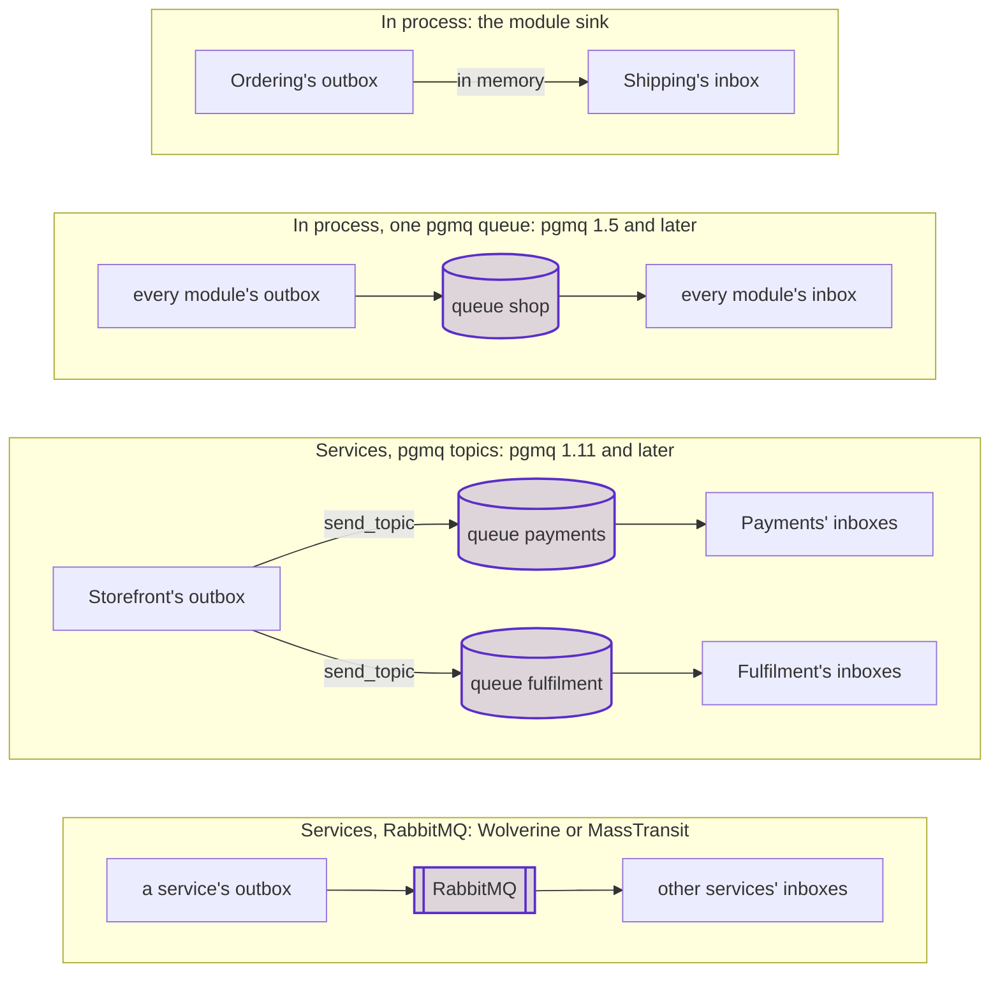

# Transports

A module in the same process as the modules that react to it needs no transport. The
[module sink](integration-events.md#delivering-to-a-module-in-the-same-process) passes each message to those
modules directly. When a module becomes a separate deployable, the module sink no longer reaches it. The outbox still
writes the message in the aggregate's transaction, and the receiving service's inbox still applies the message once.
A transport carries the message from one process to the other.

The toolkit has no client for RabbitMQ, Azure Service Bus, Kafka or SQS, and does not plan one.
[MassTransit](https://masstransit.io/) and [Wolverine](https://wolverinefx.net/) are mature at this job. The toolkit
passes its messages to them ([Wolverine](#through-a-broker-wolverine), [MassTransit](#through-a-broker-masstransit))
and keeps only the outbox and the inbox on each side. The toolkit does ship a sink for Postgres queues
([pgmq](#postgres-queues-pgmq)), because a pgmq queue is a table, and that changes the guarantees.

With every transport, both ends work as [Integration events](integration-events.md) describes:

- The sending module publishes the same contract through the same outbox, with a different sink.
- The receiving process registers its modules with `AddModuleIntegrationEvents`, as a monolith does.
- Each handler runs inside its module's inbox. A handler cannot tell which way a message came.

The diagram shows the four ways a message can travel, from no transport to a broker on the network. Purple: the
queue or broker that carries the message. The module sink needs none.



<details>
<summary>Show the code: choosing the way</summary>

Two things change between the ways: the sink on the outbox, and, for a queue or a broker, the reader on the
receiving side. The modules and their handlers do not change:

```csharp
// one process: the module sink
options.UseOutbox<OrderingContext>(outbox => outbox.SendToModules());

// one process, through one pgmq queue
builder.Services.AddPgmqSink(queues, pgmq => pgmq.UseQueue("shop"));
builder.Services.AddPgmqConsumer(queues, "shop");
options.UseOutbox<OrderingContext>(outbox => outbox.SendToPgmq());

// services over pgmq topics
builder.Services.AddPgmqSink(queues, pgmq => pgmq.UseTopics());
builder.Services.AddPgmqConsumer(queues, "fulfilment", consumer => consumer.BindTopics = true);
options.UseOutbox<OrderingContext>(outbox => outbox.SendToPgmq());

// services over RabbitMQ
options.UseOutbox<OrderingContext>(outbox => outbox.SendToWolverine());     // and wolverine.ReceiveIntegrationEvents(...)
options.UseOutbox<OrderingContext>(outbox => outbox.SendToMassTransit());   // and bus.AddIntegrationEventConsumers(...)
```

`queues` is an `NpgsqlDataSource` for the database that holds the queues. Each section below shows the full
registration for one way, and `Examples/` runs each of them.

</details>

## Postgres queues: pgmq

`DDDToolkit.Messaging.Postgres` sends published messages to a [pgmq](https://github.com/pgmq/pgmq) queue.

pgmq is a Postgres extension. Its queues are ordinary tables, and `pgmq.send` is an ordinary insert. A send is
therefore part of the transaction that it runs in. A broker cannot join a database transaction, which is why every
broker needs an outbox in front of it. On Postgres, the queue itself gives the outbox guarantee.

Supabase Queues is this extension with a UI. A Supabase project has the extension once Queues is turned on in the
dashboard, or once a migration runs `create extension if not exists pgmq;`. The sink does not depend on Supabase. It
talks to Postgres through Npgsql and SQL. To let the Supabase CLI apply your migrations, see
`DDDToolkit.EntityFramework.Supabase` on [Supabase](supabase.md).

The pgmq version of a database decides which features you can use, and Supabase does not ship the newest version. A
Supabase project gets the pgmq that goes with its Postgres version: 1.5.1 on Postgres 17 at the time of writing.
This query shows the version that a database offers:

```sql
select default_version, installed_version from pg_available_extensions where name = 'pgmq';
```

| | pgmq | On Supabase's 1.5.1 |
|---|---|---|
| Named queues: `UseQueue`, `UseQueues`, the consumer, headers | 1.5.1 and later | Yes |
| [Topics](#publish-and-subscribe-topics): `UseTopics`, `BindTopics` | 1.11 and later | No |

Both columns are tested. The example shop runs over named queues on a real Supabase project in the Supabase Live
workflow, and over topics on pgmq 1.13 in `Examples/Microservices.Pgmq`. The sink and the consumer read the
installed version when the application starts, and refuse topics on a pgmq without topic support. See
[Queues, creation and the extension check](#queues-creation-and-the-extension-check).

```bash
dotnet add package Temp.DDDToolkit.Messaging.Postgres --prerelease
```

```csharp
builder.Services.AddPgmqSink<OrderingContext>(pgmq => pgmq.UseQueue("ordering_events"));

builder.Services.AddDDDToolkitEntityFramework(options =>
{
    options.UseOutbox(outbox =>
    {
        outbox.AddOrderingIntegrationEvents();
        outbox.SendToPgmq<OrderingContext>();
        outbox.DeliverInTransaction = true;
    });
});
```

`PgmqSink<TContext>` sends on the context's connection, and joins the context's current transaction if there is
one. `DeliverInTransaction` uses this. With `DeliverInTransaction` on, the outbox processor wraps the delivery of one
message and its "processed" mark in a single transaction. Either the message is on the queue and the row is marked,
or neither happened. The handoff from the outbox to the queue is exactly-once.

Turn `DeliverInTransaction` on for a sink that writes to the same database, and leave it off for other sinks. A send
to a broker or an HTTP endpoint cannot be rolled back, so a wider transaction around the send gains nothing.
`DeliverInTransaction` also changes what `SendToModules` guarantees. The inbox joins the caller's transaction, so
with one transaction around the whole message, a failing consumer rolls back the consumers that already succeeded.
Do not combine `DeliverInTransaction` and `SendToModules` on one outbox.

### Sending in the aggregate's transaction

`pgmq.send` is an insert, so you can skip the outbox and send in the aggregate's transaction:

```csharp
await using var transaction = await context.Database.BeginTransactionAsync();

context.Orders.Add(order);
await context.SaveChangesAsync();

await PgmqQueue.SendAsync(
    (NpgsqlConnection)context.Database.GetDbConnection(),
    (NpgsqlTransaction?)context.Database.CurrentTransaction?.GetDbTransaction(),
    "ordering_events",
    JsonSerializer.Serialize(new OrderPlacedV2(order.Id.Value, order.Total.Amount)));

await transaction.CommitAsync();
```

The order and the message commit together.

The outbox is still the better default:

- It keeps the queue name and the payload shape out of the code that writes the aggregate.
- It retries.
- It lets you add a second sink without changes to the aggregate's code.
- It keeps working when the queue is unreachable for a short time.

Use the direct call only when you have a specific reason for it.

### Reading the queue

The receiving process registers its modules as a monolith does, with `AddModuleIntegrationEvents`, and adds a
`PgmqConsumer` for its queue:

```csharp
builder.Services.AddShippingModule(...);   // AddModuleIntegrationEvents<ShippingContext>(m => m.AddShippingIntegrationEvents())
builder.Services.AddPgmqConsumer(dataSource, "fulfilment", consumer => consumer.BindTopics = true);
```

The consumer reads the queue and rebuilds each envelope from its headers (`IntegrationEventHeaders.ToMessage`). It
passes the envelope to `IntegrationEventReceiver`. The receiver offers the envelope to every module in the process,
as the module sink does, and each handler runs inside its module's inbox. `BookShipment` is therefore the same class
whether the message came from Ordering in the same process or through a queue. A message delivered twice is applied
once.

pgmq delivers at least once, like every transport:

- A read hides a message for `VisibilityTimeout` (30 seconds) and does not remove it. Set the timeout longer than
  the slowest handler.
- The consumer archives a message only after every module applied it.
- When a handler throws, the consumer leaves the message on the queue. The message becomes visible again after
  `VisibilityTimeout`, so a retry is a wait.
- After `MaxDeliveries` reads (10), the consumer archives the message as poison and logs an error. One bad message
  therefore cannot block the queue. The message stays in the archive table, where you can read it and replay it by
  hand.
- A message without the toolkit's headers has no id to deduplicate on. The consumer archives it without delivering
  it.

The consumer reads with a long poll. One read takes up to `BatchSize` messages (10). When the queue is empty, a read
waits inside Postgres, with `pgmq.read_with_poll`, for up to `LongPollTimeout` (5 seconds, in whole seconds, rounded
up). The read returns as soon as a message is committed. While the read waits, Postgres checks the queue every
`LongPollInterval` (100 milliseconds), without a round trip. The consumer therefore picks up a message within about
a tenth of a second of its commit. A quiet queue costs one round trip every 5 seconds, instead of one per second.
`read_with_poll` exists in pgmq 1.5.1, so long polling works on Supabase too.

A long poll costs a connection. The read holds one connection from the consumer's data source while it waits, and
on a quiet queue it waits almost all the time. So every consumer in the process keeps one connection busy. Long
polling is still the default, because a consumer's job is to wait for messages, and one connection per consumer is a
small cost for immediate delivery. Count one connection per consumer when you size the pool. Keep `LongPollTimeout`
below the `statement_timeout` of the role that the consumer connects as. Otherwise Postgres cancels the read, and
the consumer logs the cancelled read as a failure.

```csharp
consumer.LongPollTimeout = TimeSpan.FromSeconds(20);           // wait longer in each read
consumer.LongPollInterval = TimeSpan.FromMilliseconds(250);    // look at the queue less often while waiting
consumer.LongPollTimeout = TimeSpan.Zero;                      // no long poll: read, then wait PollingInterval
```

With long polling off, the consumer reads with `pgmq.read` and waits `PollingInterval` (1 second) after an empty
read. After a failed read, the consumer waits `PollingInterval` in both modes. `ConsumeOnceAsync` never waits,
whatever the options. It reads one batch, delivers it and returns the number of messages. A test that polls by hand
uses it.

`PgmqQueue.ReadAsync`, `ReadWithPollAsync` and `ArchiveAsync` cover what the consumer does not do.
`PgmqMessage.MessageId` is pgmq's own counter, and differs from the integration message id. Idempotency uses the
`messageId` header, which holds the domain event's `EventId`. The
[inbox](integration-events.md#using-the-inbox-directly) stores the same id.

### Publish and subscribe: topics

In a pgmq queue, a message that one consumer reads is gone for the other consumers. Since version 1.11, pgmq also
routes by topic, as a RabbitMQ topic exchange does. A queue is bound to routing-key patterns (`pgmq.bind_topic`).
`pgmq.send_topic` puts a message on every queue that is bound to a pattern that the message's key matches. This is
pgmq's publish and subscribe, and the way to use pgmq between services:

```csharp
// every service: send by topic, the contract's published name as the routing key
builder.Services.AddPgmqSink(dataSource, pgmq => pgmq.UseTopics());

// every service: its own queue, bound to what it has to be sent
builder.Services.AddPgmqConsumer(dataSource, "fulfilment", consumer => consumer.BindTopics = true);
```

- The sender names no queue.
- At start-up, each consumer binds its queue to every contract that its modules handle and another service publishes
  (`IntegrationEventSubscriptions.FromElsewhere`).
- The consumer removes the bindings of the names that it no longer handles. A wildcard pattern that someone bound by
  hand stays.
- The sends use one connection and one transaction, so a message reaches all of its queues or none.
- A message that no queue is bound to reaches no queue, as with a broker's exchange. A consumer that has never
  started has not bound its queue yet.

`Examples/Microservices.Pgmq` routes the whole shop this way.

Without topic routing, on a pgmq older than 1.11, `pgmq.UseQueues(message => ...)` sends to named queues. The
sender then has to know its receivers.

That is the setup on Supabase today. When the receivers are the modules of one process, the simplest setup is one
queue for every message. The host reads the queue back into the modules, and the modules' inboxes decide what each
module handles. `Examples/ModularMonolith.Supabase` does this when it runs with `Messaging=pgmq`:

**[`ModularMonolith.Supabase/Examples.Webshop.Host/Program.cs`](../Examples/ModularMonolith.Supabase/Examples.Webshop.Host/Program.cs)**

```csharp
// every module's outbox sends to the one queue, and this host reads it back into the modules
services.AddPgmqSink(queues, pgmq => pgmq.UseQueue("shop"));
services.AddPgmqConsumer(queues, "shop");

var host = new ModuleHost(database, outbox => outbox.SendToPgmq());
```

No module sink is involved, so a message reaches a module only through the queue. This setup is the step before a
module moves to its own deployable. The module's messages already travel through the database instead of a method
call. When the module moves, it runs somewhere else and receives its messages in the same way.

### What the sink sends

The body is the envelope's `Payload`, stored as `jsonb`. The envelope's routing fields go into pgmq's `headers`
column. A consumer can filter on the headers without parsing the body, and a person who reads the table can see what
each row is:

```json
{
  "messageId": "0199...", "name": "ordering.order-placed", "version": "2",
  "contentType": "application/json", "occurredAt": "2026-09-13T12:00:00.0000000+00:00",
  "aggregateType": "Order", "aggregateId": "ORD_0199..."
}
```

Turn the headers off with `pgmq.SendHeaders = false`.

### Queues, creation and the extension check

By default the sink sends every message to one queue, `integration_events`, and creates the queue on first use.
`pgmq.create` is idempotent. The sink runs the create on a separate connection, outside your transaction, because
creating a table is DDL, and Postgres rolls DDL back like any other statement. A queue is deployment state. A
business transaction that rolls back must not remove it.

```csharp
pgmq.UseQueue("ordering_events");                                   // one queue, named
pgmq.UseQueue(message => message.Name.Replace('.', '_'));           // one queue per event name
pgmq.CreateQueueIfMissing = false;                                  // queues come from a migration
```

pgmq builds table names from the queue name. Keep queue names short and lower case, with only letters, digits and
underscores. Rewrite a published name such as `ordering.order-placed` before you use it as a queue name. Turn
creation off when the application's database user may not create tables. The sink then fails on a missing queue
with a clear error.

If the extension is not installed, you get a `PgmqNotInstalledException` that names the database and says what to
run. Without this check, you would get `schema "pgmq" does not exist` from deep in the driver:

```sql
CREATE EXTENSION IF NOT EXISTS pgmq;
```

The extension must be on the server first. The image `ghcr.io/pgmq/pg17-pgmq` ships it, and managed Postgres that
offers queues usually has it.

The failure comes when the application starts, before the first message. `AddPgmqSink` and `AddPgmqConsumer`
register a [start-up check](startup-checks.md), `pgmq.extension-installed`. The host runs it with its other checks
by calling `RunStartupChecks()`, before any hosted service starts, the consumers and the outbox processor included:

```csharp
builder.Services.AddPgmqSink(dataSource, pgmq => pgmq.UseTopics());
builder.Services.AddPgmqConsumer(dataSource, "fulfilment", consumer => consumer.BindTopics = true);

builder.Services.RunStartupChecks();
```

The check reads the installed version once per database, however many sinks and consumers use that database:

```sql
select extversion from pg_extension where extname = 'pgmq';
```

When there is no row, the start fails with `PgmqNotInstalledException`. When the sink uses topics or a consumer
binds them, a pgmq older than 1.11 fails the start with `PgmqTopicsNotSupportedException`. The message names the
installed version and says what works instead:

```text
The pgmq extension in database 'postgres' is version 1.5.1, and topics (UseTopics on the sink, BindTopics
on the consumer) need pgmq 1.11 or later. Supabase ships pgmq 1.5.1 with Postgres 17 at the time of this
release, so a Supabase project cannot route by topic yet. Named queues work on every version: send with
UseQueue or UseQueues instead of UseTopics, and leave BindTopics off. ...
```

`PgmqQueue.InstalledVersionAsync` returns the same version for a check of your own.
`PgmqQueue.EnsureTopicRoutingAsync` throws the same two exceptions.

The check needs the database at application start:

- The check runs in `StartingAsync`. The host calls `StartingAsync` for every lifecycle service before any hosted
  service's `StartAsync`, in registration order, unless the host starts the services concurrently.
- A migration applied before `RunAsync` has finished by then.
- Code that installs the extension at start-up, such as a migration with `CREATE EXTENSION`, must run before
  `app.Run()`, or in the `StartingAsync` of an `IHostedLifecycleService` registered before `RunStartupChecks()`.
  `RunStartupChecks()` registers the checks at the point where you call it.
- A plain hosted service starts after the checks, whatever its registration order
  ([Before the server binds its port](startup-checks.md#before-the-server-binds-its-port)).

If none of these fits, turn the check off by its name, or exclude the database of one sink or consumer:

```csharp
builder.Services.SkipStartupCheck(
    PgmqQueue.ExtensionInstalledCheck, reason: "the host's own migration installs the extension");

// or, for the database of one registration
builder.Services.AddPgmqSink(dataSource, pgmq => pgmq.CheckExtensionOnStart = false);
builder.Services.AddPgmqConsumer(dataSource, "fulfilment", consumer => consumer.CheckExtensionOnStart = false);
```

### Settings from configuration

The sink and the consumer both accept a configuration section, before the lambda or in place of it. The settings
can then differ per environment without a rebuild:

```csharp
builder.Services.AddPgmqSink(dataSource, builder.Configuration.GetSection("Pgmq:Sink"));
builder.Services.AddPgmqConsumer(dataSource, "fulfilment", builder.Configuration.GetSection("Pgmq:Consumer"),
    consumer => consumer.BindTopics = true);
```

```json
{
  "Pgmq": {
    "Sink": { "Queue": "shop" },
    "Consumer": { "LongPollTimeout": "00:00:10", "MaxDeliveries": 5 }
  }
}
```

- Every property of `PgmqConsumerOptions` is a key with the same name.
- The sink reads these keys: `Queue` for one queue, `Queues` for a list of queues that every message goes to,
  `Topics` set to `true` to route by topic, and `CreateQueueIfMissing`, `SendHeaders` and `CheckExtensionOnStart`.
- Keys match in any case. Write a time span as `00:00:05`. A missing key keeps its default, so an environment
  variable such as `Pgmq__Consumer__LongPollTimeout` works as for any other setting.
- A queue chosen per message stays in code, with `UseQueue(message => ...)`.

The package reads the section itself, without the configuration binder. A mistake therefore fails when the services
are registered, and is not ignored. These mistakes fail:

- a key that the options do not have (`LongPolTimeout`),
- a value that does not parse,
- a sink section with more than one of `Queue`, `Queues` and `Topics`.

The message names the key.

The lambda runs after the section, so code wins. For the sink this includes the routing. The last call of
`UseTopics`, `UseQueues` or `UseQueue` decides, from the section or from code. `ReadFrom(section)` on either options
class does the same inside a lambda of your own.

### For a queue in another database

`PgmqSink` without a type argument opens its own connections from an `NpgsqlDataSource`:

```csharp
builder.Services.AddPgmqSink(NpgsqlDataSource.Create(connectionString), pgmq => pgmq.UseQueue("events"));

// and on the outbox:
outbox.SendToPgmq();
```

This path has no shared transaction, so delivery is at least once, as with every remote sink. Use it when the queue
is in another database.

## Through a broker: Wolverine

`DDDToolkit.Messaging.Wolverine` makes Wolverine the transport between the outbox of one process and the inbox of
another. Wolverine carries the message. The toolkit keeps the outbox, which writes the message in the aggregate's
transaction, and the inbox, which applies the message once. The integration does not use Wolverine's own outbox,
inbox and sagas, so the process has one outbox and one inbox.

Wolverine sends these messages like any other message. Each contract is a separate message type, and Wolverine's
routing decides where it goes. With RabbitMQ's conventional routing, every contract type gets a fanout exchange.
Every service that handles the type gets a queue bound to that exchange. What the contract does not contain travels
in headers, the same headers that the pgmq sink writes (`IntegrationEventHeaders`): the outbox's message id, the
published name and version, the time and the aggregate.

```csharp
builder.Services.AddFulfilmentModules(...);   // first: the modules say what this service handles

builder.UseWolverine(wolverine =>
{
    wolverine.UseRabbitMq(rabbitUri)
        .AutoProvision()
        .UseConventionalRouting(conventions => conventions
            .UseIntegrationEventNames()                                    // exchanges named ordering.order-placed.v1
            .QueueNameForListener(type => $"fulfilment.{type.Name}")      // a queue per service and contract
            .ConfigureListeners((listener, _) => listener.ProcessInline())
            .ConfigureSending((sender, _) => sender.SendInline()));

    // a handler per contract this service has to be sent; retries, then the error queue
    wolverine.ReceiveIntegrationEvents(builder.Services.IntegrationEventSubscriptions());
    wolverine.Policies.DisableConventionalLocalRouting();    // what this process publishes goes to the broker
});

// the outbox of each module
options.UseOutbox<OrderingContext>(outbox => outbox.SendToWolverine());
```

- `WolverineSink` publishes the contract through `IMessageBus`.
- `ReceiveIntegrationEvents` adds an `IntegrationEventHandler<TContract>` to Wolverine's discovery for every contract
  that the modules handle and this process does not publish itself. Wolverine therefore listens for those types
  only, and no code names a contract by hand.
- The handler passes the message to `IntegrationEventReceiver`, which delivers it to the process's modules, each
  handler inside its module's inbox.
- When a handler throws, Wolverine retries with a cooldown, by default after 250 milliseconds, 1 second and 5
  seconds. Pass other cooldowns to `ReceiveIntegrationEvents` to change them. After the last retry, Wolverine moves
  the message to its error queue, where you can read it and replay it. A retry cannot apply anything twice, because
  the inboxes already hold the rows of the handlers that succeeded.

Three things to get right:

- **Name the listener queues per service**, as above. Otherwise two services that handle one contract share a queue,
  and each service gets half the messages.
- **Listen inline** (`ProcessInline()`), so Wolverine acknowledges a message after the modules applied it. A buffered
  listener acknowledges first, and a crash in between loses the message.
- **Reference `WolverineFx.RuntimeCompilation`** in the process. Wolverine compiles its handler adapters at start-up,
  and since 6.x ships that compiler as a separate package.

`Examples/Microservices.Wolverine` runs the shop this way.

`UseIntegrationEventNames()` is optional, and the samples use it. Without it, Wolverine names a contract's exchange
after its CLR type. When you rename the contract class or move it to another namespace, its messages move to another
exchange, and a service that still uses the old name sends to an exchange that nobody reads. With
`UseIntegrationEventNames()`, the exchange is the contract's published name and version, `ordering.order-placed.v1`
([Stable names](domain-events.md#stable-names)). That name stays when the class is renamed, as long as the name is
pinned. Each version is a separate exchange, because each version is a separate type to Wolverine. Listeners bind
their queues to the same name, so all services that share the events must switch together. Other message types keep
Wolverine's names.

## Through a broker: MassTransit

`DDDToolkit.Messaging.MassTransit` works in the same way with MassTransit:

- Each contract is a separate message type, published and consumed like any MassTransit message.
- The same receiver delivers the message to the modules.
- The integration does not use MassTransit's own outbox and sagas.

The package is built on **MassTransit 8**, the last major version under the Apache 2.0 licence. Version 9 and later
are commercial. Whoever deploys the software decides whether to move to them.

```csharp
builder.Services.AddFulfilmentModules(...);   // first: the modules say what this service handles

builder.Services.AddMassTransit(bus =>
{
    // a consumer per contract the modules handle and another service publishes
    bus.AddIntegrationEventConsumers(builder.Services.IntegrationEventSubscriptions());

    bus.UsingRabbitMq((context, rabbit) =>
    {
        rabbit.Host(rabbitUri);
        rabbit.UseIntegrationEventNames();   // exchanges named ordering.order-placed.v1, before any endpoint

        // this service's queue; MassTransit binds it to the exchange of every contract its consumers take
        rabbit.ReceiveEndpoint("fulfilment", endpoint =>
        {
            endpoint.UseMessageRetry(retry => retry.Intervals(250, 1000, 5000));
            endpoint.ConfigureConsumers(context);
        });
    });
});

// the outbox of each module
options.UseOutbox<OrderingContext>(outbox => outbox.SendToMassTransit());
```

`MassTransitSink` publishes the contract through `IPublishEndpoint`. MassTransit sends it to the exchange of its
type, uses the outbox's message id as MassTransit's message id, and adds the toolkit's headers. MassTransit names
that exchange after the CLR type, `Shop.Ordering.Contracts:OrderPlacedV1`. `UseIntegrationEventNames()` replaces
MassTransit's entity name formatter with `IntegrationEventEntityNameFormatter`. The exchange is then the published
name and version, `ordering.order-placed.v1`, and stays the same when the class is renamed, for the same reasons as
with Wolverine. Consumers bind through the same formatter, so switch all services together. Message types that the
toolkit does not name, such as `Fault<T>`, keep MassTransit's names.

`IntegrationEventConsumer<TContract>` passes the message to `IntegrationEventReceiver`. MassTransit acknowledges the
message when the consumer returns. When a handler throws, MassTransit retries as the endpoint configures, and then
moves the message to the endpoint's error queue.

MassTransit has its own `AddMediator` on `IServiceCollection`. In a file that imports the `MassTransit` namespace,
the [Mediator](https://github.com/martinothamar/Mediator) source generator no longer reads the options of your
`AddMediator` call. The process then stops at start-up with a message that the code was generated for another
lifetime. Configure MassTransit in a separate file, as `Examples/Microservices.MassTransit` does in each service's
`RabbitMq.cs`.

## The GraphQL subscription sink

`DDDToolkit.HotChocolate` has one more sink, `GraphQlSubscriptionSink`, and it has a different purpose. The module
sink, pgmq and the brokers are integration. The message is durable and retried, and the receiver gets the message
even if the receiver was not running at the time. A GraphQL subscription stores nothing, and reaches only the
clients that hold a socket at that moment. Use it to keep a browser in step with the server. Do not use it to tell
other parts of the system that an order was placed. [GraphQL](graphql.md#pushing-integration-events-to-subscribers)
has the registration, the subscription field, the transports, and the reason that the sink publishes the contract
instead of the domain event.

## Writing a sink of your own

A sink has one method, which takes one message and a cancellation token. When the method returns, the transport
accepted the message. When the method throws, the transport did not accept it.

```csharp
public interface IIntegrationEventSink
{
    Task SendAsync(IntegrationEventMessage message, CancellationToken cancellationToken = default);
}
```

```csharp
using DDDToolkit.BaseTypes;
using DDDToolkit.Interfaces;

public sealed class WebhookSink(HttpClient client) : IIntegrationEventSink
{
    public async Task SendAsync(IntegrationEventMessage message, CancellationToken cancellationToken)
    {
        using var content = new StringContent(message.Payload, Encoding.UTF8, message.ContentType);
        content.Headers.Add("X-Message-Id", message.MessageId.ToString());
        content.Headers.Add("X-Message-Name", $"{message.Name}/v{message.Version}");

        var response = await client.PostAsync("/events", content, cancellationToken);
        response.EnsureSuccessStatusCode();
    }
}
```

A sink for a real broker has the same shape. The topic comes from `Name`, the deduplication id from `MessageId`, the
partition key from `AggregateId` and the body from `Payload`:

```csharp
public sealed class ServiceBusSink(ServiceBusSender sender) : IIntegrationEventSink
{
    public Task SendAsync(IntegrationEventMessage message, CancellationToken cancellationToken)
        => sender.SendMessageAsync(
            new ServiceBusMessage(message.Payload)
            {
                MessageId = message.MessageId.ToString(),
                Subject = message.Name,
                PartitionKey = message.AggregateId,
                ContentType = message.ContentType,
                ApplicationProperties = { ["version"] = message.Version },
            },
            cancellationToken);
}
```

`SendTo<TSink>()` takes the sink from the processor's scope when you registered the sink there. Otherwise it creates
the sink and injects the services of its constructor. `SendTo(sink)` takes an instance that you already have, which
suits tests.

The outbox passes every message it publishes to every sink on that outbox. A message counts as delivered only when
all sinks accepted it.
[When one sink fails and another does not](integration-events.md#when-one-sink-fails-and-another-does-not) explains
what that means for a sink that cannot handle a repeated message.

### Why a sink receives an envelope

A sink receives an `IntegrationEventMessage`. Two other inputs were considered, the `IDomainEvent` and the outbox
row:

- **The `IDomainEvent`.** Every sink would have to serialize the event, so every sink would need your JSON options.
  A sink would also put the domain type on the wire without a decision to publish it.
- **The `OutboxMessage` row.** The row carries `Attempts`, `NextAttemptAt`, `ProcessedAt` and `LastError`. These
  fields are this process's bookkeeping, and a transport does not need them. The row would also put Entity Framework
  into the sink's signature. A sink project would then have to reference `DDDToolkit.EntityFramework` to send an
  HTTP request.

The envelope is in the core `DDDToolkit` package. It has no Entity Framework types, and it carries what a transport
routes on:

| Member | What it is |
|---|---|
| `MessageId` | The idempotency key. The domain event's `EventId`, which is also the outbox row's key |
| `Name` | What consumers route on |
| `Version` | The schema version of `Payload` |
| `Payload` | The serialized body |
| `ContentType` | `application/json` unless you change it |
| `OccurredAt` | When the event happened, which differs from when delivery was attempted |
| `AggregateType` | CLR type name of the aggregate that raised the event |
| `AggregateId` | The aggregate's key as text. Use it as a partition key |
| `Body` | The object that `Payload` was serialized from, for transports that send CLR objects |

One id runs through the whole path: `EventId` on the event, `Id` on the outbox row, `MessageId` on the envelope, and
`MessageId` on the consumer's inbox row. This one id makes
[the guarantees](integration-events.md#delivery-guarantees) hold.

## Where to look next

- [Integration events](integration-events.md) for the contract, the module sink, the inbox and versioning.
- `Examples/Microservices.Pgmq`, `Examples/Microservices.Wolverine` and `Examples/Microservices.MassTransit` for the
  example shop run as three services over each transport.
- `Tests/DDDToolkit.EntityFramework.Tests/PgmqSinkTests.cs` for the transactional send, against a real Postgres, and
  `PgmqConsumerTests.cs` next to it for reading the queue.
- `Tests/DDDToolkit.EntityFramework.Tests/OutboxTransactionTests.cs` for `DeliverInTransaction`.
- `Tests/DDDToolkit.Messaging.Tests/WolverineTests.cs` and `MassTransitTests.cs` for the two brokers.
- `Tests/DDDToolkit.EntityFramework.Tests/IntegrationEventTests.cs` for the sink contract.
