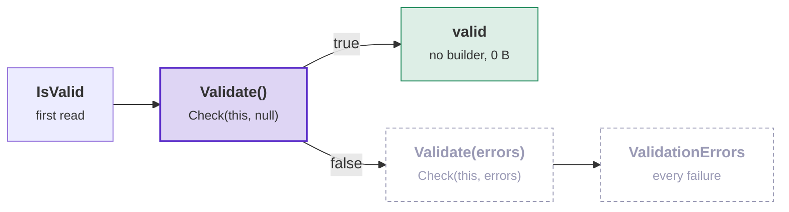

# Validation rules

A value object can declare its rules in a nested `Validator`, in the style of FluentValidation. The generator turns
each rule into an `if` statement during the build. No validator object exists at run time, and validating a valid
value allocates nothing. Each failure is a `ValidationError` with a standard code, such as `ddd.not-empty`, or with the
code of your own error record.

The rules are part of `DTS.DDD`. They need no package beside it. For the `Validate()` overrides that you write by
hand, see [Value objects](value-objects.md#validation).

## A first rule

```csharp
using DTS.DDD.Validation;

[SingleValueObject<string>]
public partial record EmailAddress
{
    public static EmailAddress Create(string value) => new(value);

    partial class Validator
    {
        public Validator() => RuleFor(x => x.Value).NotEmpty().EmailAddress();
    }
}
```

```csharp
var email = EmailAddress.Create("ada.harbor.example");
email.IsValid;            // false
email.ValidationErrors;   // one failure: Code "ddd.email-address", PropertyName "Value"
```

The rules are extension methods in the namespace `DTS.DDD.Validation`, so the file needs `using DTS.DDD.Validation;`.

A value object with several properties has one `RuleFor` per property:

```csharp
[ValueObject]
public partial record Address
{
    public const int StreetLength = 40;

    public Address(string street, string country, string? postalCode)
        => (Street, Country, PostalCode) = (street, country, postalCode);

    public string Street { get; protected init; }
    public string Country { get; protected init; }
    public string? PostalCode { get; protected init; }

    partial class Validator
    {
        public Validator()
        {
            RuleFor(x => x.Street).NotEmpty().Length(2, StreetLength);
            RuleFor(x => x.Country).NotEmpty();
            RuleFor(x => x.PostalCode).NotEmpty().When(x => x.Country == "NL");
        }
    }
}
```

## What the generator writes

The generator gives `Validator` the base class `Rules<T>` and a static method `Check`. The value object gets both
`Validate` overrides, and each calls `Check`:

**Address.Validator.g.cs** (shortened)

```csharp
partial record Address
{
    protected override bool CollectsFailuresOnlyWhenInvalid => true;
    protected override bool Validate() => Validator.Check(this, null);
    protected override void Validate(ValidationErrorBuilder errors) => Validator.Check(this, errors);

    partial class Validator : Rules<Address>
    {
        internal static bool Check(Address instance, ValidationErrorBuilder? errors)
        {
            var valid = true;
            {
                var value0 = instance.Street;
                if (!(RuleChecks.IsNotEmpty(value0)))
                {
                    valid = false;
                    if (errors is null) return false;
                    errors.Add(RuleFailures.NotEmpty("Street", value0));
                }
                // ... Length(2, StreetLength)
            }
            {
                var value2 = instance.PostalCode;
                if ((instance.Country == "NL") && !(RuleChecks.IsNotEmpty(value2)))
                {
                    // ...
                }
            }
            return valid;
        }
    }
}
```

`IsValid` runs the rules once and caches the verdict. The diagram shows the two runs. Purple: the run on every value;
green: a valid value, which stops there; grey: the second run, only for an invalid value.



- Without a builder, `Check` returns `false` at the first failed rule.
- With a builder, `Check` runs every rule and adds every failure. A property with two failed rules gives two failures.
- `CollectsFailuresOnlyWhenInvalid` tells the base class to skip the builder for a valid value.

The generator copies the body of each lambda into `Check`. It replaces the parameter of a `When` lambda with
`instance`, and the parameter of a `Must` lambda with the value. The copied code resolves names with the using
directives of your file.

## The rules

| Rule | Fails when | Code | Arguments |
|---|---|---|---|
| `NotNull()` | the value is null | `ddd.not-null` | |
| `Null()` | the value is not null | `ddd.null` | |
| `NotEmpty()` | null, empty or white-space text, an empty collection, or the default of a struct | `ddd.not-empty` | |
| `Empty()` | `NotEmpty()` would pass | `ddd.empty` | |
| `Length(min, max)` | the text is shorter than `min` or longer than `max` | `ddd.length` | `MinLength`, `MaxLength`, `TotalLength` |
| `Length(exact)` | the text is not `exact` characters long | `ddd.exact-length` | `MinLength`, `MaxLength`, `TotalLength` |
| `MinimumLength(min)` | the text is shorter than `min` | `ddd.minimum-length` | `MinLength`, `TotalLength` |
| `MaximumLength(max)` | the text is longer than `max` | `ddd.maximum-length` | `MaxLength`, `TotalLength` |
| `Matches(pattern)` | the text does not match | `ddd.matches` | `RegularExpression` |
| `EmailAddress()` | the text has no `@`, more than one, or one at the start or end | `ddd.email-address` | |
| `Equal(value)`, `NotEqual(value)` | the value differs, or equals | `ddd.equal`, `ddd.not-equal` | `ComparisonValue` |
| `GreaterThan(value)` and the other three comparisons | the comparison is false | `ddd.greater-than`, `ddd.greater-than-or-equal`, `ddd.less-than`, `ddd.less-than-or-equal` | `ComparisonValue` |
| `InclusiveBetween(from, to)`, `ExclusiveBetween(from, to)` | the value is outside the range | `ddd.inclusive-between`, `ddd.exclusive-between` | `From`, `To` |
| `IsInEnum()` | the value is no named member of its enum | `ddd.enum` | |
| `Must(v => ...)`, `Must((x, v) => ...)` | the lambda returns false | `ddd.must` | |

- The text, comparison and enum rules let null pass, as in FluentValidation. Put `NotNull()` or `NotEmpty()` first when
  the value is required.
- Every failure has the property name, such as `Street`, and the value as `AttemptedValue`. The message is English, such
  as `'Street' must be between 2 and 40 characters. You entered 52 characters.`
- `DTS.DDD.Localization` translates a failure by its code. See [Localization](localization.md).
- `Matches` takes a constant pattern or a `Regex`. The generator compiles a constant pattern once into a static field.
  A `[GeneratedRegex]` method works too, such as `Matches(PostalCodePattern())`.
- A rule argument is a constant or a static member, such as `Length(2, StreetLength)`.

## Conditions

`When` and `Unless` after a rule apply to every rule before them in the same `RuleFor`:

```csharp
RuleFor(x => x.PostalCode).NotEmpty().Matches(DutchPostalCode).When(x => x.Country == "NL");
RuleFor(x => x.State).NotEmpty().Unless(x => x.Country == "NL");
```

`When` and `Unless` with a lambda of rules apply to every rule inside:

```csharp
When(x => x.IsBusiness, () =>
{
    RuleFor(x => x.CompanyName).NotEmpty();
    RuleFor(x => x.VatNumber).NotEmpty().Matches(VatPattern);
});
```

## Your own error

`WithError` replaces the failure of the rule before it with your own error record. The record has `[ErrorCode]` and
derives from `InvalidError`:

```csharp
[ErrorCode("address.postal-code-required", "A postal code is required in {Country}.")]
public sealed partial record PostalCodeRequired(string Country) : InvalidError;

RuleFor(x => x.PostalCode).NotEmpty()
    .WithError(x => new PostalCodeRequired(x.Country))
    .When(x => x.Country == "NL");
```

The failure takes the code `address.postal-code-required`, the message `A postal code is required in NL.` and the
argument `Country`. Its property name stays `PostalCode`. The generator creates the record only when the rule fails.
A handler can return the same record in a `Result`, so a rule and a handler share one code and one translation.

## Collections and nested value objects

`RuleForEach` runs the rules for each item. A failure names the item by its index, such as `Names[1]`:

```csharp
RuleForEach(x => x.Names).NotEmpty();
```

A property that holds another value object adds the failures of that value object. The property name is the path,
such as `PostalCode.Value`. This needs no rule.

## What FluentValidation has and the rules do not

- `MustAsync` and other async rules. A value object validates itself without I/O.
- Validators that get services through dependency injection, `SetValidator` and `Include`.
- `WithMessage` and `WithErrorCode`. Use `WithError` with an error record for a code and a text of your own.

A call that the generator does not know gets [DDD00115](diagnostics.md#ddd00115). The other diagnostics of the rules
are [DDD00116](diagnostics.md#ddd00116) to [DDD00119](diagnostics.md#ddd00119).

## Moving from DTS.DDD.FluentValidation

The rules have the names of FluentValidation, so most validators compile after three changes:

1. Remove the package reference to `DylansTechStack.DDD.FluentValidation`.
2. Replace `using FluentValidation;` with `using DTS.DDD.Validation;`.
3. Replace each `WithMessage` and `WithErrorCode` with a `WithError` and an error record.

The codes change. A failure that had `NotEmptyValidator` now has `ddd.not-empty`. A project that references
`DTS.DDD.FluentValidation` keeps the FluentValidation generator, and the rule generator writes nothing for it.
