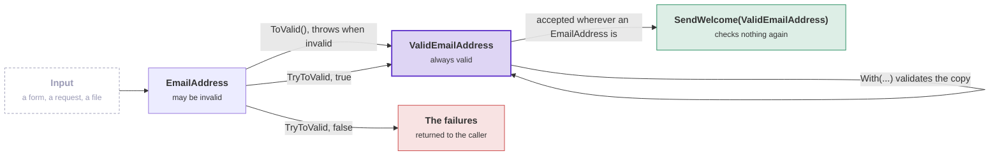

# Value objects

An email address passed around as a `string` can be any string. This causes three problems:

- Every method that receives the string must decide whether to trust it.
- The compiler cannot see when code swaps a customer's email address and a supplier's name.
- The rule for a valid email address is copied to every place where somebody remembered it.

A value object gives the value its own type. A value object has no identity. Two value objects with the same contents
are equal, the way two ten-euro notes are the same amount. The value object carries its rules, so the rules live in
one place. A method can ask for a valid value in its signature.

The toolkit has two kinds of value object:

- `[SingleValueObject<T>]` wraps one value, such as an email address.
- `[ValueObject]` holds several properties, such as an address or an amount of money.

This page shows both kinds, then validation, the always-valid twin and changing a value. It ends with storage and the
other integrations.

## A single value

```csharp
[SingleValueObject<string>]
public partial record EmailAddress
{
    public static EmailAddress Create(string value) => new(value);
}
```

The record must be `partial`, so the generator can add to it. The generator derives the record from
`SingleValueObject<string>`, which supplies the `Value` property. It writes the equality over `Value`, the
constructors and `ToValid()`:

**EmailAddress.g.cs, shortened**

```csharp
partial record EmailAddress : SingleValueObject<string>, IValidatable<ValidEmailAddress>
{
    public virtual bool Equals(EmailAddress? other)
    {
        // ... null, type and reference checks
        return EqualityComparer<string>.Default.Equals(Value, other.Value);
    }

    public override int GetHashCode() => Value is null ? 0 : EqualityComparer<string>.Default.GetHashCode(Value);

    protected EmailAddress(string value) : base(value)
    {
    }

    [JsonConstructor]
    protected EmailAddress()
    {
    }

    public ValidEmailAddress ToValid() => new(this);
}
```

[The always-valid twin](#the-always-valid-twin) explains `ToValid()` and `ValidEmailAddress`. Using the value object:

```csharp
var email = EmailAddress.Create("dylan@example.com");

email.Value;                                              // "dylan@example.com"
email == EmailAddress.Create("dylan@example.com");        // true: same contents, same value
```

The constructors are `protected`, so expose a factory such as `Create` above. A factory gives callers one entry point,
and it is a place to add validation later.

## A value with several properties

```csharp
[ValueObject]
public partial record PersonName
{
    public PersonName(string firstName, string lastName)
        => (FirstName, LastName) = (firstName, lastName);

    public string FirstName { get; protected init; }

    public string LastName { get; protected init; }
}
```

The generator writes the equality over the properties, in declaration order. Two names are equal when the first names
are equal and the last names are equal.

**PersonName.g.cs, shortened**

```csharp
partial record PersonName : ValueObject, IValidatable<ValidPersonName>
{
    [Internal]
    protected override IEnumerable<object?> GetEqualityComponents()
    {
        yield return FirstName;
        yield return LastName;
    }

    public virtual bool Equals(PersonName? other)
    {
        // ... null and type checks
        return Enumerable.SequenceEqual(GetEqualityComponents(), other.GetEqualityComponents());
    }

    // GetHashCode over the same components, a constructor for JSON, ToValid() and With(...)
}
```

Add a property, and the next build adds it to `GetEqualityComponents()`. Nobody keeps a list of members up to date by
hand. In a hand-written value object, that list is the part that goes wrong.

Properties you declare yourself must be `{ get; protected init; }`. Any other accessor reports
[DDD00010](diagnostics.md#ddd00010) or [DDD00011](diagnostics.md#ddd00011), and a code fix changes the accessor to
`protected init`. Code sets a value when it creates the value, and nothing changes the value afterwards.
[Why `with` is closed to callers](#why-with-is-closed-to-callers) has the full reason.

A value object with little behavior can be a positional record. The generator takes care of its properties:

```csharp
[ValueObject]
public partial record Money(decimal Amount, string Currency);
```

### Leaving a property out of equality

Some properties are not part of what the value is. Mark them with `[DontCompare]`:

```csharp
[ValueObject]
public partial record PersonName
{
    public PersonName(string firstName, string lastName)
        => (FirstName, LastName) = (firstName, lastName);

    public string FirstName { get; protected init; }

    [DontCompare]
    public string? MiddleNames { get; protected init; }

    public string LastName { get; protected init; }

    [DontCompare]
    public string FullName => string.Join(" ", FirstName, MiddleNames, LastName).Trim();
}
```

Two names are now equal when the first and last names are equal, whatever the middle names are. The generated
`GetEqualityComponents()` is the same as above, without the marked properties. Mark a computed property such as
`FullName` with `[DontCompare]` too, even though it is computed from compared properties. The attribute documents the
intent and keeps the equality components small. On a positional record, write `[property: DontCompare]` on the
parameter.

## Validation

Override `Validate()`. The result is cached in `IsValid`:

```csharp
[SingleValueObject<string>]
public partial record EmailAddress
{
    public static EmailAddress Create(string value) => new(value);

    protected override bool Validate() => Value.Contains('@');
}
```

```csharp
var email = EmailAddress.Create("nope");
email.IsValid;        // false
email.IsValidated;    // true, validation has run
email.EnsureValidated();   // throws InvalidValueObjectException
```

Code can create an invalid value. A value object made from a form or a request is often invalid, and the code that
creates it is rarely the code that should decide what to do about it. The toolkit guarantees two things:

- You can always ask whether a value is valid.
- The [always-valid twin](#the-always-valid-twin) can only hold a value that passed.

`IsValid`, `IsValidated` and `Validate` are marked `[Internal]`, so they stay out of your database tables, your JSON
and your GraphQL schema.

A `bool` gives no reason. The second overload of `Validate` reports reasons. Use it when a caller needs to know what
went wrong:

```csharp
[SingleValueObject<string>]
public partial record EmailAddress
{
    public static EmailAddress Create(string value) => new(value);

    protected override void Validate(ValidationErrorBuilder errors)
    {
        if (!Value.Contains('@'))
        {
            errors.Add("An email address needs an @.", nameof(Value), "NoAtSign", Value);
        }
    }
}
```

A run that adds no failure passes. Both overloads run. The value is valid only when `Validate()` returned `true` and
`Validate(ValidationErrorBuilder)` added no failure. Override the overload that suits the rule. Most types override
one of the two. With `DDDToolkit.FluentValidation` referenced, the generator writes both overloads and you write rules
instead. See [With FluentValidation](#with-fluentvalidation).

## The always-valid twin

The generator writes a twin for every value object record, named `Valid<Name>`:

```csharp
EmailAddress candidate = EmailAddress.Create(userInput);
ValidEmailAddress confirmed = candidate.ToValid();   // throws if invalid
```

The twin makes validity visible in signatures. A method that takes `ValidEmailAddress` cannot receive an unchecked
email address. So the check happens once, at the boundary, and the code behind the boundary does not check again:

```csharp
public Task SendWelcome(ValidEmailAddress address)   // no re-validation needed
```

The diagram shows the ways from input to the twin. Purple is the twin, green is code that receives the twin, red is
the failures, and grey is input from outside your code:



<details>
<summary>Show the code: checking once, at the boundary</summary>

The endpoint turns the request into the twin, or it refuses the request. The code behind the endpoint takes the twin
and does not check again:

```csharp
app.MapPost("/subscribers", (SubscribeRequest body) =>
{
    if (!EmailAddress.Create(body.Email).TryToValid(out var email, out var errors))
    {
        return Results.ValidationProblem(errors.ToErrorDictionary());
    }

    return Results.Ok(subscribers.Add(email));   // email is a ValidEmailAddress
});

public Task SendWelcome(ValidEmailAddress address)   // no re-validation needed
```

See [Failure handling](#failure-handling).

</details>

The generator writes the twin next to the value object. Every constructor of the twin validates, so code cannot hold a
`ValidEmailAddress` that was not checked:

**EmailAddress.g.cs, shortened**

```csharp
public partial record ValidEmailAddress : EmailAddress, IAlwaysValid
{
    public ValidEmailAddress(EmailAddress value) : base(value)
    {
        value.EnsureValidated();
        _isValid = true;
    }

    public ValidEmailAddress(string value) : base(value)
    {
        EnsureValidated();
    }

    // equality, the same as on EmailAddress
}
```

The twin is made with the record's copy constructor. So the twin holds everything the original held: get-only
properties, `protected` properties, private fields and `[Internal]` state. The twin derives from the original, so
code accepts a twin wherever it expects the original. The twin implements `IAlwaysValid`, and both JSON integrations
refuse to deserialize it directly. Deserializing into a twin would let invalid data in through a type that promises
valid data. Deserialize the base type and call `ToValid()`.

For the same reason, [`With`](#changing-a-value-with) on a twin validates the copy and throws when the copy is
invalid. So `With` never returns a twin that breaks the twin's promise.

A twin is never equal to a plain value, even when the components are the same. This holds from both sides:

```csharp
Money plain = new(8m, "EUR");
ValidMoney twin = plain.ToValid();

plain == twin                  // false
twin == plain                  // false
twin == new Money(8m, "EUR").ToValid()   // true: twin to twin compares the components
```

Equality between a twin and a plain value cannot be `true` in both directions. The twin is a derived record. For a
derived record, the compiler writes the twin's `Equals(Money?)`, and that method only accepts a `ValidMoney`. The
compiler does not let code replace that member. So the generated equality also compares the runtime type, as the
compiler's record equality does, and both sides give the same answer. To compare a twin with a plain value, compare
twin to twin (call `ToValid()` on the plain value), or compare the components. The hash code does not include the
type. So a twin and a plain value with the same components have the same hash code, which is allowed and causes no
harm.

> [!NOTE]
> **Why a value object cannot be sealed or a struct.** `ValidEmailAddress` derives from `EmailAddress`. Three things
> depend on that:
>
> - Code accepts a twin wherever it accepts the original. So a signature can ask for `ValidEmailAddress` while the
>   rest of the code uses `EmailAddress`.
> - The twin is built with the record's copy constructor. The compiler makes that constructor `protected` on a record
>   that is not sealed, and `private` on a sealed record.
> - `With` is virtual. So the twin's override validates the copy, even when code holds the twin as its base type.
>
> A sealed record cannot be derived from ([DDD00013](diagnostics.md#ddd00013)), and neither can a struct. So a value
> object must be a reference record ([DDD00001](diagnostics.md#ddd00001)). A twin that wrapped the value, instead of
> deriving from it, would lose all three. Around a struct, such a twin could not keep its promise. `default` and every
> element of a new array skip the constructor, and so they skip the check. The same holds for
> [struct identifiers](identifiers.md#struct-or-record), which have no twin.

## Failure handling

`ToValid()` throws. Throwing is right when an invalid value is a bug. It is wrong when an invalid value is a normal
answer. An endpoint that validates a request body should answer with a refusal (a 400) instead of an error (a 500).
A validation pass over a request should collect every failure, and an exception stops at the first one.

So the toolkit has a second way in, which never throws.

### TryToValid

```csharp
var candidate = EmailAddress.Create(userInput);

if (candidate.TryToValid(out ValidEmailAddress? email, out var errors))
{
    // email is not null here
}
else
{
    // errors lists every failure
}
```

A shorter overload, `TryToValid(out var email)`, suits a caller that only needs to know whether the conversion
worked. `TryValidate(out var errors)` checks a value object without converting it, for example a value object nested
inside another one.

Both methods work the same for `[ValueObject]`, `[SingleValueObject<T>]` and `[EntityId<T>] partial record`. Struct
identifiers have neither method, and they need neither. A struct identifier is well formed by construction and has no
twin to convert to.

Both methods are extension methods. The generator adds no member for them. `TryToValid` extends the generated
`IValidatable<TValid>` interface, so the compiler infers the twin type at the call site. `TryValidate` extends
`ValueObject`, because it converts nothing and needs no twin. No new member lands on your types, so nothing new turns
up in an Entity Framework model or a GraphQL schema.

### What a failure looks like

A failure is a `ValidationError`. This is the toolkit's type, and it needs no FluentValidation:

| Member | Meaning |
| --- | --- |
| `Message` | What is wrong, in words you could show a user. |
| `PropertyName` | The property the failure belongs to, or `null` for the whole value. |
| `Code` | A stable code to branch on, so code never matches on the message. |
| `AttemptedValue` | The value that was rejected, when the rule reported one. |
| `Arguments` | The values the message was built from, by name, such as `MaxLength`. Never `null`. |

The failures are the ones your `Validate(ValidationErrorBuilder)` added. A `Validate()` that returns `false` without
describing the failure produces one failure with the code `ValidationError.UnspecifiedCode`. So a caller never
receives an empty list that looks like a pass. With FluentValidation referenced, you get one `ValidationError` per
`ValidationFailure` instead. See [With FluentValidation](#with-fluentvalidation).

`ValidationErrors` on the value object holds the same list. Reading it runs the rules if they have not run yet, as
reading `IsValid` does.

### Returning a refusal from an endpoint

```csharp
app.MapPost("/subscribers", (SubscribeRequest body) =>
{
    if (!EmailAddress.Create(body.Email).TryToValid(out var email, out var errors))
    {
        return Results.ValidationProblem(errors.ToErrorDictionary());
    }

    return Results.Ok(subscribers.Add(email));
});
```

`ToErrorDictionary()` groups the failures by property name and keeps the messages. `Results.ValidationProblem` and
`ModelStateDictionary` expect this shape. The client gets a 400 response it can read field by field, and nothing is
thrown.

To answer with every failure in the request, collect the failures. `Prefixed()` puts a value object's failures under
the field they came from. A failure on `Value` or `Street` alone does not say where it was in the request body:

```csharp
var errors = new List<ValidationError>();

if (!EmailAddress.Create(body.Email).TryToValid(out var email, out var emailErrors))
{
    errors.AddRange(emailErrors.Prefixed("email"));     // "Value" becomes "email.Value"
}

if (!new Address(body.Street, body.City).TryToValid(out var shipTo, out var addressErrors))
{
    errors.AddRange(addressErrors.Prefixed("shipTo"));  // "Street" becomes "shipTo.Street"
}

if (errors.Count > 0)
{
    return Results.ValidationProblem(errors.ToErrorDictionary());
}

return Results.Ok(subscribers.Add(email!, shipTo!));
```

The last line needs the two `!` operators. The compiler knows that `email` is not null inside its `if`, but it cannot
prove that `email` and `shipTo` are set on the last line.

### Which method to use

| Situation | Use |
| --- | --- |
| The value came from outside and may be invalid | `TryToValid` |
| You collect failures across a request | `TryToValid` plus `Prefixed` |
| The value was already validated at the boundary | `ValidEmailAddress` in the signature |
| An invalid value here would be a bug | `ToValid()`, and let it throw |

`InvalidValueObjectException` carries `Errors` and `ObjectType`, so the throwing path also says why. Read them in a
log line. For control flow, use `TryToValid`.

### Why not a Result type

The toolkit does not ship a `Result<T>`. Teams already use FluentResults, ErrorOr, OneOf or a type of their own. A
result type also spreads. If the toolkit returned one, it would appear in every signature that touches a value object.
A codebase with its own result type would then have two.

The toolkit uses the Try pattern instead. A Try method gives you the value and the failures, and you put them in the
type you already use. Wrapping the call in a `Result<T>` takes one line:

```csharp
public static Result<ValidEmailAddress> ToResult(this EmailAddress email)
    => email.TryToValid(out var valid, out var errors)
        ? Result.Ok(valid)
        : Result.Fail(errors.Select(e => e.Message));
```

The same holds for a command that is refused. An aggregate method or a use case that refuses a request throws
`RefusalException`. The exception carries:

- a stable `Code`;
- a `Kind`, which says that the request is invalid (`Invalid`), is not permitted (`NotPermitted`), names something
  that does not exist (`NotFound`), or conflicts with the current state (`Conflict`);
- the `Arguments` that the message was built from.

A refusal is not an invariant violation, because nothing changed. The edge of the application maps `Kind` to a status
code and translates the message by `Code`. A `Result<T>` can wrap a refusal with one `catch`.

### Limits of validation

- The toolkit has no `Result<T>`, on purpose. See above.
- Validation is synchronous. `Validate` cannot call a database.
- Failures have no severity. There are no warnings.
- `Message` is the text your rule wrote. To show it in the reader's language, branch on `Code`, or let
  [`DDDToolkit.Localization`](localization.md) phrase the message from `Code` and `Arguments`.
- A rule sees one value object. No rule sees the request around it. A validator for the whole request checks across
  value objects, and [`MustBeValid()`](fluent-validation.md#a-value-object-in-a-request-validator) adds a value
  object's rules to such a validator.

## Changing a value: `With`

Code never changes a value object in place. To get a different value, code makes a copy with some properties
replaced. Every `[ValueObject]` has a generated `With(...)` method for this. Name the properties to replace, and leave
out the others. Take a `Money` with an optional note:

```csharp
[ValueObject]
public partial record Money(decimal Amount, string Currency, [property: DontCompare] string? Note = null);
```

```csharp
var converted = money.With(amount: 12.50m, currency: "USD");
var cleared = money.With(note: null);   // sets Note to null; leaving note out keeps it
```

On `Money`, `With` returns a copy that is judged afresh, like any new value. Ask `IsValid` or call `ToValid()`. On
`ValidMoney`, `With` validates the copy before it returns the copy. An invalid copy throws
`InvalidValueObjectException` on the line that asked for it:

```csharp
ValidMoney valid = money.ToValid();
valid.With(amount: 5);    // a ValidMoney
valid.With(amount: -1);   // throws here
```

The generator writes this for the two-property `Money(decimal Amount, string Currency)` and its twin:

**Money.g.cs, shortened**

```csharp
partial record Money
{
    [Internal]
    [HotChocolate.GraphQLIgnoreAttribute]
    public virtual Money With(Optional<decimal> amount = default, Optional<string> currency = default)
        => this with { Amount = amount.Or(Amount), Currency = currency.Or(Currency) };
}

public partial record ValidMoney : Money, IAlwaysValid
{
    [Internal]
    [HotChocolate.GraphQLIgnoreAttribute]
    public override ValidMoney With(Optional<decimal> amount = default, Optional<string> currency = default)
        => new(base.With(amount, currency));
}
```

`With` is a method, so code runs after all the new values are in place. C#'s `with` expression cannot do this.
[Why `with` is closed to callers](#why-with-is-closed-to-callers) explains why that matters. `With` also makes value
objects easy to test. To build a test case, copy a valid value and change one property.

The base method makes the copy, and the twin's constructor validates the copy. `ToValid()` uses the same constructor.
`With` is virtual. So code that only knows `Money` still calls the twin's override when it receives a twin:

```csharp
static Money Discount(Money money) => money.With(amount: money.Amount - 100);

Discount(valid);   // throws: the discounted twin would not be valid
```

Details:

- The parameters are `Optional<T>`, a small struct in `DDDToolkit.BaseTypes`. It tells "not given" apart from "given
  as `null`". An ordinary optional parameter cannot tell the two apart, and a nullable property needs both. A value
  converts to `Optional<T>` implicitly, so you never write the type.
- `With` has a parameter for each property that has a setter and is not `[Internal]`. Computed properties have no
  parameter.
- `With` is marked `[Internal]`, and `[GraphQLIgnore]` when the project references HotChocolate. Without
  `[GraphQLIgnore]`, HotChocolate publishes public methods as fields. HotChocolate cannot turn `Optional<T>` into an
  input type, so the schema would fail to build.
- If the value object declares a member named `With`, the generator writes no `With`. An existing method keeps
  working.

### Why `with` is closed to callers

A record comes with `with`, which copies a value and changes some of its properties:

```csharp
var moved = address with { City = "Utrecht" };
```

For a value object, `with` is the right operation. It is also a way to create a value that no check has seen. So the
properties are `protected init`. With `protected init`, `with` compiles only inside the value object and its twin.
Other code uses `With(...)`. This section explains why the toolkit neither leaves `with` open nor adds a check to it.
You do not need this section to use the toolkit.

#### What `with` does, step by step

`money with { Amount = -1 }` compiles to three steps:

1. **Clone.** The code calls the record's hidden clone method, which the compiler generates. The method is virtual,
   so the copy has the *runtime* type of `money`, whatever the type of the variable.
2. **Copy constructor.** The clone method runs the copy constructor, which copies every field of the original.
3. **Init accessors.** The new values are assigned now, one property at a time, in the order they are written between
   the braces.

No code of yours runs after step 3. C# has no hook for "the `with` expression is done", so no code can check the
finished copy before the caller gets it.

#### `with` on a plain value object

The copy constructor of `ValueObject` clears the cached result of validation. So a copy made by `with` has not been
validated. The first time code reads `IsValid` or `ValidationErrors`, or calls `ToValid()`, the rules run on the
copy's new contents:

```csharp
var copy = money with { Amount = -1 };   // inside the type, where it is allowed
copy.IsValid;                            // false: judged afresh
```

A `Money` may be invalid, and `IsValid` reports it. So `with` on the plain type misleads no one.

#### `with` on the always-valid twin

A `ValidMoney` says "this value was checked" in a signature, so the code that receives it does not check again.
`with` on a twin produces another twin, holding whatever values were assigned:

```csharp
ValidMoney valid = money.ToValid();
var copy = valid with { Amount = -1 };   // a ValidMoney and IAlwaysValid, with Amount -1
```

This also happens when nobody writes `with` on a `ValidMoney`. Step 1 above copies the runtime type, so ordinary code
that knows nothing about twins makes such a copy too:

```csharp
static Money Discount(Money money) => money with { Amount = money.Amount - 100 };

var result = Discount(valid);   // a ValidMoney, holding -90
```

Passing a twin where code expects a `Money` is normal, because a twin is a `Money`. The code in `Discount` is
reasonable. Yet `result is ValidMoney` is true for a value that is not valid. `result.IsValid` returns `false`,
because the copy constructor cleared the cached result. But code that trusts the type does not ask.

#### Why `with` cannot check the copy

Each place where a check could run has a problem:

- **In the copy constructor.** This is too early. The copy constructor runs in step 2, before the new values arrive,
  so it sees the old, valid values.
- **In each init accessor.** An accessor sees a half-changed object. `with { Amount = 5, Currency = "USD" }` sets
  `Amount` while `Currency` still holds the old value. A rule about the pair, such as "this amount is allowed in this
  currency", would fail on a combination nobody asked for.
- **An exception from the twin's copy constructor, always.** Then every `with` on a twin fails, including `Discount`
  above when its result is valid.
- **A check later, when code first reads a property of the copy.** This is possible, but the exception is then thrown
  wherever the copy is used, which can be far from the line that made it. The stack trace points at the code that
  reads the copy instead of the code that made it.
- **Protection on the twin only**, by declaring its properties again as `protected init`. That stops
  `valid with { ... }`. It does not stop `Discount`, which goes through `Money`'s properties.

None of these is acceptable for a type that must be trustworthy. So the toolkit makes the situation impossible. With
`protected init`, `with` compiles only inside the value object and its twin:

```csharp
money with { Amount = -1 };   // outside the type: CS0272, the init accessor is inaccessible
```

The generated code of the value object and its twin still uses `with`. That code checks what it produces.
`With(...)` gives all other code the same operation, with the check included.

## Positional records

A positional record turns each parameter into a property, and that property is always `public init`. C# has no syntax
for another accessor. Left as it is, the property would open `with` to every caller again.

C# has one way around this. When any partial part of the record declares a property with a parameter's name, the
compiler does not create a property for that parameter. The generator uses this rule. It declares each positional
property itself, as `protected init`, with an initializer that reads the parameter. For
`record Money(decimal Amount, string Currency)`:

**Money.g.cs, shortened**

```csharp
partial record Money : ValueObject, IValidatable<ValidMoney>
{
    [JsonInclude]
    public decimal Amount { get; protected init; } = Amount;

    [JsonInclude]
    public string Currency { get; protected init; } = Currency;

    // equality over Amount and Currency

    [JsonConstructor]
    protected Money() : this(default(decimal)!, default(string)!)
    {
    }

    // ToValid() and With(...)
}
```

- `= Amount` reads the constructor parameter. So the primary constructor still fills the properties.
- The parameterless constructor chains to the primary constructor, because in a positional record every other
  constructor must.
- `[JsonInclude]` is there because System.Text.Json cannot set a `protected init` property by itself. Without it, the
  value would deserialize with default values, and a value object in a domain event would come out of the outbox
  empty. The generator leaves `[JsonInclude]` out when the project does not reference System.Text.Json, and does not
  repeat it when the parameter already carries it.

| What the positional record gives you | After generation |
|---|---|
| The constructor, `new Money(10m, "EUR")` | unchanged |
| Deconstruction, `var (amount, currency) = money;` | unchanged |
| Value equality | the toolkit's, over the properties not marked `[DontCompare]` |
| `money with { Amount = 1 }` outside the type | does not compile (CS0272) |
| `money.With(amount: 1)` | generated, see [`With`](#changing-a-value-with) |

Attributes aimed at the property, such as `[property: DontCompare]`, only work while the compiler creates the
property. The generator copies them onto the property it declares, so they still apply. The compiler does not know
this, and it warns that the attribute is ignored (CS0657). A suppressor in the toolkit removes that warning, but only
when the attribute did arrive on the property.

A property you declare yourself replaces the created one, as in any record, and the generator leaves it alone. Use
this when a parameter needs something that the generated declaration does not do:

```csharp
[ValueObject]
public partial record Money(decimal Amount, string Currency)
{
    public string Currency { get; protected init; } = Currency.ToUpperInvariant();
}
```

The analyzer checks such a property like any other declared property, so it needs `protected init` too. A
`[property: ...]` attribute on its parameter is lost, and the CS0657 warning stays to tell you.

## Hiding members

`[Internal]` marks a member as infrastructure. The toolkit leaves the member out of equality, the Entity Framework
mapping, the Newtonsoft contract resolver and the GraphQL schema.

```csharp
[Internal]
public string CacheKey => $"{FirstName}:{LastName}";
```

Use `[Internal]` for anything an outside observer should not see. `[DontCompare]` does less. A `[DontCompare]` member
stays visible and stored, and only equality ignores it.

## Entity Framework

Everything above works without a database. To store value objects, reference `DDDToolkit.EntityFramework`. Its
generator adds the mapping:

- `[SingleValueObject<T>]` and identifiers get a generated `ValueConverter`, so an `EmailAddress` is stored as a plain
  `string` column. `Add<Module>Converters` registers all the converters. See [Entity Framework](entity-framework.md).
- `[ValueObject]` records get `[ComplexType]`, so their properties are stored as columns of the owning table. They get
  no table of their own.

A single value object can set the width of its column. `ColumnLength` becomes `HaveMaxLength` in the generated
configuration:

```csharp
[SingleValueObject<string>(ColumnLength: MaxLength)]
public partial record EmailAddress
{
    public const int MaxLength = 255;

    public static EmailAddress Create(string value) => new(value);
}
```

The generator writes a converter into the record, for the record and for its twin. It writes one registration per
type into the project's `Add<Module>Converters`, and the length goes into that registration:

**EmailAddress.Converter.g.cs, shortened**

```csharp
partial record EmailAddress
{
    public sealed class EmailAddressConverter : ValueConverter<EmailAddress, string>
    {
        public EmailAddressConverter() : base(static v => v.Value, static v => new EmailAddress(v))
        {
        }
    }
}
```

**ConverterExtensions.g.cs, shortened**

```csharp
modelConfigurationBuilder.Properties<EmailAddress>().HaveConversion<EmailAddress.EmailAddressConverter>().HaveMaxLength(255);
modelConfigurationBuilder.DefaultTypeMapping<EmailAddress>().HasConversion<EmailAddress.EmailAddressConverter>().HasMaxLength(255);
```

`ColumnLength` has no effect on validation, and no effect at all without the Entity Framework package. A constant
such as `MaxLength` lets a validation rule use the same number.

A `[ValueObject]` gets no converter. Its generated part only carries the attribute that tells Entity Framework to
store its properties as columns of the owner:

**PersonName.EntityFramework.g.cs**

```csharp
[ComplexType]
partial record PersonName
{
}

[ComplexType]
partial record ValidPersonName
{
}
```

## With FluentValidation

If you write rules with FluentValidation, reference `DDDToolkit.FluentValidation`. Write a value object's rules as a
validator instead of a `Validate()` override:

```csharp
[SingleValueObject<string>]
public partial record EmailAddress
{
    public static EmailAddress Create(string value) => new(value);

    partial class Validator
    {
        public Validator() => RuleFor(x => x.Value).EmailAddress();
    }
}
```

The generator writes the rest. `IsValid`, `TryToValid()` and the twin run your rules. `MustBeValid()` adds a value
object's rules to the validator you write for a request. See [FluentValidation](fluent-validation.md).

## Requirements

The declaration must be a `partial record` that is not sealed. A class or struct with `[ValueObject]` or
`[SingleValueObject<T>]` reports [DDD00001](diagnostics.md#ddd00001). A sealed record reports
[DDD00013](diagnostics.md#ddd00013). A declaration without `partial` reports [DDD00005](diagnostics.md#ddd00005).

The properties you declare on a `[ValueObject]` record must be `{ get; protected init; }`. The generator takes care of
the properties that a [positional record](#positional-records) declares through its parameters.
