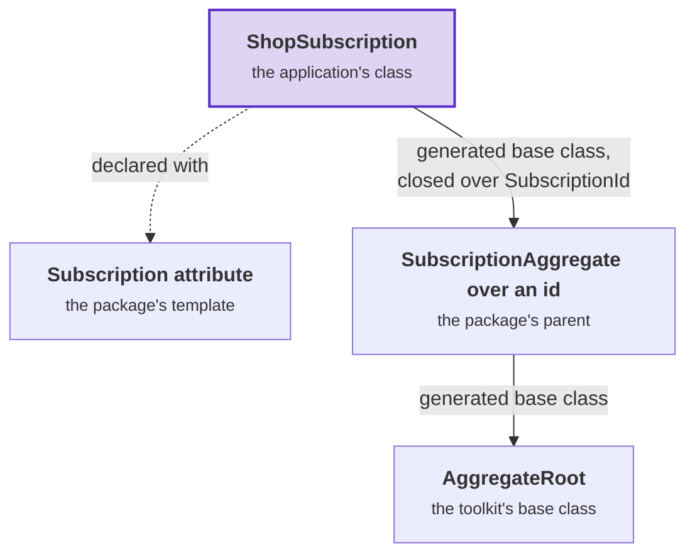
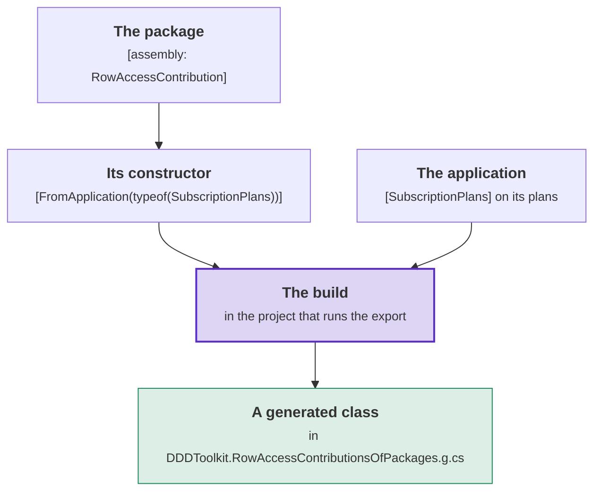
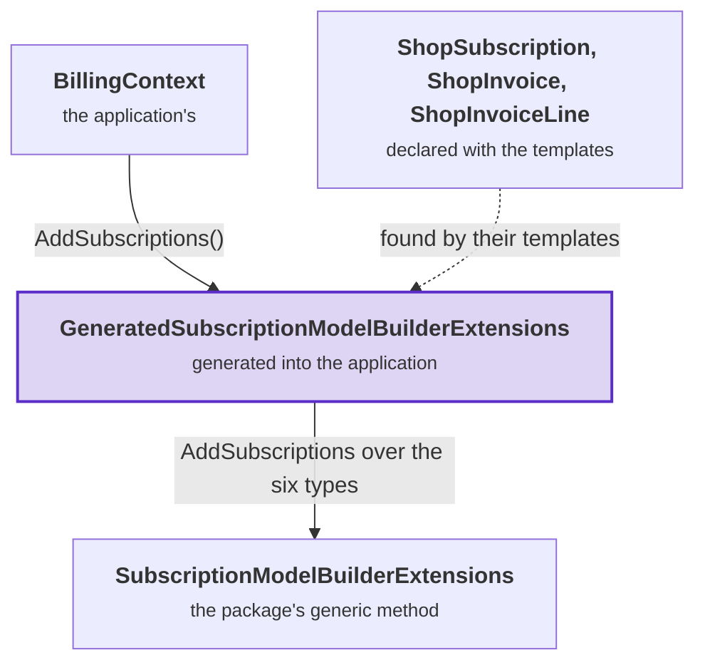
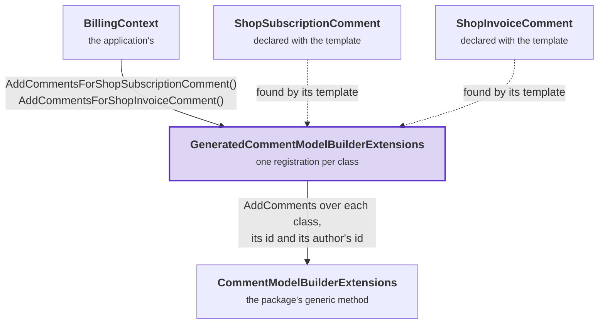
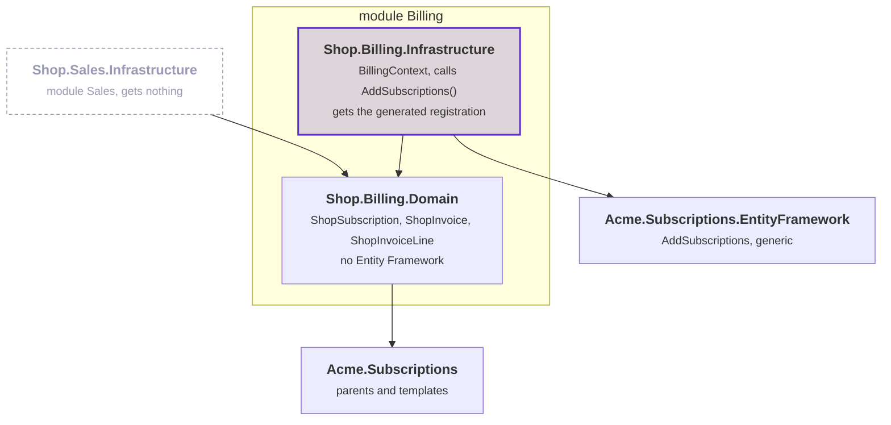
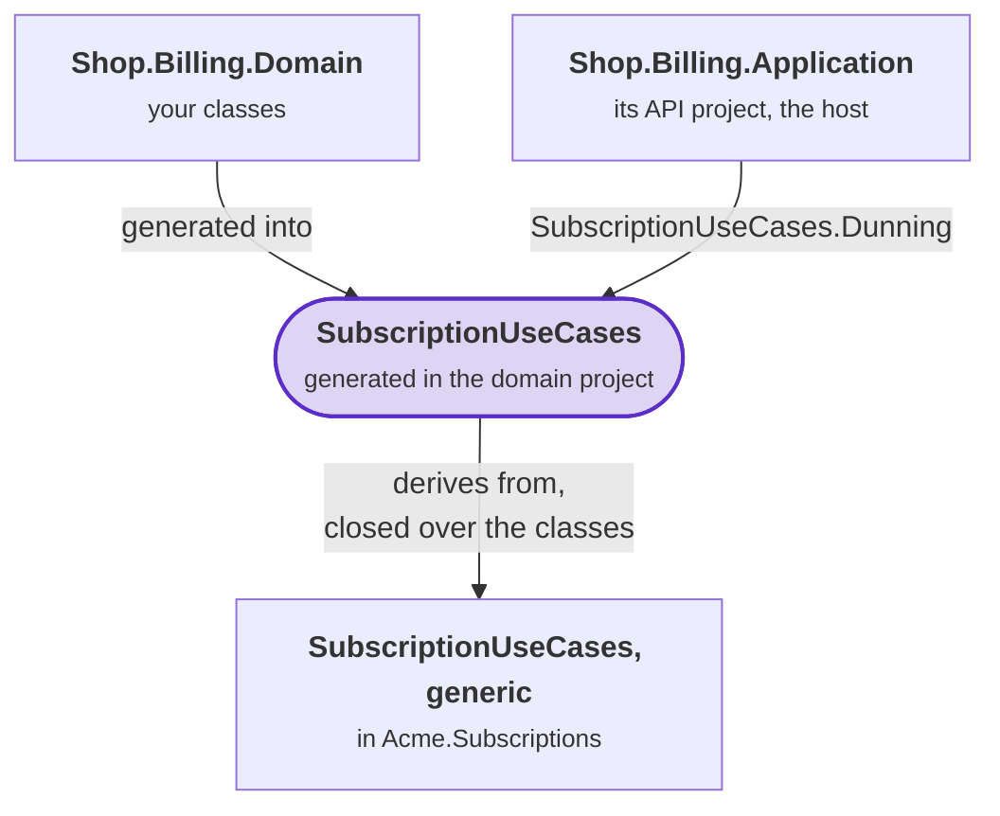

# Writing your own supporting domain

Your core domain is what your application is for. You write it with the
[building blocks](entities-and-aggregates.md). Next to it are domains that many applications need and that make no
application different: subscriptions, tenants, audit. A **supporting domain** is such a domain, written once as a
package and used by many applications. The toolkit ships its own under `DDDToolkit.Supporting.*`,
[Tenancy](tenancy/overview.md) and [Membership](membership/overview.md), and you can write one the same way.

A supporting domain is written with the building blocks, like your own modules. When an application references it, it
becomes a module of that application. The way the application extends it makes it a package instead of a copy:

- **The application owns the ids.** It declares them with `[EntityId<T>]` in its contracts project, over any value
  type. The package never forces a `Guid` on anyone.
- **The application owns the classes.** It declares each aggregate and entity of the package as a class of its own,
  and adds properties, behaviour, rules and entities to it.
- **The package owns the rules.** Every rule the package states runs for the application's class, before the class's
  own rules. The application can add rules. It cannot leave one out by accident.
- **The application owns the database.** The package brings no migrations and no `DbContext`. The application's
  context and migrations stay in the module that owns them.

The example on this page is a package for subscriptions and their invoices, `Acme.Subscriptions`, and a shop that uses
it.

## A parent and its template

The package declares each aggregate as an abstract generic **parent**, marked `[AggregateRootBase]`, with the id as
its first type parameter. You write it like any other aggregate: rules nested in it, a `CheckInvariants()` method,
read-only collections.

```csharp
[AggregateRootBase]
public abstract partial class SubscriptionAggregate<TSubscriptionId>
    where TSubscriptionId : IEntityId, IEquatable<TSubscriptionId>
{
    protected SubscriptionAggregate(TSubscriptionId id, string plan) : base(id) => Plan = plan;

    public string Plan { get; private set; } = "";

    public sealed class PlanIsRequired : IInvariant<SubscriptionAggregate<TSubscriptionId>>
    {
        public string Code => "subscription.plan";

        public InvariantFailure? Check(SubscriptionAggregate<TSubscriptionId> entity)
            => entity.Plan.Length > 0 ? null : "A subscription is on a plan.";
    }
}
```

Next to the parent goes the **template**. The template is the attribute that the application puts on its class. It
names the parent, and its type arguments fill the parent's first type parameters, the id first:

```csharp
[AggregateRootTemplate(typeof(SubscriptionAggregate<>))]
[AttributeUsage(AttributeTargets.Class, Inherited = false)]
public sealed class SubscriptionAttribute<TSubscriptionId> : Attribute;
```

A child entity works the same way, with `[EntityBase]` on the parent and `[EntityTemplate]` on the attribute.

## What the application writes

The application declares its ids, and declares its own class with the template. It adds what only the application
knows:

```csharp
[EntityId<Guid>]
public readonly partial record struct SubscriptionId;      // in its contracts project

[Subscription<SubscriptionId>]
public sealed partial class ShopSubscription
{
    public ShopSubscription(SubscriptionId id, string plan, bool isTrial) : base(id, plan) => IsTrial = isTrial;

    public bool IsTrial { get; private set; }

    public sealed class TrialsAreOnTheFreePlan : IInvariant<ShopSubscription> { ... }
}
```

The generator makes the class derive from the parent, closed over the application's id. It makes the parent derive
from the toolkit's `AggregateRoot<TId>`. Nobody writes a base class by hand.

In the diagram, purple marks the application's class:



<details>
<summary>Show the code: what the generator writes</summary>

**`SubscriptionAggregate.g.cs`** and **`ShopSubscription.g.cs`**, shortened:

```csharp
partial class SubscriptionAggregate<TSubscriptionId> : global::DDDToolkit.BaseTypes.AggregateRoot<TSubscriptionId>
{
    protected void CollectBaseInvariantViolations(
        ref global::System.Collections.Generic.List<global::DDDToolkit.Invariants.InvariantViolation>? violations,
        ref global::DDDToolkit.Exceptions.InvariantViolationException? seamFailure,
        global::System.Type entityType)
    {
        foreach (var invariant in __invariants)
        {
            // ...
        }

        // ...then its CheckInvariants() method
    }
}

partial class ShopSubscription : global::Acme.Subscriptions.SubscriptionAggregate<global::Shop.Contracts.SubscriptionId>
{
    private void CollectInvariantViolations(
        ref global::System.Collections.Generic.List<global::DDDToolkit.Invariants.InvariantViolation>? violations,
        out global::DDDToolkit.Exceptions.InvariantViolationException? seamFailure)
    {
        seamFailure = null;
        CollectBaseInvariantViolations(ref violations, ref seamFailure, typeof(global::Shop.Billing.ShopSubscription));

        foreach (var invariant in __invariants)
        {
            // ...
        }

        // ...then its own CheckInvariants() method
    }
}
```

</details>

## Invariants of the parent and the class

Every rule that the parent states runs for every class derived from it, and so does the parent's `CheckInvariants()`.
The parent's rules run first, then the class's rules. Both come back in one list from `GetInvariantViolations()`, or
as one exception from `EnsureInvariants()` and from the save. Every violation names the application's class,
`ShopSubscription`, because that is the object that is wrong. The toolkit checks the parent's child entities the same
way, so a rule on the package's invoice line runs when the application's invoice is checked.

The parent also gets the four public invariant methods, which run only the parent's rules. A class declared with the
template replaces them with its own methods. They exist for a class that derives from the parent by hand. Without
them, such a class would check none of the package's rules.

A rule of the application can be about its class, about the parent, or about an interface the parent implements. All
of them are nested in the application's class:

```csharp
[Subscription<SubscriptionId>]
public sealed partial class ShopSubscription
{
    public sealed class TrialsAreOnTheFreePlan : IInvariant<ShopSubscription> { ... }

    public sealed class PlanIsKnown : IInvariant<SubscriptionAggregate<SubscriptionId>> { ... }
}
```

## Parents that need more than an id

An invoice needs more than its own id. It needs the id of the subscription it bills, and the class of its lines, which
the application declares. A **`[TemplateArgument]`** fills such a type parameter from the one class declared with the
template it names. By default it takes that class's id. With `Take = TemplateArgumentKind.Type` it takes the class
itself:

```csharp
[AggregateRootTemplate(typeof(InvoiceAggregate<,,,>))]
[TemplateArgument(1, typeof(SubscriptionAttribute<>))]
[TemplateArgument(2, typeof(InvoiceLineAttribute<>), Take = TemplateArgumentKind.Type)]
[TemplateArgument(3, typeof(InvoiceLineAttribute<>))]
[AttributeUsage(AttributeTargets.Class, Inherited = false)]
public sealed class InvoiceAttribute<TInvoiceId> : Attribute;
```

The application declares each class once, and the generator fills in the rest:

```csharp
[InvoiceLine<InvoiceLineId>]
public sealed partial class ShopInvoiceLine : IInvoiceLineFactory<ShopInvoiceLine, InvoiceLineId> { ... }

[Invoice<InvoiceId>]
public sealed partial class ShopInvoice
{
    public ShopInvoice(InvoiceId id, SubscriptionId subscriptionId) : base(id, subscriptionId) { }
}
```

`ShopInvoice` derives from `InvoiceAggregate<InvoiceId, SubscriptionId, ShopInvoiceLine, InvoiceLineId>`, with the
subscription's id taken from `ShopSubscription`. The generator looks for the class a template takes from in the
application's project first. When that project declares none, it looks in the projects the project references. So a
billing module can take the subscription's id from the module that declares the subscription.

## Creating the application's entities

A parent that holds the application's child entities cannot call their constructor, because it does not know their
class. A static abstract factory on an interface that the child implements creates them. The parent constrains its
type parameter to that interface:

```csharp
public interface IInvoiceLineFactory<TSelf, TLineId>
    where TSelf : IInvoiceLineFactory<TSelf, TLineId>
{
    static abstract TSelf Create(TLineId id, decimal amount);
}

[AggregateRootBase]
public abstract partial class InvoiceAggregate<TInvoiceId, TSubscriptionId, TLine, TLineId>
    where TInvoiceId : IEntityId, IEquatable<TInvoiceId>
    where TSubscriptionId : IEntityId, IEquatable<TSubscriptionId>
    where TLine : InvoiceLineEntity<TLineId>, IInvoiceLineFactory<TLine, TLineId>
    where TLineId : IEntityId, IEquatable<TLineId>
{
    public partial IReadOnlyList<TLine> Lines { get; }

    public TLine Charge(TLineId id, decimal amount)
    {
        var line = TLine.Create(id, amount);
        _lines.Add(line);
        return line;
    }
}
```

An application class that does not implement the factory is reported with [DDD00048](diagnostics.md#ddd00048) on the
class that takes it, instead of as a compile error in the generated code. A `new()` constraint cannot replace the
factory, because the parameterless constructor that the generator writes is never public.

### Ids the package creates

The invoice line above receives its id. A package that creates a new id itself, as Tenancy creates the id of every
seat it adds, asks the id type for it: `TLineId.Create()`, the static member of `ICreatableEntityId<TSelf>`. It does
this in code, before the save. The generator implements `Create()` for every `[EntityId<Guid>]`, with a time-ordered
id. An application whose id is over a `long` declares its own `Create()`. The package states this in two places, in
its code and on its template:

```csharp
// The code that creates the ids requires id types with a Create().
public abstract class SubscriptionUseCases<TSubscription, TSubscriptionId>
    where TSubscription : SubscriptionAggregate<TSubscriptionId>
    where TSubscriptionId : struct, ICreatableEntityId<TSubscriptionId>, IEquatable<TSubscriptionId>
{
    public static TSubscriptionId NewId() => TSubscriptionId.Create();
}

// The template states that the package creates the ids of its classes.
[AggregateRootTemplate(typeof(SubscriptionAggregate<>), CreatesIds = true)]
[AttributeUsage(AttributeTargets.Class, Inherited = false)]
public sealed class SubscriptionAttribute<TSubscriptionId> : Attribute;
```

With `CreatesIds`:

- An application class declared over an id without a `Create()` is [DDD00067](diagnostics.md#ddd00067), on the class,
  with a code fix that adds `Create()` to the id.
- The registrations and the class the use cases are named through also require `Create()` in their constraints. They
  do not report the class again, and the compiler reports no error in generated code.

Without `CreatesIds`, the toolkit cannot tell the application which class to fix. Then a registration reports the
problem with [DDD00050](diagnostics.md#ddd00050), and the class the use cases are named through with
[DDD00065](diagnostics.md#ddd00065). Leave `CreatesIds` unset for a template whose ids the application creates
itself. Its ids then need no `Create()`.

## Storing the classes with Entity Framework

Nothing changes. Entity Framework maps the application's classes, and the parent's properties and collections become
part of each class. A child entity declared with an `[EntityTemplate]` is an owned type like any other child entity.
Entity Framework never maps the parent. The parent is an open generic, and Entity Framework only sees the classes
closed over the application's ids. `[KeyPart]` properties on a parent come first in the key, before the class's own
key parts.

A [row access rule](row-level-security.md#row-access-rules-written-in-c) is written for the application's class, and
reads the parent's properties and collections like the class's own. A rule about the parent itself is refused with
[DDD00040](diagnostics.md#ddd00040), because the parent has no table.

### Row level security from a package

A package can ship its own row level security (RLS), for tables that are not the application's aggregates, and for SQL
that names the schema and the id types that the application chose. It does this with a
[row access contribution](row-level-security.md#policies-a-package-ships). That is a class that writes functions,
policies and statements from the application's model when the export runs.

The package declares itself a contributor with one assembly attribute. From then on, a reference to the package is the
application's consent. The Supabase export of every application that references the package writes the package's SQL.
The application writes no line and no class for it. A package that needs its policies in the database to work leaves
the application nothing to choose.

Where the SQL depends on something only the application knows, the package takes the value as a constructor parameter
of its class. For each parameter, it names the attribute that the application marks the value with. The package ships
that attribute too, next to the type of the value.

In the diagram, purple marks the build, which creates the class, and green marks the class it writes:



The build creates the class in the project that runs the export, before any host exists, from the static property or
field that the application marks:

- A parameter with a default value may stay unmarked. So give a default wherever the package can work without the
  value, as Tenancy does for its catalogue.
- A parameter without a default that nothing marks is a warning, [DDD00054](diagnostics.md#ddd00054), and the
  package's SQL is not written.
- `Every = true` hands the parameter every member marked with the attribute, as Tenancy collects the permissions of
  every module.
- A generic attribute closes a generic contribution once for every member it marks, as Membership is created once for
  each resource.

<details>
<summary>Show the code: a package that takes the application's plans</summary>

```csharp
// In the package's Postgres project
[assembly: RowAccessContribution(typeof(SubscriptionRowAccess))]

public class SubscriptionRowAccess(
    [FromApplication(typeof(SubscriptionPlansAttribute))] IReadOnlyList<SubscriptionPlan> plans,
    [FromApplication(typeof(GraceDaysAttribute))] int graceDays = 14) : IRowAccessContribution
{
    public string Owner => "subscriptions";

    public RowAccessContributionResult? Contribute(DbContext context, RowAccessExport export) { ... }
}

// In the package's domain project, which the application's own projects reference
[ApplicationMark]
[AttributeUsage(AttributeTargets.Property | AttributeTargets.Field)]
public sealed class SubscriptionPlansAttribute : Attribute;

[ApplicationMark]
[AttributeUsage(AttributeTargets.Property | AttributeTargets.Field)]
public sealed class GraceDaysAttribute : Attribute;

// In the application
public static class ShopPlans
{
    [SubscriptionPlans]
    public static IReadOnlyList<SubscriptionPlan> All { get; } = [new("free"), new("pro")];
}
```

</details>

Rules for the class and the marks:

- The class is public, is not abstract, and implements `IRowAccessContribution`. It has one public constructor. Every
  parameter of that constructor states where its value comes from, or the constructor has no parameters. A class
  that the build cannot create is [DDD00071](diagnostics.md#ddd00071) in every application that references the
  package, and the diagnostic names the package.
- Put the marker attributes where the application declares the values: in the package's domain project, and not in
  its Postgres project. Then the project that declares the values needs no reference to Postgres.
- The build searches the exporting project, and every project it references that references the attribute's assembly.
  It skips the assembly that declares the attribute, so a package can mark its own example values without the build
  taking them for the application's.
- Put `[ApplicationMark]` on each marker attribute. The exporting project sees only the public members of a library.
  An application that marks an internal member would get the default or nothing, without a diagnostic. With
  `[ApplicationMark]` on the marker, the toolkit's analyzer reports that member where it is declared,
  [DDD00070](diagnostics.md#ddd00070).
- Test it as the toolkit tests Tenancy and Membership: with a host that references the package and marks nothing, one
  that marks everything, and one that marks a value twice.

The access files name the package's class and assembly above the SQL it writes, without a version. The class that the
build writes into the exporting project hands the export the package's class through
`IPackageRowAccessContribution`. A new version of the package that writes the same SQL leaves every application's
access files unchanged. A version that writes other SQL makes the next export write a new access file.

A package is an assembly that declares no module. An application's own module that writes its own SQL may declare its
class the same way, with `[assembly: RowAccessContribution]`. Because that assembly declares a module, the declaration
is only an offer. The host lists it with `[assembly: UseRowAccessContribution]`, because that SQL belongs to the
application. Until the host lists it, the build warns with [DDD00069](diagnostics.md#ddd00069).

**Functions for the application's rules.** The package declares the questions that the application's rules may ask in
an `[AccessFunctions(Owner = "subscriptions")]` class. The functions that the package contributes answer these
questions. The export finds them by their logical names, such as `subscriptions/active_plans`, in the default schema
of the context that maps the package's tables. A package that keeps the access to a resource of the application, as
Membership keeps a resource's members, lets the application ask by the resource's id instead. Its function states which
set it returns (`Answers` on the `ContributedFunction`). A rule asks through a one-line
`[ResourceAccessContract<TId>]` of the application, so neither side names the function
([A resource's access, asked by its id](row-level-security.md#resource-access-contracts)).

**Data for other modules.** The package also gives other modules its data as functions, and not as its tables. Each
function returns rows under its own column names, and the package ships the mapping that reads them into a module's
context. A module's model then names what the package offers, and nothing about how the package stores it. So the
application can name the package's tables and columns as it likes, and the policies on those tables still decide what
each caller gets ([Tenancy's read functions](tenancy/postgres.md#read-functions-for-modules)).

Limit what a module can read this way to what a rule needs. A read model of ids, permissions, periods and statuses lets
a module ask "is this subscription active" inside its own query. It gives the module nothing to show: no plan name, no
subscriber name. Names are a separate question, which a module asks the package by id. A directory method such as
`PlansByIdAsync(ids)` returns the names of the plans in a module's result, to callers who may work with those plans,
and leaves out an id that the caller may not ask about. A module's results then carry ids, and the code that shows
them asks the package for the names. Ship a check next to the mapping. The check reports what a module's model maps of
the package beyond the read model, such as its own type on one of the package's tables, or a property added to a row.
A test of the application then checks every module against it
([What a module reads of Tenancy](tenancy/who-may-do-what.md#what-a-module-reads-of-tenancy), and
[its names](tenancy/names-and-languages.md#names)).

**What the contribution writes** follows from what the package owns:

- **Policies on its own tables.** The package lists these tables in `ExclusiveTables`, so no rule of the application
  adds a policy next to them.
- **A default read policy on a table of the application's class.** The application often decides who reads such a
  table, for example who reads the subscriptions. Then the package marks its read policy a
  [default](row-level-security.md#policies-a-package-ships), with the rows its own work reads and the limit it keeps
  every caller to. The application replaces the default with a read rule on its class. The export then writes the
  application's rule within that limit, next to the rows the package's work reads. [Tenancy's
  seats](tenancy/postgres.md#default-read-policies-for-seats-and-invitations) work this way.
- **Restrictive policies on the application's tables that depend on the package**, such as a table limited to one
  subscription. A restrictive policy is never merged with the policies of the rules, and no rule can widen it.
- **Statements**: the triggers that check what no policy can see, such as a rule about rows other than the row
  written, checked at commit.

An application can leave a contribution out, or never mark its data. The contribution then writes nothing, and the
build at most warns. So the package also ships a start-up check that its policies are in the database and were written
from what the application runs with. For example, a function written from the catalogue of subscription plans that the
application is configured with returns the same plans as that catalogue. The package's registration for Postgres
registers that check with `services.AddStartupCheck(...)`, in the database stage. A host that runs its
[start-up checks](startup-checks.md#a-check-of-your-own) then gets the check without naming it.
[Tenancy's Postgres package](tenancy/postgres.md) does all of this.

**Rows that belong to a customer.** A package can keep rows that a customer creates, in a class of the application.
The package knows no customer. Which customer a row belongs to is a column that the application adds, checked by a
rule that the application writes. The package's functions run as their owner and see the rows of every customer, so
they cannot check "of the same customer". The package can still make the database enforce what the application
declared:

- A restrictive policy that queries the application's table as the caller,
  `EXISTS (SELECT 1 FROM <the application's table> ... )`, gets its answer under the application's own rules on that
  table. So a row that refers to a row the caller cannot see is not written.
- A rule that the package's own operations apply to every caller, such as a state that no row may be left in, is a
  trigger written from the rules. The trigger applies to whoever writes the row.

[Membership's roles a customer makes](membership/permissions-and-roles.md#roles-a-customer-makes) use both.

## A registration closed over your classes

A package usually also ships a registration: a method that adds its tables to the application's model, or its services
to the container. The package cannot name the application's classes, so the method is generic over them. An
application with three classes and three ids would name all six in every call:

```csharp
modelBuilder.AddSubscriptions<ShopSubscription, SubscriptionId, ShopInvoice, InvoiceId, ShopInvoiceLine, InvoiceLineId>();
```

To avoid this:

- Mark the method **`[TemplateRegistration]`**.
- Mark each type parameter that the application fills with **`[TemplateType]`**, and name the template whose class
  fills it.
- Name the type that declares the method in an assembly attribute, **`[TemplateRegistrations]`**. Then the generator
  in the application finds the method without searching every type of every reference.

```csharp
[assembly: TemplateRegistrations(typeof(Acme.Subscriptions.SubscriptionModelBuilderExtensions))]

public static class SubscriptionModelBuilderExtensions
{
    [TemplateRegistration]
    public static ModelBuilder AddSubscriptions<
        [TemplateType(typeof(SubscriptionAttribute<>), Take = TemplateArgumentKind.Type)] TSubscription,
        [TemplateType(typeof(SubscriptionAttribute<>))] TSubscriptionId,
        [TemplateType(typeof(InvoiceAttribute<>), Take = TemplateArgumentKind.Type)] TInvoice,
        [TemplateType(typeof(InvoiceAttribute<>))] TInvoiceId,
        [TemplateType(typeof(InvoiceLineAttribute<>), Take = TemplateArgumentKind.Type)] TLine,
        [TemplateType(typeof(InvoiceLineAttribute<>))] TLineId>(
        this ModelBuilder modelBuilder, string schema = "sales")
        where TSubscription : SubscriptionAggregate<TSubscriptionId>
        where TInvoice : InvoiceAggregate<TInvoiceId, TSubscriptionId, TLine, TLineId>
        where TLine : InvoiceLineEntity<TLineId>, IInvoiceLineFactory<TLine, TLineId>
        // and the three ids, constrained as the parents constrain them
    {
        modelBuilder.Entity<TSubscription>().ToTable("Subscriptions", schema);
        modelBuilder.Entity<TInvoice>().ToTable("Invoices", schema);
        return modelBuilder;
    }
}
```

The application calls the method without its classes:

```csharp
protected override void OnModelCreating(ModelBuilder modelBuilder) => modelBuilder.AddSubscriptions();
```

In the diagram, purple marks the method that the generator writes into the application:



<details>
<summary>Show the code: what the generator writes</summary>

**`SubscriptionModelBuilderExtensions.AddSubscriptions.Registration.g.cs`**, shortened:

```csharp
namespace Acme.Subscriptions;

internal static partial class GeneratedSubscriptionModelBuilderExtensions
{
    public static global::Microsoft.EntityFrameworkCore.ModelBuilder AddSubscriptions(
        this global::Microsoft.EntityFrameworkCore.ModelBuilder modelBuilder, string schema = "sales")
        => global::Acme.Subscriptions.SubscriptionModelBuilderExtensions.AddSubscriptions<
            global::Shop.Billing.ShopSubscription, global::Shop.Contracts.SubscriptionId,
            global::Shop.Billing.ShopInvoice, global::Shop.Contracts.InvoiceId,
            global::Shop.Billing.ShopInvoiceLine, global::Shop.Contracts.InvoiceLineId>(modelBuilder, schema);
}
```

</details>

- **Each `[TemplateType]` is filled like a `[TemplateArgument]`**, from the one class declared with the template: in
  the project first, and then in the projects it references. By default it takes that class's id. With
  `Take = TemplateArgumentKind.Type` it takes the class itself. A template with more type arguments than the id hands
  those over too ([A template with more than one type argument](#a-template-with-more-than-one-type-argument)). A
  template that may be declared more than once gets a registration per class
  ([A template declared more than once](#a-template-declared-more-than-once)).
- **A type parameter without `[TemplateType]` stays open**, with its constraints. So the application still names
  what only it can choose: `services.AddSubscriptions<BillingContext>(options => ...)`.
- **The parameters are the method's own**, default values included, and the generated method passes them on.
- **The generated method is internal**, in a class named `Generated` plus the declaring type's name, in the declaring
  type's namespace. The `using` that the application already has for the package is enough for a call. Two projects
  that both declare the classes never see each other's generated method.
- **The generic method keeps working.** The generated method calls it, and an application can call it too.

A project gets the registration when it declares a class with at least one of the method's templates. A project that
declares none, such as the package itself or a module that only uses the ids, gets nothing and no diagnostic. The
exception is a project of the same module as the projects that declare the classes, declared with `DDD_Module` or
`[assembly: Module]` ([In a module split by layer](#in-a-module-split-by-layer)). A project that declares some of the
classes and misses one gets [DDD00049](diagnostics.md#ddd00049), which names the missing one, and a code fix declares
it. That is why the registrations belong in a package of their own, as Tenancy keeps them in
`DDDToolkit.Supporting.Tenancy.EntityFramework`. A domain module that declares one of the classes and does not
reference the storage package is never asked for the rest.

### A template with more than one type argument

Not every type a parent needs comes from another class. A comment is written by someone, and the application decides
what identifies that someone: its own `StaffId`, or a `Guid`. Such a type is a further type argument of the template,
after the id. It fills the parent's next type parameter:

```csharp
[AggregateRootBase]
public abstract partial class CommentAggregate<TCommentId, TAuthorId>
    where TCommentId : IEntityId, IEquatable<TCommentId>
    where TAuthorId : struct, IEquatable<TAuthorId>
{
    protected CommentAggregate(TCommentId id, TAuthorId writtenBy, string text) : base(id)
    {
        WrittenBy = writtenBy;
        Text = text;
    }

    public TAuthorId WrittenBy { get; private set; }

    public string Text { get; private set; } = "";
}

[AggregateRootTemplate(typeof(CommentAggregate<,>), AllowSeveral = true)]
[AttributeUsage(AttributeTargets.Class, Inherited = false)]
public sealed class CommentAttribute<TCommentId, TAuthorId> : Attribute;
```

```csharp
[Comment<InvoiceCommentId, StaffId>]
public sealed partial class ShopInvoiceComment
{
    public ShopInvoiceComment(InvoiceCommentId id, StaffId writtenBy, string text) : base(id, writtenBy, text) { }
}
```

Only the first type argument must be an entity id. The others are whatever the application writes there, checked
against the parent's constraints ([DDD00053](diagnostics.md#ddd00053)).

A registration that takes the class also takes those type arguments, with **`Argument`**. It counts from zero, like the
attribute's own type arguments, so 0 is the id and you do not need to state it:

```csharp
[assembly: TemplateRegistrations(typeof(Acme.Subscriptions.CommentModelBuilderExtensions))]

public static class CommentModelBuilderExtensions
{
    [TemplateRegistration]
    public static ModelBuilder AddComments<
        [TemplateType(typeof(CommentAttribute<,>), Take = TemplateArgumentKind.Type)] TComment,
        [TemplateType(typeof(CommentAttribute<,>))] TCommentId,
        [TemplateType(typeof(CommentAttribute<,>), Argument = 1)] TAuthorId>(
        this ModelBuilder modelBuilder, string table)
        where TComment : CommentAggregate<TCommentId, TAuthorId>
        where TCommentId : IEntityId, IEquatable<TCommentId>
        where TAuthorId : struct, IEquatable<TAuthorId>
    {
        modelBuilder.Entity<TComment>().ToTable(table);
        return modelBuilder;
    }
}
```

```csharp
modelBuilder.AddComments("InvoiceComments");       // AddComments<ShopInvoiceComment, InvoiceCommentId, StaffId>
```

The registration must take every one of them. `ShopInvoiceComment` is a `CommentAggregate<InvoiceCommentId, StaffId>`
and nothing else. A generated method that left `TAuthorId` for the caller to write would not compile, because the
class would then have to be a comment by whatever type the caller wrote. A type argument that does not meet a
constraint of the method is reported on the class with [DDD00050](diagnostics.md#ddd00050), as an id is.

### A template declared more than once

Most templates stand for something an application has one of: its tenant, its subscription. A second class declared
with such a template is a mistake, and [DDD00045](diagnostics.md#ddd00045) reports it. A template for comments is
different. The shop has comments on subscriptions and comments on invoices, each a class with its own table. The
package allows this on its template attribute with **`AllowSeveral = true`**, as `CommentAttribute` does above.

An application with one such class calls the registration by the method's name, as always. An application with
several classes gets one registration per class, named after the class:

```csharp
[Comment<SubscriptionCommentId, StaffId>]
public sealed partial class ShopSubscriptionComment { ... }

[Comment<InvoiceCommentId, StaffId>]
public sealed partial class ShopInvoiceComment { ... }

protected override void OnModelCreating(ModelBuilder modelBuilder)
{
    modelBuilder.AddCommentsForShopSubscriptionComment("SubscriptionComments");
    modelBuilder.AddCommentsForShopInvoiceComment("InvoiceComments");
}
```

In the diagram, purple marks the generated class, with one registration per class:



<details>
<summary>Show the code: what the generator writes</summary>

**`CommentModelBuilderExtensions.AddComments.Registration.g.cs`**, shortened:

```csharp
namespace Acme.Subscriptions;

internal static partial class GeneratedCommentModelBuilderExtensions
{
    public static global::Microsoft.EntityFrameworkCore.ModelBuilder AddCommentsForShopSubscriptionComment(
        this global::Microsoft.EntityFrameworkCore.ModelBuilder modelBuilder, string table)
        => global::Acme.Subscriptions.CommentModelBuilderExtensions.AddComments<
            global::Shop.Billing.ShopSubscriptionComment, global::Shop.Contracts.SubscriptionCommentId,
            global::Shop.Contracts.StaffId>(modelBuilder, table);

    public static global::Microsoft.EntityFrameworkCore.ModelBuilder AddCommentsForShopInvoiceComment(
        this global::Microsoft.EntityFrameworkCore.ModelBuilder modelBuilder, string table)
        => global::Acme.Subscriptions.CommentModelBuilderExtensions.AddComments<
            global::Shop.Billing.ShopInvoiceComment, global::Shop.Contracts.InvoiceCommentId,
            global::Shop.Contracts.StaffId>(modelBuilder, table);
}
```

</details>

- **The name says which class a registration is closed over**, so the generator picks nothing for the application
  without telling it. With several classes, the method's own name is not generated. A project that declares its second
  class calls both registrations by their class names from then on. A package that wants calls to stay the same
  [names its registration itself](#naming-a-registration).
- **Every type parameter that names the template is filled from the same class.** The class, its id and its later
  type arguments belong together.
- **Only one template per method may have several classes.** A method that takes classes from two templates that each
  have several classes cannot tell which class goes with which. Two classes with the same name cannot be told apart by
  their registrations. Both cases are [DDD00045](diagnostics.md#ddd00045), and the diagnostic says what to do. The
  generic method still works for them, with the type arguments written out.
- **A parent is closed over one class.** A `[TemplateArgument]` that takes a type from such a template still needs
  exactly one class. So leave `AllowSeveral` off a template that another template takes from.
- **Write the package for several classes.** The registration is called once per class in one application. Key every
  service, option and name by the class or its id, never by the author's id alone. Take table names as parameters
  instead of fixing them. [Membership](membership/resources-and-members.md#several-kinds-of-resource) is written that
  way. It has a member class per kind of resource, and everything it registers is requested by the resource.

A module split by layer gets these registrations the same way. Its infrastructure project gets one registration for
each class that the module's projects declare.

### Naming a registration

A registration has its method's name, and `{Method}For{Class}` once a project declares a second class. A package can
choose the name instead, with **`Name`** on `[TemplateRegistration]`. The name contains a type parameter of the method
in braces, and the generator puts the name of the type that fills that parameter there. The registration then has that
name with one class and with several classes, so a second class changes no existing call.

A registration is often best named after what the class is about: the discounts on an invoice, the members of a
document. The template states this. A template attribute may have **more type arguments than its parent takes**.
Those type arguments are not the parent's, and a registration takes them by position. With **`IdOfArgument = true`**,
the registration takes the id of the entity or aggregate root that one of them names. So the application writes that
class once, where it declares its own class, and writes neither the class nor its id again:

```csharp
[EntityBase]
public abstract partial class DiscountEntity<TDiscountId>
    where TDiscountId : IEntityId, IEquatable<TDiscountId>
{
    protected DiscountEntity(TDiscountId id, decimal percent) : base(id) => Percent = percent;

    public decimal Percent { get; private set; }
}

// TOwner is the class the discounts are given on. The parent takes the id alone.
[EntityTemplate(typeof(DiscountEntity<>), AllowSeveral = true)]
[AttributeUsage(AttributeTargets.Class, Inherited = false)]
public sealed class DiscountAttribute<TDiscountId, TOwner> : Attribute;

public static class DiscountModelBuilderExtensions
{
    [TemplateRegistration(Name = "Add{TOwner}Discounts")]
    public static ModelBuilder AddDiscounts<
        [TemplateType(typeof(DiscountAttribute<,>), Take = TemplateArgumentKind.Type)] TDiscount,
        [TemplateType(typeof(DiscountAttribute<,>))] TDiscountId,
        [TemplateType(typeof(DiscountAttribute<,>), Argument = 1)] TOwner,
        [TemplateType(typeof(DiscountAttribute<,>), Argument = 1, IdOfArgument = true)] TOwnerId>(
        this ModelBuilder modelBuilder)
        where TDiscount : DiscountEntity<TDiscountId>
        where TDiscountId : IEntityId, IEquatable<TDiscountId>
        where TOwner : AggregateRoot<TOwnerId>
        where TOwnerId : IEntityId, IEquatable<TOwnerId>
    {
        modelBuilder.Entity<TDiscount>().ToTable(typeof(TOwner).Name + "Discounts");
        return modelBuilder;
    }
}
```

```csharp
[Discount<InvoiceDiscountId, ShopInvoice>]
public sealed partial class ShopInvoiceDiscount
{
    public ShopInvoiceDiscount(InvoiceDiscountId id, decimal percent) : base(id, percent) { }
}

modelBuilder.AddShopInvoiceDiscounts();   // AddDiscounts<ShopInvoiceDiscount, InvoiceDiscountId, ShopInvoice, InvoiceId>
```

- **The name is the type's own name**, as its declaration writes it, without its namespace: `ShopInvoice`. Only a
  type parameter with `[TemplateType]` can be named, because the generated method is closed over it. A type without a
  name of its own, such as an array, is reported on the class ([DDD00050](diagnostics.md#ddd00050)).
- **Each registration needs its own name.** Two classes of discounts on the one `ShopInvoice` would both be
  `AddShopInvoiceDiscounts`, and a call could not tell them apart. [DDD00045](diagnostics.md#ddd00045) names both.
  Classes with one name in two namespaces are no problem, as long as the types they are named after differ.
- **The id comes from the way the class is declared**: the id of `[AggregateRoot<InvoiceId>]`, of `[Entity<T>]` or
  of a template, in the project or in a project it references. It can also be the id generated next to a class
  declared over a raw value, `[AggregateRoot<Guid>]`. A type declared in none of these ways has no id to take, and is
  reported on the class that names it ([DDD00050](diagnostics.md#ddd00050)).
- **Only the registration's constraints check the extra type argument.** Constrain the attribute's own type parameter
  where the compiler should catch a mistake: `where TOwner : class`. An entity or aggregate root of the application's
  own project is checked against the registration's constraints by what the generator will make of it. So a child
  entity named where `TOwner : AggregateRoot<TOwnerId>` is required is reported on the class that names it
  ([DDD00050](diagnostics.md#ddd00050)), and not inside the registration.

[Membership](membership/overview.md) is written this way. `[Member<DocumentShareId, UserId, NamedRole, Document>]` names
the document whose members the class holds, and the application calls
`services.AddDocumentMembership<TContext>(rules)`.

### In a module split by layer

An application that splits a module into projects by layer declares the classes in its domain project. That project
references the package and not its storage. The application calls the registration from its infrastructure project,
which holds the context and declares none of the classes. The infrastructure project still gets the registration,
because it declares the same module. It declares the module with `DDD_Module`, which the module's folder can set for
every project of the module ([A module named by its folder](modules.md#a-module-named-by-its-folder)), or with
`[assembly: Module]` as below. The registration is closed over the classes that the module's other projects declare,
and only those.

In the diagram, purple marks the project that gets the generated registration. Grey marks a project of another module,
which gets nothing:



<details>
<summary>Show the code: the two projects of the module</summary>

```csharp
// Shop.Billing.Domain: references Acme.Subscriptions, and no Entity Framework
[assembly: Module("Billing")]

[Subscription<SubscriptionId>]
public partial class ShopSubscription;

// Shop.Billing.Infrastructure: references the domain project and Acme.Subscriptions.EntityFramework
[assembly: Module("Billing")]

public sealed class BillingContext(DbContextOptions<BillingContext> options) : DbContext(options)
{
    // Generated into this project, closed over the classes the domain project declares
    protected override void OnModelCreating(ModelBuilder modelBuilder) => modelBuilder.AddSubscriptions();
}
```

</details>

Only the lowest such project gets the generated registration. A project of the module above it, such as an API
project that references the infrastructure project to compose the module, also declares none of the classes. It sees
the same registration through that reference, and gets nothing. The registration is already in the project below it,
and the API project calls that project's public registration.

A project of another module that references the domain project gets nothing and no diagnostic. So does a project that
declares no module. The generator never looks for a class in the package, which declares no module. When the module's
projects declare a class with one of the method's templates and none with another, the infrastructure project gets
[DDD00049](diagnostics.md#ddd00049), which names the missing template. The diagnostic is on the project's
`[assembly: Module]` attribute, or at its project file where `DDD_Module` declares the module. The missing class
belongs next to the others, in the domain project.

## Use cases closed over your classes

A package's use cases need the application's classes as much as its registrations do. Nest the use cases, and the
records they take and return, in one class that is generic over the classes. Then the classes are named once for all
use cases. The application would still have to write that class's type arguments wherever it names a use case, in
every project that does. To avoid this:

- mark each type parameter **`[TemplateType]`**, as for a registration;
- make the class abstract, not static, with a protected constructor;
- name the class in an assembly attribute, **`[assembly: TemplateFacade]`**.

```csharp
[assembly: TemplateFacade(typeof(Acme.Subscriptions.SubscriptionUseCases<,,,,,>))]

public abstract partial class SubscriptionUseCases<
    [TemplateType(typeof(SubscriptionAttribute<>), Take = TemplateArgumentKind.Type)] TSubscription,
    [TemplateType(typeof(SubscriptionAttribute<>))] TSubscriptionId,
    [TemplateType(typeof(InvoiceAttribute<>), Take = TemplateArgumentKind.Type)] TInvoice,
    [TemplateType(typeof(InvoiceAttribute<>))] TInvoiceId,
    [TemplateType(typeof(InvoiceLineAttribute<>), Take = TemplateArgumentKind.Type)] TLine,
    [TemplateType(typeof(InvoiceLineAttribute<>))] TLineId>
    where TSubscription : SubscriptionAggregate<TSubscriptionId>
    where TInvoice : InvoiceAggregate<TInvoiceId, TSubscriptionId, TLine, TLineId>
    where TLine : InvoiceLineEntity<TLineId>, IInvoiceLineFactory<TLine, TLineId>
    // and the three ids, constrained as the parents constrain them
{
    // For the class the application gets, which derives from this one. Nothing creates either class.
    protected SubscriptionUseCases()
    {
    }

    public sealed record InvoiceDue(TInvoiceId Invoice, TSubscriptionId Subscription, decimal Amount);

    public sealed class Dunning
    {
        public InvoiceDue Due(TInvoice invoice) => new(invoice.Id, invoice.SubscriptionId, invoice.Lines.Sum(line => line.Amount));
    }
}
```

The project that declares the classes gets a class named `SubscriptionUseCases`, your class's name without its type
parameters. That project and every project above it name the use cases and their records through this class, without
type arguments:

```csharp
public sealed class Reminders(SubscriptionUseCases.Dunning dunning)
{
    public SubscriptionUseCases.InvoiceDue DueFor(ShopInvoice invoice) => dunning.Due(invoice);
}
```

In the diagram, purple marks the class that the generator writes into the application:



<details>
<summary>Show the code: what the generator writes</summary>

**`SubscriptionUseCases.TemplateFacade.g.cs`**

```csharp
/// <summary>
/// SubscriptionUseCases, closed over the classes of the module Billing: ShopSubscription, SubscriptionId,
/// ShopInvoice, InvoiceId, ShopInvoiceLine and InvoiceLineId.
/// Every type nested in it, and every static member, is named through this class and is the package's own: the type
/// its registration added, the method it declares.
/// The class is only that name. Nothing makes one, and nothing derives from it.
/// Named as the package's class is; [assembly: TemplateFacadeName("SubscriptionUseCases", "...")] in this project names it otherwise.
/// </summary>
public abstract class SubscriptionUseCases : global::Acme.Subscriptions.SubscriptionUseCases<
    global::Shop.Billing.ShopSubscription, global::Shop.Contracts.SubscriptionId,
    global::Shop.Billing.ShopInvoice, global::Shop.Contracts.InvoiceId,
    global::Shop.Billing.ShopInvoiceLine, global::Shop.Contracts.InvoiceLineId>
{
    private SubscriptionUseCases()
    {
    }
}
```

</details>

- **A name, and no second type.** C# finds a type nested in a class through every class derived from it. So
  `SubscriptionUseCases.Dunning` is the package's own `Dunning`, closed over the application's classes. It is the type
  that the package's registration adds to the container, with the package's documentation. The generated class is
  abstract, has a private constructor, and is never created.
- **Calls as well as names.** C# finds a static member through a derived class, as it finds a nested type. So put
  members that are generic over the classes, and that code calls, on the same class. The application calls them
  without type arguments: `public static IDisposable BeginRun() => DunningRuns.Begin<TSubscriptionId>();` on
  `SubscriptionUseCases<...>` is `SubscriptionUseCases.BeginRun()`. Tenancy puts its system work and the current caller
  there: `TenancyUseCases.BeginSystem()`. The compiler binds a call, and the compiler sees the output of every
  generator. So a call also works in the project the class is generated into, where another generator would not see
  the class.
- **Written once, where the classes are.** A project gets the class when it declares a class with one of the type's
  templates. Each type parameter is filled as a registration's is: from the project's own classes, or, for a template
  the project declares no class of, from the projects of its module that it references. Every project above sees the
  class through the reference, and so do the generators there, including HotChocolate's. A `using` alias would have to
  be written into every project. And the alias of one generator is seen by the compiler, and not by the other
  generators. The same applies to the class in the project it is generated into. Another generator in that project does
  not see it. So a module of one project that names the records in such a generator's attributes or resolvers keeps an
  alias with exactly that name there, and gets no generated class.
- **Named as your class is.** The application's class has your class's name, without the type parameters. It is the
  name your documentation uses, whatever the module is called. It does not clash with your class, because C# tells the
  two apart by their type parameters, even in a file that imports your namespace. So name the generic class for what
  it holds, `SubscriptionUseCases` and not `UseCases`. Classes with one name from two packages would clash in an
  application that uses both. Your package asks only for its own types. An `[assembly: TemplateFacade]` that another
  assembly declares for your types has no effect.
- **Two modules, two names.** An application with two modules that each declare your classes gets two classes with
  that name. They clash in the projects that see both, the host first. The toolkit reports this in such a project with
  [DDD00075](diagnostics.md#ddd00075), together with the line that gives one of them its own name. The application
  writes that line in the project that declares that module's classes:
  `[assembly: TemplateFacadeName("SubscriptionUseCases", "ShopBilling")]`. Every project above it then names that
  module's use cases `ShopBilling.Dunning`. Nothing in your package changes for this. An application may also set the
  name without a second module. A line that changes nothing is [DDD00076](diagnostics.md#ddd00076).
- **A missing class is reported where the classes are**, with [DDD00065](diagnostics.md#ddd00065), as information.
  The causes are a template with no class or with several classes, or a class that does not meet the constraints.
  Without this diagnostic, the projects above would only learn that the name does not exist. The toolkit does not
  repeat what one of the classes or one of your registrations already reports in that project as an error, and a class
  that cannot be generated has its own diagnostic. A name the project already has stays the application's, without a
  diagnostic: a type or a namespace in the global namespace, or an alias at the top of a file. A type with that name
  declared in a namespace keeps the class out with DDD00065, because the class would hide that type wherever its
  namespace is imported.
- **The generic class** is a class that is not static, not sealed and not nested in a generic type. It has a
  parameterless constructor that a derived class can call, and every type parameter is marked `[TemplateType]`,
  because the application's class leaves none open. The generator skips a class that does not meet these rules,
  without a diagnostic. So prove it in the package's own tests, with a project that names the class.

[Tenancy](tenancy/your-module.md#calling-a-use-case) is written this way. Its use cases are `TenancyUseCases<...>`, and
an application, including the sample, names them `TenancyUseCases.SeatCommands`. The use cases of
[Membership](membership/overview.md) are small classes generic over the ids only, such as
`MemberAdmission<TResourceId, TMemberId, TRoleId>`. Their type arguments are short to write where the application uses
them, so Membership declares no such class. No other package of the toolkit uses one either.

## Working alone and next to another package

A supporting domain is more useful when it needs less. A package that requires a second package means two packages to
adopt. And an application that does the work of the second package in its own way cannot use the first. So a package
asks for what it needs, and does not name the package that provides it:

- **Ask through ports of your own.** The package asks the application through small interfaces, such as who a caller
  is to the package, or where something is. Name each interface for what it returns, key it by what it is about, and
  give it the default that a package used alone needs. The application registers a class that implements the
  interfaces. In SQL, the equivalent is a function with a logical name, `owner/name`. The name is text, so nothing is
  referenced.
- **Let the application connect two packages.** When an application uses both packages, the class that implements one
  package's ports with the other package's queries is application code: a few lines that forward calls. Write it by
  hand first, in a test host that references both packages, and keep that host and its tests.
- **Then let a generator of the package write it.** The generator ships with the package that holds the
  registrations, runs in the application, and names the other package's types by their metadata names:

  ```csharp
  if (compilation.GetTypeByMetadataName("Acme.Calendars.ICalendarQuestions`1") is null)
  {
      return;      // the other package is not here: nothing is written, and nothing is missed
  }
  ```

  A metadata name is text and needs no reference. So neither package references the other, and the toolkit's own
  generator names neither. The generator writes where the package's registration is generated, for the same classes.
  It writes only where the application's types fit, for example where an id of one package is the id that the other
  package expects. It writes a registration next to the plain one, with a name that says what it connects. This
  registration refuses what the plain one would read wrongly without a diagnostic.
- **Test it.** Test that neither package references the other, down to everything each one loads. Write generator
  tests for an application with both packages, with one, with types that do not fit, and with several classes in a
  project.

[Membership](membership/beside-an-organization.md#with-tenancy) is written this way next to
[Tenancy](tenancy/overview.md). Without an organization, a member is a user id from your sign-in. In an application
with an organization, a member is a seat.

## Code the package writes for the application

Each line that an application writes over a package's types is a line it can get wrong, and a line that the package's
docs must explain. A package can take over these lines:

- **Classes that add nothing, and their ids.** An application declares each class of a template, even when the class
  adds nothing, and the id next to it. A package can ship a switch that writes them instead: an assembly attribute of
  the package, marked `[TemplateDefaults]` with the templates whose classes it writes.

  ```csharp
  [TemplateDefaults(typeof(SubscriptionAttribute<>), typeof(InvoiceLineAttribute<>))]
  [AttributeUsage(AttributeTargets.Assembly, Inherited = false)]
  public sealed class GenerateBillingClassesAttribute : Attribute;
  ```

  An application that writes `[assembly: GenerateBillingClasses]` gets a public `Subscription`, declared
  `[Subscription<SubscriptionId>]`, and a public `SubscriptionId`, declared `[EntityId<Guid>]`, in its root
  namespace. A class is named after its template's noun. Its id is named after the class, or after the parent's id
  type parameter where that parameter names another class, as an organization's `TTenantId` is its tenant's id.

  Nothing is written without the switch, so no code appears unless the application asks for it. What the application
  declares wins. A class of a template that the application declares, in this project or in a project of its module,
  is not written. An id with the same name is used, and not written.

  The toolkit's generator writes the declarations and hands them to the toolkit's other generators, through the same
  providers that the declared classes come from. So a written class and id get the base class, the converters, the
  registrations and the class the use cases are named through, like declared ones. A template of another package that
  names a written id as a later type argument is closed over that id. Generators outside the toolkit see the written
  classes only from the project above, as they see the class the use cases are named through.

  A second attribute with `IdsOnly = true` writes only the ids, for a module's contracts project. Leave out a class
  whose declaration turns on a feature, as Tenancy leaves out the invitation
  ([Quick start](tenancy/your-module.md#quick-start)). What a switch cannot write is reported on the switch with
  [DDD00066](diagnostics.md#ddd00066).

- **A registration for each thing, next to the main one.** A registration can take only the later type arguments of a
  template, and leave the rest to the call. Membership adds its access check this way. The registration is closed over
  the resource that the member template names and over that resource's id. It is named after the resource, like the
  resource's own registration:

  ```csharp
  [TemplateRegistration(Name = "Add{TResource}MemberAccess")]
  public static IServiceCollection AddMemberAccess<
      [TemplateType(typeof(MemberAttribute<,,,>), Argument = 3)] TResource,
      [TemplateType(typeof(MemberAttribute<,,,>), Argument = 3, IdOfArgument = true)] TResourceId,
      TRequests>(this IServiceCollection services)
      where TResource : AggregateRoot<TResourceId>
      where TResourceId : struct, IEntityId, IEquatable<TResourceId>
      where TRequests : class, IRequireAccess
      => services.AddAccessCheck<TRequests, MemberAccessCheck<TResource, TResourceId>>();
  ```

  The application calls `services.AddDocumentMemberAccess<IFilingRequest>()`. When a class of the template is declared
  twice, both registrations that take the template are refused, each under its own name.

- **A request requirement as an attribute.** A package that ships cases of `AccessRequirement` ships an attribute for
  each case that a request names without computing anything. The attribute's class states which call it stands for.
  The toolkit's generator writes that call for every request that carries the attribute, as one line in the module's
  interface. The generator knows no package's attribute by name:

  ```csharp
  [StatesRequirement(typeof(BillingAccess), nameof(BillingAccess.OnAccount))]   // [OnAccount]: BillingAccess.OnAccount()
  [AttributeUsage(AttributeTargets.Class | AttributeTargets.Struct, Inherited = false)]
  public sealed class OnAccountAttribute : Attribute;

  [PermissionMarker(typeof(BillingAccess), nameof(BillingAccess.OnLedger), IdOf = typeof(LedgerAttribute<>))]
  [AttributeUsage(AttributeTargets.Parameter | AttributeTargets.Property, Inherited = false)]
  public sealed class OnLedgerAttribute : Attribute;                             // [RequiresPermission(permission)] with [OnLedger]: OnLedger(permission, request.Ledger)
  ```

  - `[StatesRequirement]` passes the attribute's constructor arguments to the call in their order, and the attribute's
    type arguments as the method's type arguments. For example, `[SeenWith<DocumentId>(permission)]` becomes
    `MemberAccess.SeenWith<DocumentId>(permission)`. `QueriesOnly = true` states that the requirement is for queries
    only ([DDD00082](diagnostics.md#ddd00082)).
  - `[PermissionMarker]` marks where the permission of the core's `[RequiresPermission(permission)]` is held. The call
    takes the permission and the marked member. `IdOf` names the template whose classes' ids the member holds, as a
    `[TemplateType]` names one, `Argument` and `IdOfArgument` included. A marker on a member of another id is
    [DDD00081](diagnostics.md#ddd00081), in the project where the application's classes are visible.
  - `[PermissionMarkerArgument(typeof(OnLedgerAttribute))]` marks one more argument of that call, as Membership's
    `[ExpectedVersion]` does for `[OnResource]`.
  - `[assembly: PermissionWithoutMarker(typeof(...), nameof(...))]` states what a permission without any marker means.
    One package of an application states this: Tenancy, for the whole tenant.

  The compiler checks the call's types in the written line. So a declaration that does not fit is the package's to
  find, in its own tests of a request that carries the attribute.

  An application stacks your attribute next to others, and all of them apply: `AccessRequirement.All` of their calls,
  in the order they are written ([Stacked attributes are all](access-requirements.md#stacked-attributes)). So
  a module's own attribute declared this way stacks like yours. The marks state three more things, each with a
  default:

  - `Implies = [typeof(SignedInAttribute)]`, on any of the three marks, names the requirement attributes that yours
    already requires. One of them stacked next to yours is then a warning, [DDD00084](diagnostics.md#ddd00084).
    Tenancy's `[RequiresOperator]` names `[SignedIn]`, and its permission cases name `[InTenant]`.
  - `OwnAlternative = nameof(...)` on `[PermissionMarker]` states that the marked member is what the request acts on,
    so `[OrOwn]` may stand next to it. It names a method of your factory, with the same parameters as the marker's
    method. The case it returns is what a caller who acts on its own value must still meet. Membership's
    `[OnResource]` names `MemberAccess.Sees`, so a caller acting on its own value still sees the resource. `[OrOwn]`
    next to it is `Any(All(Own(member), Sees(permission, resource)), On(permission, resource))`. Without
    `OwnAlternative`, `[OrOwn]` is [DDD00085](diagnostics.md#ddd00085).
  - A type that your package declares the caller's own, with an `ICallersOwn<TValue>` it registers, goes in
    `[assembly: CallersOwn(typeof(...))]`. For an id that the application declares with your template, write
    `[assembly: CallersOwn(IdOf = typeof(SeatAggregateAttribute<>))]`, as Tenancy does for its seat id. The generator
    then reports `[OrOwn]` on any other type, [DDD00086](diagnostics.md#ddd00086). `Implies` there names what a
    caller with such a value already meets, as Tenancy names `[InTenant]` and `[SignedIn]` for its seat id. Register
    the handle with `TryAdd`, so a host's own handle, registered before yours with `AddCallersOwn`, stays. A handle
    registered after yours replaces it.

- **The package's texts.** The registration that knows the refusal codes offers the texts for them. An application
  that localizes its refusals adds no line: `services.AddFailureTexts<MembershipFailures>(codes.TextKeys)`. The offer
  changes nothing for an application that does not localize, and the application's own texts come first
  ([Texts a package's registration offers](localization.md#texts-a-packages-registration-offers)).
- **What a context needs, added by the one call.** A package whose storage needs an interceptor on the application's
  contexts registers it as a part of a context, next to the code it belongs to: `services.AddContextPart(...)`.
  `UseDDDToolkit` adds it to every context, in its place. The application names it nowhere, and a module added later
  gets it from the same call. Where a context cannot work without the part, because of what the package mapped into
  its model, the mapping states this with `RequireContextPart`. A context without the part is then refused at its
  first save and at start-up. Tenancy's save check does both
  ([A part of your own](entity-framework.md#writing-a-context-part)).
- **A line on the application's own class.** Membership's generator writes the member list on the resource that a
  member class names, from the collection, the owner and the refusal codes that the resource declares. Such a
  generator ships with the package that declares the template, and not with the package that holds the
  registrations. It runs where the classes are declared, in a domain project, which references no storage. It names the
  package's types by their metadata names, as text. It follows three rules:

  - **It guesses nothing.** It writes only when each thing it needs is the only one of its kind on the class. Its docs
    list those shapes.
  - **It keeps what the application wrote.** A class that declares the line itself, under any name, is left alone and
    gets no diagnostic. So the hand-written form is available for every other shape.
  - **It reports what it cannot write.** A class that has no line and cannot get one is told what is in the way. This
    is a warning, because the class compiles and is only not usable yet: [DDD00059](diagnostics.md#ddd00059).
- **What every module states, collected where the modules are composed.** Tenancy's generator writes a module's list
  of permissions from the `[Permissions]` classes the module declares. It reads the list of every module in the
  assemblies that a project references. It writes those lists, with the call that registers them, into each project
  that declares no module with `DDD_Module` or `[assembly: Module]`, the host among them
  ([Declaring a module's permissions](tenancy/roles-and-permissions.md#declaring-a-modules-permissions)). So a module
  states once what two programs need, and no project lists the modules. A list that a module writes by hand would state
  its permissions twice. It is an error where it is declared: [DDD00095](diagnostics.md#ddd00095).

A generator of the package ships inside the package it belongs to, in `analyzers/dotnet/cs`, and is not a package of its
own. So it never arrives in another version than the types it names as text. The package references the generator's
project only to build it first, and packs its assembly:

```xml
<ItemGroup>
  <ProjectReference Include="..\Acme.Subscriptions.Analyzers\Acme.Subscriptions.Analyzers.csproj" ReferenceOutputAssembly="false" PrivateAssets="all" />
  <None Include="..\Acme.Subscriptions.Analyzers\bin\$(Configuration)\netstandard2.0\Acme.Subscriptions.Analyzers.dll" Pack="true" PackagePath="analyzers/dotnet/cs" Visible="false" />
</ItemGroup>
```

An application that references only a package above it, the storage package or the Postgres package, still gets the
generator. The compiler receives the analyzers of every package that the application depends on. So the generator also
runs in every project above the one it is for, such as an application's infrastructure project and its host, and must
write nothing there. It writes for what the project itself declares, or where the registration it belongs to is
written. Membership's two generators ship this way. So does Tenancy's generator, which writes in the host, because the
host composes the modules.

A build from the packed packages proves that the generators arrive and write nowhere else. It builds an application in
three projects:

- a domain project on the two domain packages;
- an infrastructure project on the two Postgres packages;
- a host above them, which receives every generator, gets nothing from Membership's generators, and gets the modules'
  permissions from Tenancy's generator.

## Requirements

- The parent is a partial class, like every entity ([DDD00005](diagnostics.md#ddd00005),
  [DDD00002](diagnostics.md#ddd00002)). It is abstract, and has the id as its first type parameter, constrained
  `where TId : IEntityId, IEquatable<TId>`. It is not nested in a generic type ([DDD00042](diagnostics.md#ddd00042)).
- The template's first type argument, which the application chooses, is an entity id
  ([DDD00043](diagnostics.md#ddd00043)). Every type argument that a template supplies, its own and the ids it takes
  from other classes, meets the parent's constraints, such as `struct` ([DDD00053](diagnostics.md#ddd00053)).
- A template fills every type parameter of its parent exactly once, with its own type arguments and its
  `[TemplateArgument]`s. A parameter that takes the application's class is not constrained `new()`
  ([DDD00046](diagnostics.md#ddd00046)). DDD00046 is reported on the attribute when the package builds. Type arguments
  that the attribute has beyond what its parent takes are its own, for a registration to take.
- A `[TemplateArgument]` finds exactly one class ([DDD00044](diagnostics.md#ddd00044),
  [DDD00045](diagnostics.md#ddd00045)), and a class it takes meets the parent's constraints
  ([DDD00048](diagnostics.md#ddd00048)). DDD00044 has a code fix that declares the missing class.
- Each `[TemplateType]` of a `[TemplateRegistration]` method finds exactly one class
  ([DDD00049](diagnostics.md#ddd00049), [DDD00045](diagnostics.md#ddd00045)). For the one template of the method that
  sets `AllowSeveral = true`, it finds one class per registration, each with its own name. Also
  ([DDD00050](diagnostics.md#ddd00050)):
  - a class, an id or a later type argument that it takes meets the method's constraints;
  - a type argument whose id it takes is an entity or an aggregate root;
  - a type that the registration is named after has a name.

  The method is public, static and generic. Each `[TemplateType]` names a template attribute. An `Argument` is one
  that the attribute has, and is used without `Take = Type`. A `Name` has its braces around type parameters that carry
  `[TemplateType]`, and is a valid name once they are filled. The declaring type is named in
  `[assembly: TemplateRegistrations]`. The generator skips a method that does not meet these rules, so the package's
  own tests of the call without type arguments must show it.
- A template that a `[TemplateDefaults]` switch names is a template attribute with one type argument, the id. The
  generator cannot tell what a later type argument should be, and skips a template that has one. So the package's own
  tests of the switch must show it. A class or an id that the switch would write where something of the application is
  in the way is not written ([DDD00066](diagnostics.md#ddd00066)).
- A class is declared in one way only: with a template, `[AggregateRoot<T>]`, `[Entity<T>]`, `[AggregateRootBase]` or
  `[EntityBase]`, never two of them ([DDD00047](diagnostics.md#ddd00047); `[AggregateRoot<T>]` with `[Entity<T>]` is
  [DDD00009](diagnostics.md#ddd00009)).
- A parent does not derive from another parent. There is one level of parent.
- The package is no module. It becomes part of whichever module of an application declares a class with its templates,
  and that module names the package's types freely. The package sets no `DDD_Module`, and its generated code is named
  after its assembly. Or it sets one for the name, with `<DDD_DeclareModule>false</DDD_DeclareModule>` next to it, as
  Tenancy's and Membership's packages do. If the package were a module, every module that names one of its unpublished
  types would get [DDD00022](diagnostics.md#ddd00022)
  ([A module named by its folder](modules.md#a-module-named-by-its-folder)).
